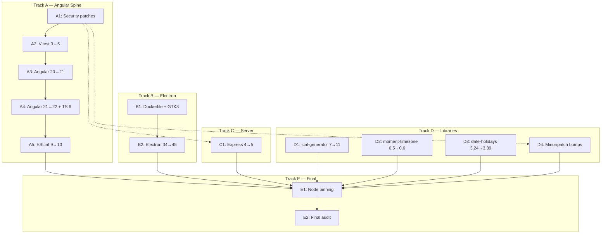

# Dependency Upgrade Task Board

**Created:** 2026-11-09
**Motto:** Compatibility before Current. Security third.
**Target state:** All frameworks and dependencies on mutually compatible, most-current versions with no known security advisories.

---

## Current State Summary

| Component | Installed | Latest | Gap | Security |
|---|---|---|---|---|
| Node (container) | 26.13.0 (floating `lts-slim`) | 26.13.0 | current | — |
| Angular | 20.3.18 | 22.2.5 | 2 majors | 6 HIGH advisories |
| Angular Material/CDK | 20.2.14 | 22.2.6 | 2 majors | — |
| TypeScript | 5.9.3 | 7.0.2 | 2 majors | — |
| Electron | 34.5.8 | 45.2.3 | 11 majors | HIGH (<=42.11.15) |
| electron-builder | 26.0.12 | 26.18.0 | 18 patches | HIGH (<=26.14.0) |
| Vitest | 3.2.4 | 5.1.0 | 2 majors | CRITICAL (<=4.1.10) |
| ESLint | 9.x | 10.14.0 | 1 major | — |
| @angular-eslint/* | 20.7.0 | 22.6.0 | 2 majors | MODERATE |
| Express | 4.21.2 | 5.3.0 | 1 major | via proxy-addr CRITICAL |
| compression | 1.7.5 | 1.8.2 | minor | HIGH (<1.8.2) |
| concurrently | 9.1.0 | 10.0.7 | 1 major | CRITICAL (9.2.1) |
| ical-generator | 7.2.0 | 11.1.3 | 4 majors | — |
| moment-timezone | 0.5.48 | 0.6.6 | 1 minor | — |
| date-holidays | 3.24.0 | 3.39.1 | 15 minors | LOW |
| @ngx-translate/core | 16.0.3 | 18.1.0 | 2 majors | — |
| @playwright/test | 1.64.1 | 1.65.0 | 1 minor | — |
| jsdom | 26.1.0 | 31.0.0 | 5 majors | — |
| sass | 1.83.0 | 1.108.1 | 25 minors | — |
| @types/node | 22.10.2 | 26.6.6 | 4 majors | — |
| zone.js | 0.15.0 | 0.16.3 | minor | — |
| rxjs | 7.8.1 | 7.8.2 | patch | — |
| esbuild | 0.25.9 (pinned) | 0.28.2 | 3 minors | — |

**npm audit totals:** 85 vulnerabilities (6 critical, 35 high, 39 moderate, 5 low).
**Production-only:** 16 vulnerabilities (1 critical, 7 high, 5 moderate, 3 low).

---

## Compatibility Constraints (the "plays nice" matrix)

These are HARD peer-dependency constraints that dictate ordering:

```
Angular 22 requires:  TypeScript >=6.0 <6.1, Node ^22.22.3 || ^24.15 || >=26, Vitest ^4.0.8 || ^5.0.0, RxJS ^6.5.3 || ^7.4.0
Angular 21 requires:  TypeScript >=5.9 <6.0, Node ^20.19 || ^22.12 || >=24,   Vitest ^4.0.8
@angular-eslint 22:   tracks Angular 22, ESLint 9 or 10
@angular-eslint 21:   tracks Angular 21
@ngx-translate 18:    Angular >=18 (works with 20, 21, 22)
@ngx-translate 17:    aligned with Angular 21
@ngx-translate 16:    aligned with Angular 20 (current)
Electron 45:          bundles Node 24.22.2, Chromium 156; uses @electron-internal/extract-zip (fixes yauzl bug)
Electron 34:          uses broken extract-zip@2.0.1 (deadlocks on Node >=24.16)
```

**Critical path:** `Vitest 5 → Angular 21 → TypeScript 6 + Angular 22 → ESLint 10 + @angular-eslint 22`

---

## Task Board

### Track A — Angular Spine (sequential, each step gates the next)

#### A1. Immediate security patches (within existing semver ranges)

**Risk:** Minimal — caret/tilde ranges already allow these versions.
**Action:**
- Lockfile refresh: `npm audit fix` (resolves transitives within declared ranges)
- Verify `compression` resolves to >=1.8.2 (HIGH advisory fix, `^1.7.5` allows it)
- Verify `electron-builder` resolves to >=26.14.1 (HIGH advisory fix, `^26.0.12` allows it)
- Verify `concurrently` does NOT resolve to 9.2.1 (CRITICAL); if it does, pin to `^10.0.7` or `<9.2.1`
- Add `"yauzl": "^3.3.1"` to `overrides` (interim fix for Electron 34 extract-zip deadlock on Node 26)
- Bump `@types/node` from `^22.10.2` to `^26.6.6` (match actual runtime)
- Bump `rimraf` from `^6.0.1` to `^6.1.4` (moderate advisory)

**Gates:** Full gate suite (G1–G6), `npm audit` re-measure, e2e 16/0, unit baseline unchanged.
**Blocks:** Nothing. Can run immediately.

---

#### A2. Vitest 3 → 5 (CRITICAL advisory fix + Angular 21 prerequisite)

**Risk:** HIGH — two major versions; Vitest 5 requires Vite ^6.4 || ^7 || ^8 as a peer.
**Action:**
- Bump `vitest` from `^3.1.0` to `^5.1.0`
- Bump `jsdom` from `^26.1.0` to `^31.0.0` (Vitest 5 peer)
- Verify `vitest.setup.ts` still works (the localStorage restoration for Node 26)
- Verify `@angular/build`'s unit-test builder accepts Vitest 5 (Angular 20's peer is `vitest ^3.0.0`; this may require a temporary `overrides` entry or an Angular 21 bump first — **investigate before committing**)
- Re-establish the unit-test baseline (the 24F/47P partition may shift; if it does, record the new md5)

**Gates:** G4 (unit tests), G1–G3 (type-check), lint, e2e.
**Blocks:** A3 (Angular 21 requires Vitest ^4.0.8+).
**Blocked by:** A1 (security patches should land first for a clean baseline).
**NOTE:** If Angular 20's `@angular/build` peer rejects Vitest 5, then A2 and A3 must be merged into a single atomic upgrade step.

---

#### A3. Angular 20 → 21

**Risk:** HIGH — major framework upgrade.
**Action:**
- `ng update @angular/core@21 @angular/cli@21` (or manual bump of all `@angular/*` packages)
- TypeScript stays at `~5.9.3` (Angular 21 peer: >=5.9 <6.0)
- `@angular/material` + `@angular/cdk` → 21.x
- `@angular-eslint/*` → 21.x
- `@ngx-translate/core` + `http-loader` → ^17.x (aligned with Angular 21)
- `zone.js` → verify compatibility (Angular 21 accepts ~0.15)
- `rxjs` → verify (Angular 21 accepts ^7.4.0; current ~7.8.1 satisfies)
- Address any codemod/migration changes flagged by `ng update`
- Verify the esbuild build pipeline (`scripts/build.mjs`) still works
- Verify `angular.json` builder references are updated if needed

**Gates:** Full gate suite, lint, e2e, production build + budget check.
**Blocks:** A4 (Angular 22 requires being on 21 first).
**Blocked by:** A2 (Vitest 5 must be in place).

---

#### A4. Angular 21 → 22 + TypeScript 6

**Risk:** HIGH — major framework upgrade + major TypeScript upgrade (simultaneous).
**Action:**
- `ng update @angular/core@22 @angular/cli@22`
- TypeScript `~5.9.3` → `~6.0.x` (Angular 22 peer: >=6.0 <6.1)
- `@angular/material` + `@angular/cdk` → 22.x
- `@angular-eslint/*` → 22.x
- `@ngx-translate/core` + `http-loader` → ^18.x
- `zone.js` → ~0.16.x (Angular 22 accepts either 0.15 or 0.16)
- Address TypeScript 6 breaking changes (TS 6 is the bridge release to TS 7; expect deprecation removals)
- Verify `emitDecoratorMetadata` warning is resolved or still benign
- Update `tsconfig.json` if Angular 22's compiler requires new options

**Gates:** Full gate suite, lint, e2e, production build + budget check.
**Blocks:** A5 (ESLint 10 needs @angular-eslint 22).
**Blocked by:** A3.

---

#### A5. ESLint 9 → 10 + @angular-eslint 22 alignment

**Risk:** MEDIUM — ESLint 10 is flat-config-only (Duely already uses flat config).
**Action:**
- `eslint` → ^10.14.0
- `@eslint/js` → ^10.0.1
- Verify `eslint.config.js` (331 lines, flat config) needs no structural changes
- Verify `typescript-eslint` ^8.72 supports ESLint 10
- Verify all custom rules still resolve

**Gates:** `npm run lint` exit 0 (or known-warning baseline), type-check.
**Blocked by:** A4 (@angular-eslint 22 tracks Angular 22 and may require ESLint 10).

---

### Track B — Electron (independent of Track A, can run in parallel from B2 onward)

#### B1. Dockerfile hardening for Electron

**Risk:** LOW — additive change.
**Action:**
- Add `libgtk-3-0` (and any other missing GUI libs) to the Dockerfile's `apt-get install` in the development stage
- Verify the Playwright version-pin assertion still passes
- Optionally pin `node:lts-slim` → `node:26-slim` or `node:26.13.0-slim` to prevent future floating-tag surprises

**Gates:** `docker compose build duely-dev` succeeds; Playwright e2e 16/0 still passes.
**Blocks:** B2 (Electron needs GTK3 to launch).
**Blocked by:** Nothing (can run immediately, in parallel with A1).
**NOTE:** This touches the Dockerfile, which the user personally hardened (security commits `3a3ce21`/`c379a4c`). Requires explicit user approval before modifying.

---

#### B2. Electron 34 → 45

**Risk:** HIGH — 11 major versions; expect breaking changes in IPC, BrowserWindow API, preload scripts.
**Action:**
- Bump `electron` from `^34.0.0` to `^45.2.3` in both root and `electron/package.json`
- Bump `electron-builder` to latest (^26.18.0 or newer if available for Electron 45)
- Remove the `yauzl` override added in A1 (Electron 45 uses `@electron-internal/extract-zip`)
- Update `electron/main.ts` for any API changes across 11 majors
- Verify the `file://` loading strategy works with the three lazy-loaded route chunks (task #58's original concern) — if not, implement a custom protocol or local HTTP server
- Verify `electron-builder` packaging succeeds on Linux arm64

**Gates:** Electron launches in container (with Xvfb), navigates all 5 route states, no console errors. Production packaging succeeds.
**Blocked by:** B1 (GTK3 must be present).
**Revives:** Task #58 (Electron launch verification).

---

### Track C — Server (independent, can run in parallel with A and B)

#### C1. Express 4 → 5

**Risk:** MEDIUM — breaking changes in path-to-regexp, async error handling, res.status().json() semantics.
**Action:**
- Bump `express` from `^4.21.2` to `^5.3.0` in both root and `server/package.json`
- `@types/express` is already `^5.0.0` (currently a silent mismatch — this fixes it)
- Update `server/app.ts` for Express 5 changes (the file is small: static serving + a catch-all)
- Verify `compression` ^1.8.2 works with Express 5
- Address the proxy-addr CRITICAL advisory (resolved by Express 5 pulling a fixed version)

**Gates:** G1b (server tsconfig), server starts and serves `dist/server/static/` correctly, healthcheck passes.
**Blocked by:** A1 (compression should be patched first).

---

### Track D — Independent Libraries (can run in parallel with everything)

#### D1. ical-generator 7 → 11

**Risk:** HIGH — 4 major versions; expect significant API changes.
**Action:**
- Bump `ical-generator` from `^7.2.0` to `^11.1.3`
- Update `appointments.service.ts` for API changes (this is the primary consumer)
- The pre-existing `toJSON` drift that makes `getICalString()` throw for recurring-with-exclusions fixtures may be resolved by the upgrade — verify
- Verify `moment-timezone` peer (ical-generator 11 optionally peers on moment-timezone >=0.5.33 — satisfied)
- Re-establish the spec baseline if the ical-generator drift was causing any of the 24 failures

**Gates:** G4 (unit baseline), G1 (type-check), e2e.
**Blocked by:** Nothing (can start immediately).
**NOTE:** Locked decision 3 says "no test work" — but that applies to the migration backlog cycle, not to this upgrade cycle. The user should confirm whether the same constraint applies here.

---

#### D2. moment-timezone 0.5 → 0.6

**Risk:** LOW — minor version bump, same API surface.
**Action:**
- Bump `moment-timezone` from `^0.5.47` to `^0.6.6`
- Verify the full dataset still loads correctly (task #64's measurement showed the default `require('moment-timezone')` path uses `index.js` with full data)
- Verify offsets remain correct for Europe/Berlin 1980–2200
- Check if 0.6.x changes the trimmed-build behaviour (task #64's decline was specific to 0.5.48's builds)

**Gates:** G4, G5, the leader's tz-isolated probe script.
**Blocked by:** Nothing.

---

#### D3. date-holidays 3.24 → 3.39

**Risk:** LOW — minor bumps, data-only changes expected.
**Action:**
- Bump `date-holidays` from `^3.24.0` to `^3.39.1`
- Update `CollisionDetector.spec.ts` German holiday dates from 2017 to 2037 (per TODO-notes-he.md)
- Verify `HolidayCatalogService` and the two deferred `new Holidays()` sites still work
- The five-way duplicated `type HolidaysCountry` may need updating if the package's type exports changed

**Gates:** G4, G1, e2e.
**Blocked by:** Nothing.
**NOTE:** This is the one task that TOUCHES a spec file — user should confirm whether locked decision 3 applies to the upgrade cycle.

---

#### D4. Remaining minor/patch bumps

**Risk:** LOW.
**Action:**
- `sass` ^1.83.0 → ^1.108.1
- `tslib` ^2.8.1 → ^2.9.1
- `rxjs` ~7.8.1 → ~7.8.2
- `@playwright/test` ^1.64.1 → ^1.65.0
- `typescript-eslint` ^8.70.0 → ^8.72.1
- `esbuild` 0.25.9 → decide whether to unpin or bump to 0.28.2 (pinned for reproducibility)
- `file-saver` 2.0.5 — already latest; CJS-only, no upgrade path
- `ts-node` 10.9.2 — already latest

**Gates:** Full suite.
**Blocked by:** Nothing (but ideally runs after the majors land to avoid churn).

---

### Track E — Node and Docker Strategy (cross-cutting, runs last)

#### E1. Node pinning decision

**Risk:** POLICY — no code change, but affects reproducibility.
**Action:**
- Decide: keep floating `node:lts-slim` (currently Node 26), or pin to `node:26-slim` / `node:26.13.0-slim`?
- The floating tag already caused one surprise (Node 24 → 26 silently, TASKBOARD §26.1)
- If pinning: update Dockerfile, rebuild image, re-run all gates
- Update `engines` in all three `package.json` files if the minimum changes
- Update STATE §1 runtime facts (currently stale: says Node 24.21.0)

**Blocked by:** All other tracks (pin last, after all upgrades are validated on Node 26).

---

#### E2. Final audit and cleanup

**Action:**
- `npm audit` — target: 0 critical, 0 high
- Remove any `overrides` entries that are no longer needed (yauzl, glob, tar — verify each)
- Update all three `package.json` engines fields to reflect the new minimum versions
- Regenerate `package-lock.json` cleanly in Docker
- Update documentation: README, INSTALL.md, TESTING_GUIDE.md, STATE §1 runtime facts
- Run the full gate suite one final time
- Verify the dep-graph visualization (`scripts/dep-graph.mjs`) reflects the upgraded state

**Blocked by:** ALL other tasks.

---

## Dependency Graph



---

## Parallelisation Guide

| Can run in parallel | Must be sequential |
|---|---|
| A1 + B1 + D1 + D2 + D3 | A1 → A2 → A3 → A4 → A5 |
| B1 → B2 (parallel with Track A from A2 onward) | B1 → B2 |
| C1 (after A1) | A5 → E1 → E2 |
| D1, D2, D3, D4 (all independent) | Everything → E2 |

---

## Open Questions for the User

1. **Does locked decision 3 ("no test work") apply to this upgrade cycle?** D1 and D3 both touch spec files. If yes, those tasks must be scoped differently.
2. **Does locked decision 9 ("no modernisation") apply?** The Angular upgrades will inevitably modernise (new compiler, new builder APIs). If yes, only security-driven upgrades are in scope and Angular stays at 20.
3. **Pin `node:lts-slim` or keep it floating?** The floating tag already caused one silent Node 24→26 transition.
4. **esbuild: keep the exact pin at 0.25.9 or bump?** It was pinned for reproducibility of `scripts/build.mjs`.
5. **Should the Electron `file://` strategy change?** Task #58's concern: lazy-loaded chunks may not resolve under `file://`. Options: custom protocol, local HTTP server in main process, or keep routes eager in the Electron build.
6. **moment-timezone replacement?** Still actively maintained (0.6.6 released 11 days ago), but the ecosystem direction is Temporal/luxon/dayjs. 18 source files import moment. Is a replacement in scope for this cycle or deferred?

---

## Relationship to the Migration Backlog

This task board is **SEPARATE** from `docs/2026_MIGRATION_BACKLOG.md` (which tracks the Bootstrap-to-Material migration). The migration backlog is nearly empty (Phases 12–13 remain). This upgrade cycle should begin AFTER Phase 13 closes, or in parallel if the user authorises it.

Task #58 (Electron launch verification, cancelled/out-of-cycle) is **revived by B1+B2** in this board.

The cancelled tasks #19/#20/#21 (audit/plan/execute dependency upgrade) are **superseded by this document**.
