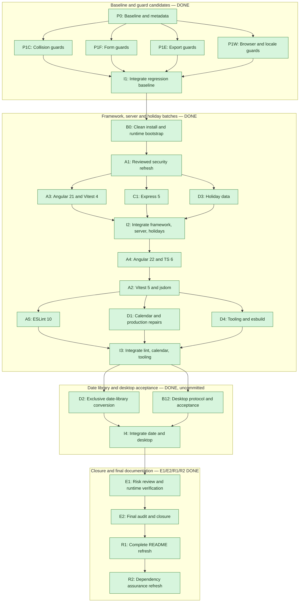

# Duely — Dependency Upgrade Execution Plan

**Prepared:** 2026-11-09 · **Branch:** `dev-v2` · **Source checkpoint:** `1546c4f`.
**Status:** P0, P1C/P1F/P1E/P1W, I1, B0, A1, I2, A4, A2, the A5 + D1 + D4 batch and **I3** DONE
(2026-11-10); the A3 + C1 + D3
batch produced three isolated candidates on the same day, and the separately approved **I2** integrated
them into the working tree as one combined, uncommitted baseline. Reviewed security patch set
integrated on `dev-v2` (13 direct pins + glob override bump); clean Node 26 images rebuilt and verified.
Classified baseline remains 55F/70P units and 8F/14P E2E with identical names/causes; full audit
73 → 48, production 16 → 8. A3 carries its own classified baseline (52F/74P units under Vitest 4) with
118 explained deltas; C1 and D3 are baseline-equal to A1 apart from attributable evidence; candidate
audits read A3 45/8, C1 45/5 with no critical production finding, D3 48/7. **I2's combined state** keeps
A3's 52F/74P units, 14/8 E2E and 7 lint warnings with 12 explained deltas and 0 unexplained ones, holds
the 2032 holiday fixture in UTC and Europe/Berlin with D3's exact 10 oracle deltas, resolves a single
`moment-timezone` 0.6.6 (production initial 2.42 MB, no budget warning) and audits at 48 → **42** full /
8 → **4** production. **A4** moves the framework to Angular 22.2.5 / build 22.2.6 / TypeScript 6.0.3
(Vitest 4 retained) on 14 paths, keeps the same 52F/74P units, 14/8 E2E, 7 lint warnings and 0 oracle
deltas with 12 explained deltas, trims production initial to 2.40 MB and audits at 42 → **25** full /
**4** production. **A2** then moves the runner to Vitest **5.1.0** and jsdom **31.0.0** on 5 paths,
keeps the same 52F/74P units with byte-identical failure names, 14/8 E2E, 7 lint warnings, 0 oracle
deltas and 2.40 MB production, removes the storage warnings (13 → 0) without moving any outcome, and
audits at 25 → **24** full / **4** production. Desktop protocol, launch and packaging acceptance (**B12**
without a dependency change) is DONE on that tree as well.
The **A5 + D1 + D4** batch then produced three isolated candidates from that A2 checkpoint: A5 moves the
linter to ESLint 10.14.0 / @eslint/js 10.0.1 / typescript-eslint 8.72.2 without touching configuration
or outcomes (24 → 25 full audits from one minimatch advisory), D1 moves ical-generator to 11.1.3 and
repairs the boundary/ordinal contract (units 52F → **4F/122P**, E2E 14/8 → **20/2** with no E2E edit,
64 explained deltas, audit unchanged at 24/4) and D4 finishes the tool/minor set (esbuild 0.28.2,
Playwright 1.65.0 + Chromium 1254, sass/tslib/zone.js/concurrently/@types/node) with an identical
outcome (0 deltas) and 24 → **23** full audits. **I3** then integrated the three in order on 5 paths and
re-resolved the combined lock from the A2 seed (165 changed entries = 61 A5 + 2 D1 + 102 D4, 0
unexplained, one `moment-timezone` 0.6.6), reproducing D1's outcome exactly — units **4F/122P** with
the same names, E2E **20/2**, 7 lint warnings, 0 oracle deltas, production 2.41 MB — with **86**
explained interaction deltas, 0 unexplained, console errors 4 → 0 and audits at **24** full / **4**
production.
**Priority:** Compatibility before Current. Security third.
**Objective:** Upgrade every direct dependency across all three manifests to the newest mutually
compatible stable version, replace Moment with a maintained date library (D2 selected `date-fns` +
`@date-fns/tz`), and eliminate known advisories where possible.
Unresolved upstream advisories or compatibility ceilings must be documented, not hidden by forced
installs, downgrades or misleading green gates.

This replaces the former upgrade task board. The Material migration is complete. Preparing this
plan, including its research agents, does **not** authorize dependency changes, commits or pushes.

**Closed 2026-11-11:** every task in this plan is DONE and its one deferred item (M1) lives in Known
Limitations (l). New work is tracked in [`docs/AI_TASKBOARD.md`](AI_TASKBOARD.md), which carries this
document's execution contract and evidence rules forward. This file remains the measured record of the
cycle: its §1 contract, §5 gate recipe and task records are still the reference, but no new task is
added here.

---

## 1. Execution contract

### 1.1 Confirmed choices and boundaries

- Tests are fair game in this upgrade cycle; the migration's frozen 24F/49P partition is historical,
  not an upgrade target. Necessary modernisation is allowed, not an unrelated application rewrite.
- Pin all three Docker stages to `node:26-slim`, retaining 26.x patch updates. Verify the tag and
  selected packages' engines before building; do not silently substitute another Node major.
- Replace Electron's `file://` loading with a privileged, validated custom protocol.
- Upgrade direct esbuild to 0.28.2, initially keeping an exact pin for attributable verification.
- Replace every client/spec Moment import with the selected date library (**`date-fns`** 4.4.0 +
  **`@date-fns/tz`** 1.5.0 per the D2 decision, reconfirmed by the user 2026-11-10 after a Luxon
  re-check), not a trimmed Moment data build.
- **Packaging scope (user, 2026-11-10):** this project does not need AppImage packaging. The B12
  AppImage stays as measured evidence, but the Linux artifact to ship and keep is the `deb`; no later
  batch builds an AppImage without an explicit request. macOS packaging is no longer a task of this
  board: it moved to `docs/2026_KNOWN_LIMITATIONS.md` (l), where **M1** runs interactively with the
  user and is not authorized by any batch approval.
- **Pause after every task**, including integration, verification, review and documentation tasks.
  Report results and obtain explicit approval for the next task. Play an attention sound only when
  approval, a decision or a blocker actually needs user interaction, explaining the required response;
  routine task/agent completion stays silent. An explicitly approved parallel batch authorizes only
  its named tasks; completed agents do not launch successors. Integration needs separate approval.
- Run all npm/Node/Angular/TypeScript/lint/test/build diagnostics inside Docker. Stop if Docker is
  unavailable; never fall back to host execution. Source editing and Git inspection can use the host.
- Never edit, read for consolidation, or stage `TODO-notes-he.md`. Preserve unrelated work, including
  `.DS_Store`, and existing baseline/screenshot artefacts. No commits or pushes without a new request.

**Keep:** strict compiler/template/injection checks; native-Date Material adapter boundaries;
intentional `this.alarms = this.appointment.alarms` aliasing; bundled namespaced icons; persisted
settings, accent names and the M3 token theme. Never use `as any`, `@ts-ignore`,
`NO_ERRORS_SCHEMA`, `CUSTOM_ELEMENTS_SCHEMA` or `ng add @angular/material` to bypass problems.
Keep parent-triggered recurrence `markForCheck()` outside `updateRepeatsBy()`, which is also called
from `ngAfterViewChecked()`. Do not drop dual bindings without replacing their model synchronization
and change-detection notifications with regression coverage.

**Still outside scope:** creator `saveText` option C implementation/positive-test deletion;
general coverage/dead-code audit; global signals/DI/form rewrites; desktop save-dialog/storage
activation; timepicker; theme/accessibility/help redesign; catalogue sharing/lazy loading; legal
copy changes; accepted Express missing-asset 200 behaviour. Required upgrade API replacements are
in scope, but optional feature work is not. Known Limitations retains these decisions.

### 1.2 Coordinator and file ownership

The main agent is the **integration coordinator**. It owns all dependency mutations:
`package.json`, `package-lock.json`, `server/package.json`, `electron/package.json`, engine ranges,
overrides, install commands, dependency-image provisioning and final documentation.
Source agents submit exact package/version requests; they do not run independent refreshes or edit
any manifest/lockfile. Never use broad `npm audit fix`, `--force` or peer-conflict overrides.

For Angular, the coordinator stages and installs the complete compatible package set, then runs
source-only migrations serially inside that candidate using its local CLI:
`ng update <one-package> --migrate-only --from=<recorded-old-version> --to=<staged-target-version> --allow-dirty`.
Apply the relevant core/CLI/Material collections separately with explicit version bounds. The dirty
snapshot allowance applies only to the reviewed, transferred task input; inspect and preserve that
diff first. Do not run ordinary package-mutating `ng update` from a source agent, use `--force`, or
clear user edits to satisfy the CLI. Review migration output/affected paths before handing the source
candidate to the framework agent; reject any unexpected manifest mutation or lease expansion.

Each implementation agent uses `isolation: "worktree"` or an equivalently isolated source copy,
starting from the approved integration snapshot. Worktrees alone do not include uncommitted edits:
transfer the approved diff explicitly and record its identity; do not create an unsolicited commit.
Provision candidate dependencies **serially** under coordinator ownership, then let disjoint source
agents work/test in their own provisioned containers. Record candidate source/lock/image hashes.

Give each task a unique image tag, container name, dependency volume and output directory. The
current Compose file has fixed container names and an anonymous `/app/node_modules` volume; a
unique project name alone is insufficient. Use isolated one-shot `docker run` containers or a
session-local Compose override with task-specific names/images/mounts. Do not run concurrent
installs, share dependency volumes, or rely on an old image after changing a lockfile. Default
one-shot Compose runs do not publish service ports; publish only task-specific ports when required.
Keep each Playwright runner and both of its servers in the same container. Serialize builds/E2E
within one candidate because `scripts/build.mjs` cleans static outputs and E2E builds production.
Stop only containers created by this session; never use blanket `docker compose down` or pruning.

| Source lease | Exclusive paths / restrictions |
|---|---|
| P1C / D3 | `CollisionDetector.spec.ts`; later `HolidayCatalogService.ts`, `RecurrencePattern.ts` and only necessary holiday API/type consumers |
| P1F / A3 / A4 | `client/app/creator/appointment-form/` tests; Angular owner later holds required client/config migration edits |
| P1E / D1 | `appointments.service.spec.ts`; D1 also holds `appointments.service.ts`, `EventCollisionData.ts` |
| P1W | `e2e/app.e2e.spec.ts`; other agents submit scenarios rather than editing it |
| A3 storage seam | `client/app/storage/` specs; implementation/factory changes only if a proven seam requires them |
| B0 / B12 | B0: `Dockerfile` and runtime provisioning; B12: `electron/main.ts`, `electron/tsconfig.json`, necessary target-specific base/protocol configuration — **closed**: B12 used `electron/main.ts`, `angular.json` (`baseHref`), `electron/package.json` (deb maintainer) and three development-stage Dockerfile tools; `electron/tsconfig.json` needed no change |
| C1 | `server/app.ts`, `server/tsconfig.json`, production healthcheck in `docker-compose.yml` |
| A5 | `eslint.config.js`; no blanket autofix of other agents' source |
| D4 | `scripts/build.mjs`, Playwright configuration/provisioning requests and necessary tool compatibility changes |
| D2 | Exclusive final lease over all Moment consumers and their tests, date models, collision/export/form/settings code |

A lease expansion requires coordinator review before editing. D3 touching Settings/recurrence forms,
Angular codemods touching calendar service code, or D4 needing Dockerfile edits invalidates the
parallel assumption: serialize that portion. Never resolve collisions by discarding another diff.

### 1.3 Agent brief and completion record

Every dispatch names its task, approved input checkpoint, exact paths/package requests, predecessor
results, prohibited scope and required gates. State whether the agent writes code or researches only.
Use general-purpose agents for implementation/full-file semantic review; Explore is for locating
code, not document audits. Keep coordinator decisions and integration in the main agent.

Return: changed paths/diff; requested dependency changes; commands and actual exit codes; failed
names **and causes** before/after; behaviour/browser evidence; residual risks; worktree path. Do not
call a classified red suite "passed". The coordinator reviews actual diffs before accepting reports.
After approval and verification, mark the row DONE and record the evidence in this existing plan;
record maintained verification results in `docs/TESTING_GUIDE.md`, not a new handoff document.

---

## 2. Issues moved from Known Limitations

These are **OPEN**. Relocation changes ownership, not implementation status. Section labels in
Known Limitations remain as pointers. Characterization precedes the relevant dependency changes;
production repairs can land atomically with their owning upgrade. There is no requirement to fix
all unrelated red tests or accepted UI defects before starting.

**Status after the A3 + C1 + D3 batch (2026-11-10):** §2.1 is resolved inside the A3 candidate (the
three storage specs pass under Vitest 4 without a production seam), §2.6 is resolved inside the C1
candidate (Express 5 with the reviewed healthcheck), and both await I2. §2.2 remains open by design:
D3 proved the raw 2032 catalogue independently, but the assertion repairs and the host-local time
policy still belong to D1/D2. §2.3–§2.5 and §2.7 are untouched by this batch.

### 2.1 FileSaver test seam — from (a.1), owner A3

**WHAT:** Three storage tests fail with `Cannot redefine property: saveAs`. FileSaver 2.0.5 is
CJS-only; esbuild's synthesized namespace is non-configurable, so namespace spying fails. This is
not test ordering. **WHY previously accepted:** migration decision 3 barred test work.
**RISK:** `vi.mock('file-saver', …)` may be inert after inlining, manufacturing a false green.
**ACCEPTANCE:** empirically prove the seam in the actual Angular builder/Vitest pipeline. Prefer an
observable effect or a demonstrated working module mock; if neither works, propose a thin injectable
saveAs boundary and account for the no-argument storage factory. No seam choice is pre-approved by
this document. Assert calls, filename, MIME type and content, then remove/break the invocation in an
isolated negative control and demonstrate failure. Do not merely declare a mock or silence errors.
Verify local/session storage round-tripping without manual Node storage flags after runner changes.

### 2.2 Collision assertions and 2032 oracle — from (a.2), owner P1C before D3/D1/D2

**WHAT:** Both loops iterate `i` but assert `[0]` (`CollisionDetector.spec.ts:49-52,82-85`). Fourteen
of fifteen holiday entries, including Augsburger Friedensfest, are never checked. The holiday spec
also expects raw country-midnight instants, while `RecurrencePattern.ts:72-75,108-111` copies the
event's **host-local** time of day onto holiday Dates. Changing `TZ` alone does not repair that mismatch.
**WHY previously accepted:** assertion/time-policy work was outside the migration; exposing missing
assertions needs explicit failure accounting. **RISK:** false multi-location coverage and accidental
policy changes made just to satisfy stale expectations.

**ACCEPTANCE:** assert cardinality and every date/reason for explicit exclusions and the union of
Niedersachsen/Augsburg holidays. Separate raw calendar-date verification from collision-time
characterization under `TZ=UTC` and `TZ=Europe/Berlin`. Retain the current collision policy unless a
separate contract decision changes it; record newly exposed failures rather than skipping assertions.
A changed non-first result must fail the guard.

The user-requested **2017 → 2032** refresh is DONE in `74a271d`, superseding the parked 2037 proposal.
All 15 dates/offsets were independently checked against date-holidays, statutory/calendar sources,
Gregorian Easter calculation and Intl. Spec type-checks passed; the focused run stayed 1F/2P.
Neither assertion defect was repaired. Preserve those fixtures; reverify after the data upgrade.

### 2.3 Public ICS exports, ordinal recurrence and serialized dates — from (a.6), (a.7)

**Owners:** P1E establishes guards; D1 repairs production defects and reviews expectations.
**WHAT:** Phase 6 (`201f166`) exposed 19 appointments-service failures:

| Group | Historical failures | Diagnosis |
|---|---:|---|
| Recurring JSON | 10 | ISO start/end strings rather than Date objects; event timezone null rather than calendar inheritance |
| Ordinal weekdays | 7 | Rejected `'-3WE'`-style byDay encoding; inverse branches pass day-of-month to a month helper |
| ICS/simple event | 2 | Missing expected UTC `Z`; event timezone null; earlier null-repeating crash already fixed by `be16352` |

`appointments.service.ts:577` casts `ev.toJSON()` to Date-valued `EventCollisionData`, without
runtime conversion. Recurrence code then calls Date methods on strings; task #63 recorded
`eventData.start.getHours is not a function` for recurring exports with exclusions. This is a
production defect, not just stale expectations. Ordinal source sites include `:273,296,405,451`
and wrong month arguments at `:294,449`. Characterize exact multiples of seven and the one-based
month helper against forward/inverse branches, including workdays, February and leap years.

**WHY previously accepted:** test and recurrence repairs were barred by migration decisions 3/9.
**RISK:** invalid/throwing exports and timezone regressions hidden by convenient JSON expectations.
**ACCEPTANCE:** replace the serialized cast with a typed, explicit collision input adapter, including
start/end and recurrence/exclusion date boundaries. Fix ordinal encoding/calculation against the
selected ical-generator API. A new package is not assumed to repair either defect.

Guard the public flow `addAppointment()` → `getICalString()` → `getCollisions()`, not an injected
calendar already populated with an event. Cover simple, daily/weekly/monthly/yearly and ordinal
events; COUNT/UNTIL; explicit-date/holiday exclusions; alarms; floating and named timezones; all-day
boundaries. Use fixed dates and bounded horizons. Known-broken cases remain real assertions with
classified failures, not skips or tests that merely expect a known crash. Compare semantic ICS,
not byte-identical exports: generated UID/stamp values are not a preservation promise, and current
export construction does not forward the model's uid/id/url/stamp fields.

P1E must inventory intended timezone inheritance, floating wall-time, all-day end and COUNT/exclusion
semantics. If source, ICS standard and intended product behaviour do not resolve a contract, record
the exact decision for task approval before D1 changes it. Do not just replace Dates with ISO strings
or add/remove `Z` to make tests green. Rewriting the public test seam may allow later privacy
restoration of `initializeCalendar()` (Known Limitations (a.10)); that cosmetic API cleanup is optional.

### 2.4 UNTIL and form/date synchronization — from (a.4), (a.5), (a.8)

**Owners:** P1F before Angular/date changes; D2 owns the repairs during the date-library conversion.
**WHAT:** `untilDate` mixes a `YYYY-MM-DD` string seed, a picker-generated local-midnight Date and a
Moment computation value. The picker `enddate` starts null and is not hydrated when recurring settings
are assigned (`recurring-settings.component.ts:101,133`; dual input binding at HTML `:145-149`).
The reverse-end-date branch compares stale `appStart`/`appEnd` captured before mutating the start
(`appointment-form.component.ts:193-227`), allowing a 22:00 → 23:00 model shift. That anomaly is
pre-existing, byte-identical in `98f603f` and its parent, not a `5a219bc` regression.
**WHY previously accepted:** date/model refactors were outside migration decisions 3/9; picker
restoration was explicitly deferred by `8b1d40a`. **RISK:** wrong calendar days/time bands, an empty
saved UNTIL and divergence between rendered controls, validation and exported values.

**ACCEPTANCE:** characterize real input events, summary validity, keep-duration date listeners,
imperative date changes, UNTIL first reveal/reopening and exported values. Existing keep-duration
coverage does not exercise the listener, and recurrence validation has an assertion-free test.
D2 uses an explicit date-only model boundary, native Dates for the adapter and zoned computation
values; hydrate saved calendar days without timezone drift and reread post-mutation values before
reverse-date guards. Preserve alarms, duration semantics and OnPush notification. Narrow boundary
changes are required; a whole reactive-form/ngModel modernization is not.

### 2.5 Non-vacuous E2E and locale guards — from (k.2), (j.2)

**Owner:** P1W before affected client upgrades; A3/D1/D2 must pass the relevant guards afterward.
**WHAT:** Historical E2E 16/0 means eight tests against two servers, not semantic verification.
`app.e2e.spec.ts:101-113` conditionally avoids selection/assertions for nonexistent
`select[name="timeZone"]`; use the real `select[formControlName="timezone"]` unconditionally.
`:144-148` is collision logging only; `:40-65` checks a download filename but not ICS contents;
`:119-139` checks the daily panel, not its exported recurrence.

The 2026-09-11 i18n pass lacked runtime verification of datepicker labels, the translated
`EXCLUDED BY USER` reason and the three Settings metadata labels. Old ng2-datepicker checks are
superseded by Material locale checks. Legal cold-load/language changes were already fixed in Phase
10.3. Key parity alone cannot establish rendering. **WHY previously accepted:** migration coverage
was routing/rendering-oriented. **RISK:** false confidence in persisted timezone, exclusion/export
values and locale rendering.

**ACCEPTANCE:** assert the timezone control exists, change it, save/reload, then inspect exported
calendar values. Read downloaded ICS and assert event/recurrence/exclusion semantics. Replace the
collision placeholder with a bounded, real exclusion setup and assertions for date/reason. Verify
Material date labels, Settings labels and exclusion reason in EN/DE without changing wording.
Run both server projects. Classify failures exposed by production defects until D1/D2 repairs;
required repaired scenarios must pass before those upgrades are accepted. No conditional bypasses,
empty assertion blocks or count-only sign-off. A general coverage audit is still outside scope.

### 2.6 Express runtime/type alignment — from (b.11), owner C1

**WHAT:** Root/server declare Express 4 while root `@types/express` is major 5. The current locked
runtime is 4.22.1 and typings 5.0.6. **WHY previously accepted:** pre-existing Phase 6 skew.
**RISK:** a strict green type-check describes another runtime major; no new failure was established
by that observation. **ACCEPTANCE:** upgrade both runtime declarations atomically, keep compatible
root typings, and verify static responses, headers/compression, fallback and errors in Docker.
This does not block client upgrades or authorize changing the accepted missing-asset 200 policy.

### 2.7 Engine and clean-install prerequisite — from (d.4), (f)

**Owners:** P0 records evidence; B0 resolves clean-install bootstrap; B12 verifies the desktop;
A4/E1 align and verify engines.
**WHAT at preparation/P0:** All manifests advertised Node `>=24.0.0`; Angular 22 requires
`^22.22.3 || ^24.15.0 || >=26.0.0`. Earlier Electron launch attempts found missing GTK3 and an
Electron 34 `extract-zip@2.0.1 → yauzl@2.x → fd-slicer` installer deadlock on Node >=24.16/26.
Manual unzip worked; libnss3 and the zip were not the causes. The preparation/P0 Docker stages used a floating
Node tag, unpinned global CLI and `npm ci --legacy-peer-deps || npm install --legacy-peer-deps`.
**WHY previously accepted:** installer/GUI and runtime changes belonged to the next cycle.
**RISK:** nondeterministic or peer-bypassed installs, a stale dependency volume, and an unverifiable
desktop upgrade. **ACCEPTANCE:** clean peer-respecting install in B0, GUI/runtime verification in
B12, with engine declarations updated when each runtime changes. Do not add a blind yauzl major override
or assume new registry metadata proves extraction/launch works. Electron's embedded Node and browser
must be measured separately from container Node; scope Node typings accordingly.

**B0 update:** clean provisioning/extraction is verified below. All stages now use `node:26-slim`,
local CLI and peer-respecting `npm ci`; all three engines are `^26.0.0` / npm `^11.20.0`.
Electron 45.2.3 embeds Node 24.22.2 / Chrome 156.0.8078.80, measured independently from container
Node 26.13.0. Root Node typings remain unchanged for later D4 alignment. B12 desktop acceptance is
still OPEN; the original installer and missing-GTK observations above remain historical evidence.

**B12 update (supersedes the OPEN sentence):** the desktop acceptance ran in this image and passes —
the packaged Electron 45.2.3 binary starts under Xvfb as uid 1000 with the Chromium sandbox enabled, no
missing shared library and no `--no-sandbox` anywhere. `extract-zip`/yauzl are not on that path: Electron
45 extracts itself at install time in the development stage, so the historical `fd-slicer` deadlock does
not recur.

**A4 update:** Angular 22.2.5 build/CLI require Node `^22.22.3 || ^24.15.0 || >=26.0.0`. The existing
`^26.0.0` declarations in all three manifests already satisfy that intersection, so A4 changed no
engine range; `npm ci --engine-strict` accepts the regenerated lock in both stages on container Node
26.13.0. Root Node typings and the Electron-runtime measurement stay with D4/E1 as before.

The Windows optional-node pruning remains conditional, not a global prerequisite: authorize the
platform first, then re-resolve and verify actual packaging. Do not hand-craft lock nodes or claim
Linux/macOS/Windows support from configuration alone. Desktop storage/dialog feature debt stays
in Known Limitations (f), even after launch succeeds.

---

## 3. Dated dependency and security evidence

Read-only registry/audit research ran **2026-11-09, 17:17–17:21 UTC**, inside the existing image:
**Node 26.13.0 / npm 11.20.0 / Linux arm64**, registry `https://registry.npmjs.org/`.
All 44 unique direct package versions matched the lockfile/installed image. Root has 20 runtime and
24 development packages; server repeats Express/compression and Electron repeats Electron.
These are metadata/audit results, **not** upgraded build, API, packaging or browser verification.
Refresh them at P0 and before each install; record actual versions selected instead of moving targets.

### 3.1 Complete direct-package inventory

| Package(s) | Locked | Planned compatible target | Owner |
|---|---|---|---|
| `@angular/{animations,common,compiler,core,forms,platform-browser,router,compiler-cli}` | 20.3.18 | 22.2.5, via 21.2.26 | A3/A4 |
| `@angular/{build,cli}` | 20.3.23 | 22.2.6, via 21.2.29 | A3/A4 |
| `@angular/{material,cdk}` | 20.2.14 | 22.2.6, via 21.2.14 | A3/A4 |
| `@angular-eslint/{eslint-plugin,eslint-plugin-template,template-parser}` | 20.7.0 | 22.6.0, via 21.4.0 | A3/A4 |
| `typescript` | 5.9.3 | **6.0.3**, not latest 7.0.2 | A4 |
| `vitest` | 3.2.4 | 4.1.12 with Angular 21, then 5.1.0 on Angular 22 | A3/A2 |
| `jsdom` | 26.1.0 | 31.0.0 | A2 |
| `eslint` | 9.39.4 | 10.14.0 | A5 |
| `@eslint/js` | 9.39.5 | 10.0.1 | A5 |
| `typescript-eslint` | 8.70.0 | 8.72.2 | A5 |
| `@ngx-translate/core` | 16.0.4 | 18.1.0 | A3 |
| `@ngx-translate/http-loader` | 16.0.1 | 18.1.0 | A3 |
| `electron` (root and electron manifest) | 34.5.8 | 45.2.3 | B0/B12 — **verified**: Node 24.22.2 / Chrome 156.0.8078.80 launched, sandboxed, packaged |
| `electron-builder` | 26.8.1 | 26.18.1 | B0/B12 — **verified**: arm64 AppImage + deb built and inspected |
| `express` (root and server manifest) | 4.22.1 | 5.3.0 | C1 |
| `compression` (root and server manifest) | 1.8.1 | 1.8.2 | A1/C1 |
| `@types/express` | 5.0.6 | 5.0.6, already current | C1 |
| `@types/compression` | 1.8.1 | 1.8.1, already current | C1 |
| `date-holidays` | 3.27.0 | 3.39.1 | D3 |
| `ical-generator` | 7.2.0 | 11.1.3 | D1 |
| `moment-timezone` | 0.5.48 | **DONE (D2):** removed as a direct dependency and replaced by `date-fns` 4.4.0 + `@date-fns/tz` 1.5.0; 0.6.6 survives only through `date-holidays-parser → caldate` | D2 |
| `file-saver` | 2.0.5 | 2.0.5, already current | A3 |
| `@types/file-saver` | 2.0.7 | 2.0.7, already current | A3 |
| `rxjs` | 7.8.2 | 7.8.2, already current | A4/D4 |
| `tslib` | 2.8.1 | 2.9.1 | D4 |
| `zone.js` | 0.15.1 | 0.16.3 after framework settlement | D4 |
| `@playwright/test` | 1.64.1 | 1.65.0 + matching Chromium | D4 |
| `@types/node` | 22.19.17 | 26.6.6 for Node 26 tooling/server; verify Electron separately | B0/D4 |
| `concurrently` | **9.2.1** | 10.0.7; compatible interim 9.2.5 exists | A1/D4 |
| `esbuild` | 0.25.9 | 0.28.2, exact pin initially | D4 |
| `rimraf` | 6.1.3 | 6.1.4 | A1 |
| `sass` | 1.99.0 | 1.108.1 | D4 |
| `ts-node` | 10.9.2 | 10.9.2; verify TypeScript 6 runtime use if retained | D4 |
| Proposed `luxon` / `@types/luxon` | absent | **NOT ADDED:** the user's D2 decision selects `date-fns` 4.4.0 + `@date-fns/tz` 1.5.0 instead, after measured feasibility probes | D2 |

Electron-builder's highest stable release is 26.18.1 (`v26` tag), while `latest` is 26.18.0.
Inspect versions/deprecation metadata, not just `npm outdated` or one dist-tag. Animations removal
is conditional on the selected peer/API contract and actual app/Material usage; neither deprecation
nor a date-library selection proves that an existing animation provider can be deleted.

### 3.2 Compatibility ordering corrections

| Stage | Required combination / implications |
|---|---|
| Angular 20 baseline | TS 5.9.3, Vitest 3; do not install Vitest 5 against build 20 |
| A3: Angular 21 | framework/compiler-cli 21.2.26; build/CLI 21.2.29; Material/CDK 21.2.14; angular-eslint 21.4.0; **TS 5.9.3 + Vitest 4.1.12 atomically** |
| Angular 21 build peer | TS `>=5.9 <6.0`, Vitest `^4.0.8`; compiler-cli's looser TS `<6.1` does not override build's range |
| A4: Angular 22 | framework/compiler-cli 22.2.5; build/CLI/Material/CDK 22.2.6; angular-eslint 22.6.0; **TS >=6.0 <6.1**; retain Vitest 4 initially |
| A2: final runner | build 22 accepts Vitest `^4.0.8 \|\| ^5.0.0`; Vitest 5 peers Vite `^6.4 \|\| ^7 \|\| ^8` and optional jsdom `*`, not a jsdom 31 requirement. **Measured:** root Vite 7.3.7 and the builder's nested 8.3.5 already satisfied it, so only `vitest`/`jsdom` moved |
| Lint | angular-eslint 21/22 and typescript-eslint 8.72.2 accept ESLint 10; the chosen late A5 is conservative scheduling, not an Angular 22 hard prerequisite |
| Translation | core/loader 18.1.0 accept Angular >=18; no mandatory 16→17→18 major alignment. Loader requires translate-core >=18.1.0 |
| Runtime | Angular 22 Node `^22.22.3 \|\| ^24.15.0 \|\| >=26`; jsdom 31 Node `^22.22.2 \|\| ^24.15.0 \|\| >=26`; TypeScript 7 exceeds compiler AND lint TS peers |
| Existing peers | Angular 21/22 accept zone `~0.15.0 \|\| ~0.16.0` and RxJS `^6.5.3 \|\| ^7.4.0`; current resolved versions satisfy these |

Angular majors remain one-at-a-time. Preserve the existing esbuild application/dev-server/unit-test
builders and M3 `mat.theme()` / `mat.theme-overrides()` architecture; verify the chosen releases
rather than rewriting the theme speculatively. Use the local CLI, including migrations; stage the
framework/runner peer set together instead of forcing an intermediate invalid installation.

### 3.3 Audit snapshot and interpretation

| Scope | Critical | High | Moderate | Low | Total |
|---|---:|---:|---:|---:|---:|
| Full root audit | 6 | 35 | 39 | 5 | 85 |
| Root `--omit=dev` | 1 | 7 | 5 | 3 | 16 |

Recorded critical paths: Express→proxy-addr (`GHSA-jqcg-44mw-7w3h`); build→piscina
(`GHSA-67c8-pqhq-4rmx`); concurrently→shell-quote (`GHSA-w7jw-789q-3m8p`);
Vitest→tinypool (`GHSA-5gmw-xhrv-c9v3`, `GHSA-85c8-ppgw-ccpr`) and Vitest itself
(`GHSA-5xrq-8626-4rwp`). Other findings include compression, Angular framework packages,
Express/body-parser, holiday/js-yaml, Electron/extract-zip and builder/plist/xmldom.

Current overrides resolve `glob 13.0.6` and `tar 7.5.22`; no yauzl override exists. Glob itself is
reported affected and forces an asar `glob ^7.1.6` consumer onto major 13. Review each override with
its actual parent/API and advisory; do not blindly retain, widen or remove it. Direct esbuild 0.25.9
is distinct from audit-affected nested 0.27.7. Audit-proposed downgrades to angular-eslint 17 or
date-holidays 1 are not executable fixes. Counts include propagated findings, not unique exploits.

Metadata evidence used Docker-only `npm view <package>@<version> version deprecated engines
peerDependencies peerDependenciesMeta --json`, dist-tags/versions queries, `npm config get registry`,
`npm audit --json` and `npm audit --omit=dev --json`. Audits exited 1 for vulnerabilities, not network
failure. No installs or images were changed for this research. P0/E2 must retain complete JSON and
actual exit codes; root production audit does not replace deployed-server or container-image review.

**Batch snapshot (2026-11-10, every candidate branched from the accepted A1 state, all measured in
Docker):** A3 full 48 → 45 (critical 3 → 1; production unchanged 8) because Vitest 4.1.12 clears the
vitest/tinypool criticals; C1 full 48 → 45 (critical 3 → 2) and production 8 → 5 with **critical 1 →
0** — `proxy-addr`, `body-parser` and `qs` advisories all gone, and a scratch resolution of the
standalone `server/package.json` reports 0; D3 full 48 → 48 (the date-holidays low chain is unaffected
by 3.39.1) and production 8 → 7 because date-holidays-parser 3.7.0 pins a non-affected nested js-yaml.
None of the three may be summed: the batch has one combined manifest only after I2.

**Combined snapshot (I2, 2026-11-10, measured in the combined image):** full **48 → 42**
(critical **3 → 0**, high 13 → 12, moderate 28 → 26) and root `--omit=dev` **8 → 4** (critical **1 → 0**,
high **1 → 0**). `express` 5.3.0 is clean in production. What remains in production is the unfixable
`date-holidays` → `date-holidays-parser` → `deepmerge` low chain plus `moment`'s own advisory — the same
set D3 recorded, now without the critical that C1 removed and without the duplicated timezone database.

---

## 4. Tasks and gates

**P0, the four P1 candidates, I1, B0, A1, the isolated A3/C1/D3 candidates, I2, A4, A2, the isolated
A5/D1/D4 candidates, I3, D2, B12, I4, E1, E2, R1 and R2 are DONE; every task in this plan is
closed.** B0 isolates the clean-install/runtime bootstrap from B12's desktop acceptance, so
GUI/packaging blockers do not block unrelated upgrades. A2 (Vitest 5) ran **after** A4 because build 22
is the package whose peer range accepts Vitest 5; A3 includes Vitest 4. I1/I2/I3/I4 were separately
approved integration tasks. **M1** (macOS packaging) is not a task of this board any more: it moved to
`docs/2026_KNOWN_LIMITATIONS.md` (l), where it still runs interactively with the user, sits outside the
numbered sequence and blocks nothing. The flow diagram and the parallelism rules are in §7. **R1** ran
last: it re-verified the complete `README.md` against the final tree and regenerated
`docs/dep-graph.mmd` as its final step. **R2** then closed the cycle with a measured dependency
assurance pass and a lockfile-only refresh (24 → 18 advisories, 4 highs → 0), touching no manifest key
and no source file.

### P0 — Refresh evidence and capture the untouched baseline — DONE

**Owner:** coordinator · **Approved:** user's request to start the first task · **Completed:** 2026-11-09.
Record Git status/source identity, Docker availability/image digest, Node/npm/registry, all three
manifests, installed/locked versions, peers/engines/deprecations and full/production audit JSON.
Run §5's type/lint/unit/dev/prod/E2E gates against the existing image **before any refresh**, using
an isolated copy of the untouched source snapshot and its own outputs/cache. Do not let baseline
E2E's production build clean the user's existing `dist/`. Capture names and causes, warning
specifiers and browser/console evidence. The old hash changed at least because the 2032 title
changed; preserve it and write a separate dated current result.

**Exit:** attributable baseline with known-red categories and explicit blocked Electron/semantic
checks. Historical references: units 24F/49P, lint 0E/8W, E2E 16/0, 44 harness icon messages,
initial raw payload 2,312,172 B. These are comparisons, not freshly established targets. Unexpected
new failures stop execution until explained; the whole historical red suite need not be repaired.

**P0 execution record — 2026-11-09, 17:49–17:55 UTC:**

- Input: `dev-v2` / `1546c4ff41056de41c4dd2b8c9c3b23899cc26d8`, including the user's existing
  edits to this plan and Known Limitations. `.DS_Store` was preserved; `TODO-notes-he.md` was not read,
  copied or edited. Input diff SHA-256: `1f183fd6543d457708e362b48b086fd6e30b82df368fdb3f5a545e3b1be8835b`.
- Untouched 130-file source snapshot SHA-256:
  `efef55fafca1eef116866c1bdb579c7d6c1f53c494bedada14d80d034051ba98`.
  Root/image lockfiles match: `eb1eb198ea70c5906a885f45d3f9ca396b6e315a007ae6e2dc2a0d5076f94253`.
- Docker Desktop 29.9.2 was available. Existing image ID/repository digest:
  `sha256:51a1db850fe8590388e60d8702ceb140f35f5d8e7d741846787c4824eb02aed0`
  (created 2026-11-01); task alias `duely-p0:20261109-1748`. No image rebuild/pull or install occurred.
  Runtime: Node 26.13.0 / npm 11.20.0 / Linux arm64; registry `https://registry.npmjs.org/`.
- Unique `--rm --pull never` one-shot containers used a read-only workspace and isolated
  `.git/duely-p0-20261109-1748/source` copy, private image-layer dependencies, separate cache/output
  paths and no published ports. Every gate rechecked source hashes and all 44 installed/locked direct
  versions across the three manifests. Builds/E2E ran serially; user's `dist/` was never a build target.
- G1/G1b/G1c/G2: exit 0; compiler/template/injection strictness retained. Lint: exit 0, 0 errors /
  8 warnings. G4: exit 1, **24 failed / 49 passed**, 5 failed / 12 passed files; 44 harness icon messages,
  17 Node storage warnings, no NG0xxx/NG8xxx diagnostics. All failure names/causes are retained.
- Current failing-name md5: `fa0bdd93490bc4cbdf2103d7a63878fe`. The sole delta from the preserved
  historical list/hash is the authorized holiday-test title **2017 → 2032**; no other failing-name change.
  Categories remain 3 FileSaver spy failures, 1 holiday time-policy mismatch, 1 deferred creator option C,
  10 ISO-string/Date expectations, 7 rejected ordinal weekdays and 2 ICS/timezone expectations.
- Dev/prod Angular probes and actual `npm run build` / `npm run build:prod`: exit 0.
  Initial raw payload **2,312,172 B**, index 10,840 B, no budget warnings. Isolation changes hashed asset
  names; all seven initial assets match the preserved distribution after normalizing chunk import names.
  CommonJS specifiers: `deepmerge`, `file-saver`, `jalaali-js`, `moment`, `moment-timezone`, `uuid-random`.
- G6: `npm run test:e2e -- --trace on --reporter list,json,html --output /evidence/e2e-results`, exit 0,
  **16 passed / 0 failed / 0 skipped / 0 flaky** across both projects. All 16 traces were retained:
  no captured console/page/network errors; four existing dual-binding warnings. A 364-B final copy of
  the shared `/tmp/duely.ics` download was retained, not independent per-project semantic validation.
- All 44 current-version registry queries exited 0 and retained peers, optional-peer metadata, engines
  and dist-tags. Fresh deprecation flags: `@angular/animations@20.3.18`, `eslint@9.39.4`.
  **Correction to A5's preparation evidence:** `@eslint/js@9.39.5` currently has no registry deprecation
  flag (maintenance tag); the planned compatibility upgrade remains separate from that former claim.
- Complete audit JSON retained: full **6 critical / 35 high / 39 moderate / 5 low = 85**;
  production **1 critical / 7 high / 5 moderate / 3 low = 16**. Both exited 1 for vulnerabilities.
  These unchanged root counts do not establish deployed-server or container-image security clearance.
- **Explicitly blocked/unverified:** Electron package 34.5.8 has no extracted binary in this image;
  `electron --version` exits 1 with `Electron failed to install correctly`. Embedded versions, GUI,
  custom protocol and packaging remain B0/B12 work. P1W's timezone/collision/recurrence/locale guards
  and P1E/D1/D2's public export/date semantics are not proved by the unchanged E2E suite.
- Evidence: `.git/duely-p0-20261109-1748/` contains snapshot/manifests, `identity.json`, `input.diff`,
  `commands.json` with actual process exits/timestamps, raw gate logs, complete audit/registry JSON,
  `failing-names.txt`, per-failure causes, payload comparison, browser events/traces/HTML and download.
  Maintained results: `docs/TESTING_GUIDE.md` §4's P0 record. Before/after hashes confirmed 11,145
  protected files unchanged, including existing distributions/cache/screenshots/reports and baseline.
  No source, dependency, lockfile or unrelated working-tree change; no commit/push. **Paused for approval.**

### P1C / P1F / P1E / P1W — Regression-guard batch — DONE (isolated candidates)

**Needs:** P0 and explicit approval of these four parallel tasks. No package/source behaviour changes.
Each agent edits only its leased tests, following §2.2/2.4/2.3/2.5 respectively. Test real controls
and public APIs; add focused cases in existing test files. Distinguish existing-behaviour
characterization from intended-behaviour failing guards. Use bounded dates; do not compute 100 years
of daily recurrences just to test long-range timezone offsets. Resolve or record ambiguous ICS
contracts for approval; do not invent expected policy.

**Each exit:** spec type-check, focused tests and applicable browser/E2E evidence, with deliberate
negative controls and every added/changed failure attributed. No skipped failures or assertion-free
tests. P1W's test work is verified in the running browser; known broken export cases can remain red
until their owning repair. Required inputs: approved failure delta and confirmed downstream contracts.

#### P1 execution record — 2026-11-09

**Approved:** “I approve the P1C/P1F/P1E/P1W regression-guard batch next.”
**Disposition:** all four test-only candidates are complete and ready for I1 consideration, not
integrated or passing production repairs. Implementation was performed by the coordinator in four
isolated copies because implementation subagents were unavailable; independent checks used private
containers. The existing tests were preserved or strengthened, never skipped to conceal defects.

**Input/isolation:** `dev-v2` / `1546c4ff41056de41c4dd2b8c9c3b23899cc26d8`, including current approved
uncommitted documentation. Four identical 130-file inputs were captured at 18:03 UTC:
source-inventory SHA-256 `beeea981f919c61768823e12e4d99a0b1796f546ec6d8fbda8554e330b49f0e2`;
input-diff SHA-256 `54ca0ac29720d6d8b8bb528aa44b3130617cd2586c2d920218890bff82fc0900`.
The P0 image and lock hashes above remain unchanged. Task aliases `duely-p1c/p1f/p1e/p1w:20261109`
used Node 26.13.0/npm 11.20.0, private image-layer dependencies, snapshot-local node_modules links,
unique containers/caches/outputs and no installs or shared dependency volume. Builds/E2E were
serialized within each candidate. All 44 direct installed/locked versions were rechecked.

Evidence root: `.git/duely-p1-20261109-batch/`; candidate paths are `<root>/{c,f,e,w}/source`.
Only these five leased files changed, with full content hashes in each `candidate.json`:

| Candidate | Leased test edits | Final checks / actual exits |
|---|---|---|
| P1C (`c`, v1) | `client/app/DatesAndCollisions/CollisionDetector.spec.ts` | spec types 0; leased-file lint 0 (no warnings); UTC and Berlin units each exit 1, **1F/4P (5)** |
| P1F (`f`, v3) | `client/app/creator/appointment-form/appointment-form.component.spec.ts` and `recurring-settings/recurring-settings.component.spec.ts` | spec types 0; leased-file lint 0 (no warnings); UTC and Berlin units each exit 1, **2F/17P (19)** |
| P1E (`e`, v4) | `client/app/creator/appointments.service.spec.ts` | spec types 0; leased-file lint 0 (no warnings); UTC units exit 1, **48F/17P (65)** |
| P1W (`w`, v2) | `e2e/app.e2e.spec.ts` | spec types 0; leased-file lint 0; strict standalone E2E types 0; both Playwright projects exit 1, **8F/14P (22), 0 skipped/flaky** |

Commands and child-process exits are retained in each `commands.json`: local `tsc --noEmit -p
client/tsconfig.spec.json`, local ESLint on leased paths, `npm test -- --include <leased spec>`
(two includes for F), and `npm run test:e2e -- --trace on --reporter list,json,html --output
/evidence/w/e2e-results-v2`. C/F additionally set `TZ=UTC` and `TZ=Europe/Berlin`; E uses UTC.
W also ran `tsc --noEmit --strict --skipLibCheck --target ES2022 --module commonjs
--moduleResolution node e2e/app.e2e.spec.ts`. No manual Node storage flags were used.
These are separate focused results; **no combined full-suite baseline has been measured**.

**Coverage and all failure deltas:**

- **P1C:** both `[0]` loops now assert cardinality and every indexed date/reason. The preserved 15-date
  Niedersachsen/Augsburg 2032 raw catalog union matches. A separate full-array host-local collision-time
  characterization and bounded translated explicit exclusions pass in UTC/Berlin. The existing holiday
  test remains the sole failed name (0 added/removed): all 15 raw-midnight expectations now fail against
  the unchanged host-local collision policy, exposing 14 formerly unchecked date mismatches.
- **P1F:** real input/change/blur listeners guard summary validity/model sync, native adapter Dates,
  one-hour duration across the DST weekend, exported form values, alarm-array identity and rendered
  OnPush recurrence updates. The assertion-free recurrence validation test now asserts COUNT/UNTIL
  constraints. Two added failed names, 0 removed, in both zones:
  `intended guard: moving the end date backward must retain an already valid 22:00 start`
  receives 23:00 instead of 22:00 from the stale reverse-date comparison;
  `intended guard: hydrates the saved UNTIL calendar day on first reveal and reopening`
  receives empty input/null instead of April 3, 2032. Picker-selected UNTIL reopening/export passes.
- **P1E:** 43 new public-flow tests use `addAppointment()` → `getICalString()` → `getCollisions()`
  without injecting a populated calendar. All 19 old failure names/causes remain; 29 new names fail,
  0 removed. Simple/floating/named/UTC/all-day/single-alarm/UNTIL characterizations and forward-workday
  guards pass. Failures below are real assertions, not tests expecting the known crash:

| Added E failure-name family (all prefixed `intended guard:`) | Count | Observed cause / later owner |
|---|---:|---|
| `<MONTHLY/YEARLY> <forward/inverse> ordinal on <2031-02-07/2032-02-07/2032-02-14/2032-02-28> has the correct weekday position` | 16 | Rejected byDay API encoding; masks subsequent ordinal assertions. Expected forward positions 1/1/2/4 and inverse -4/-4/-3/-1; D1 |
| `<MONTHLY/YEARLY> inverse workday position on <2031-02-20/2032-02-20> uses the actual month length` | 4 | BYSETPOS -1 versus -7/-6; zero-based month passed to one-based helper; D1 |
| `exports <DAILY/WEEKLY/MONTHLY/YEARLY> COUNT without malformed empty EXDATE` | 4 | Serialized `EXDATE:` despite empty exclusions; D1 |
| `default floating sentinel must not become a literal TZID` | 1 | `TZID=floating` instead of floating value; D1 |
| `exports alarm content, absolute trigger, repeat and interval through addAppointment` | 1 | `repeat` must be an object, not the current number; D1 |
| `exports both explicit exclusions and their public date/reason collisions` | 1 | Empty EXDATE silently loses February 8/9 UNTIL exclusions; D1 boundary |
| `COUNT describes pre-exclusion occurrences and excludes only dates in that set` | 1 | `date.setHours is not a function`; serialized Date boundary; D1 |
| `exports bounded Augsburg holiday exclusions with their translated name` | 1 | `eventData.start.getHours is not a function`; serialized Date boundary; D1 |

- **P1W:** removes conditional timezone bypass and collision logging placeholder; requires real
  save/reload persistence and named exports, reads independent fixed-date downloads and DAILY COUNT3,
  configures real EN/DE exclusions, and verifies Settings metadata/Material date labels. Eleven tests
  execute on each server: **7 pass/4 fail per project**. Each project's failed scenarios are:
  `intended guard: exports bounded daily recurrence without malformed empty EXDATE` (empty property);
  `intended guard: real explicit exclusion, collision reason and EXDATE in en/de` (two download timeouts
  after export throws, so collision row/translated reason assertions remain unreached);
  `renders Settings metadata and Material calendar date labels in de` (English day aria-label instead
  of `5. April 2032`). Both locales' metadata/field labels and English calendar labels pass. Exclusion
  repair belongs to D1. Material locale/provider ownership is proposed for A3 approval; this batch
  does not authorize locale wiring or silently waive that guard.

**Nine deliberate negative controls, all in disposable copies; every control killed previously
passing guards, not merely returned exit 1:**

| Candidate / mutation | Actual red result | Newly killed guard(s) |
|---|---|---|
| C: corrupt only second date | 4F/1P, exit 1 | indexed explicit-exclusion test, full holiday host-time characterization, bounded translated exclusion guard |
| C: corrupt only second reason | 4F/1P, exit 1 | the same three; received `BROKEN` instead of the expected second reason |
| F: bypass real startDateListener binding | 3F/16P, exit 1 | real start-date listener/duration guard |
| F: clone child alarms array | 3F/16P, exit 1 | blur/export alarm identity guard (`toBe`, not equivalent contents) |
| F: remove parent markForCheck | 3F/16P, exit 1 | rendered imperative recurrence-summary guard |
| E v4: suppress public appointment addition | 63F/2P, exit 1 | 14 passing public-flow guards plus old add-appointment test; no VEVENT reaches output |
| E v4: suppress alarm creation | 49F/16P, exit 1 | single-alarm action/trigger/description guard |
| W: suppress Settings save | 2F/0P, exit 1 | timezone persistence/named export on both projects; creator never appears |
| W: replace exported summary with BROKEN | 2F/0P, exit 1 | downloaded-content assertion on both projects |

**Browser evidence:** P1W's actual dev browser verified saved timezone and EN/DE metadata, opened the
German calendar (English month/day/navigation labels), and configured COUNT3 with April 6 exclusion;
generation produced no download/collision table and a generic Angular console error. The interactive
production visit established accessibility/default English Settings only, not the full interaction
matrix. Independently, in-container Playwright exercised all 22 executions on both servers and retained
22 traces, 12 Settings/calendar/exclusion screenshots and six separate ICS downloads. Four captured
console errors belong to the EN/DE exclusion tests: production traces show `TypeError: n.setHours is
not a function` through `dateWithoutTime`/export; dev traces retain generic ERROR handles. No captured
page errors or failed/error-status network responses. Screenshots are functional context, not a full
visual-baseline acceptance. Only session-created `duely-p1w-browser` was stopped; no containers remain.

#### P1E downstream contract inventory — decisions are not silently approved

Reference: [RFC 5545](https://www.rfc-editor.org/rfc/rfc5545), §§3.2.19, 3.3.5, 3.3.10, 3.6.1 and
3.8.5.1. `ical-probe.json` independently records unchanged-package output. Characterization is an
observation, not approval to freeze a defect forever or invent a new product policy.

| Contract | Verified current behavior / standard | Required downstream disposition |
|---|---|---|
| Named wall time versus Date instant | Date `2032-02-07T09:00Z` + explicit Berlin serializes `TZID=Europe/Berlin:…T090000`, not 10:00; the real UI similarly exports selected 09:00 as named 09:00. RFC interprets TZID values as local wall times. | **Decision before affected D1/D2 repair:** preserve UTC-shaped wall components as the model boundary, or treat native Date as an instant and convert explicitly (09:00Z → 10:00 Berlin here). Alarm absolute-trigger timing must stay coherent with that choice; do not infer it from the package's optional peer. |
| Omitted public event timezone | With named calendar metadata but no event timezone/floating flags, output remains floating. Explicit floating=true also remains floating. AdvancedSettings explicitly applies persisted zone to new UI events. RFC does not make a timezone-less value inherit calendar metadata. | **Decision before D1 changes omission:** retain public floating fallback, or apply saved/calendar timezone only for omitted flags while preserving explicit floating. A historical `timezone=null` assertion is not product-policy proof. Literal `floating` is a sentinel, not an IANA TZID. |
| Date-only UNTIL | Picker/model string `YYYY-MM-DD` becomes midnight DATE-TIME; a 09:00 occurrence on that last day is not included. RFC UNTIL is inclusive at its value and must match DTSTART type; floating DTSTART requires floating UNTIL, named/UTC DTSTART requires UTC UNTIL, all-day DTSTART requires DATE. | **Decision before D1/D2 changes cutoff:** retain midnight, include the event-time occurrence on the selected last calendar day, or include the entire selected day. Then implement explicit date-only/zoned conversion; no timezone-dependent parsing or blind Z edit. |
| All-day end | Supplied February 7→8 boundaries serialize DATE values unchanged; RFC VEVENT DTEND is exclusive. The test does not establish what the UI's end picker means after selecting all-day. | **Decision before UI/date repair:** UI end is last included day (convert to next-day exclusive DTEND), or already the exclusive boundary. Do not add a day to an already exclusive public input. |
| COUNT and exclusions | RFC COUNT counts recurrence occurrences including DTSTART before EXDATE subtraction. COUNT3 with an in-set exclusion must keep RRULE COUNT3; out-of-set exclusions do not refill it. Current boundary crash prevents runtime fulfillment. | Guard uses standard pre-exclusion semantics. Refilling to three remaining occurrences would be a separate product change requiring approval, not a D1 bug fix. |
| Holiday collision instants | Raw country midnight remains separate from the event host-local time copied onto that Date; UTC/Berlin characterization is preserved, including the UTC-shifted Augsburg result. | Retain policy for D3/D1/D2 unless a separate contract approval changes it. Do not move holidays to event-zone/country midnight to make the old red test green. |

**Final preservation/evidence:** at 18:29 UTC all 130 frozen main-workspace input files and all
11,145 protected artifacts were unchanged. Candidates contain only leased test edits; manifests,
lockfile, production source, existing distributions/cache/reports/screenshots, `.DS_Store`, baseline
and Known Limitations were preserved. `TODO-notes-he.md` was not read/copied/edited/staged. Normalized
`{c,f,e,w}/candidate.patch` files were inspected and each `git apply --check` exited 0 without applying.
`attribution.json` retains all final names/causes and newly killed controls; `quality.json` retains
patch/file hashes, command exits and screenshot/download inventory; `finish.json` retains preservation
checks. Earlier failed test assumptions/parser attempts remain versioned evidence, not final results.
Only this existing board and `docs/TESTING_GUIDE.md` receive completion records in the main worktree.
No installs/upgrades/production repairs/integration/commits/pushes occurred during P1. P1 paused for
I1 approval, subsequently received and executed below; accepting/integrating these candidates does
not resolve the four policy decisions above.

### I1 — Integrate and approve the regression baseline — DONE

**Owner:** coordinator · **Approved:** explicit user approval of I1/P1C/P1F/P1E/P1W integration.
Review actual diffs/negative controls, integrate only approved test edits and run the full web gate
set serially. Record additional coverage, failed names/causes and contract decisions. Export an
approved source snapshot to subsequent worktrees. **Exit:** reliable pre-upgrade guards; unresolved
semantics block only the affected D1/D2 repair, not unrelated server/runtime work.

**I1 execution record — 2026-11-09:**

- Integrated exactly `CollisionDetector.spec.ts`, `appointment-form.component.spec.ts`,
  `recurring-settings.component.spec.ts`, `appointments.service.spec.ts` and `e2e/app.e2e.spec.ts` into
  the current **`dev-v2` working branch**. No branch switch, commit or push. All five files match their
  approved P1 candidates byte-for-byte; actual patches/leases/hashes and the nine previously effective
  negative controls were rechecked before editing. No control/production mutation was integrated.
- Input HEAD remains `1546c4ff41056de41c4dd2b8c9c3b23899cc26d8`. The 130-file input inventory SHA-256
  is `8fc1f2b2fedf11c54ed1e5bcd2c169b973c351467566eca7375de64f81b4e1e1`; input diff SHA-256
  `6695217edcecf51706ba391973d7c25cb6570cbf9442976bfeebee8ae3396fe4`.
  Measured integrated-source SHA-256 is
  `113b0054021998e0c6e2ea4a4bc6370f8c466e4677453b397aa2d15dd33bc9f0` (sorted path/hash/mode entries,
  before final I1 documentation). P0's exact image/lock and all 44 direct versions are unchanged.
- Serial Docker-only execution used one isolated combined source and private image-layer dependencies,
  cache and outputs, read-only main workspace/P1 evidence, no published ports or shared dependency
  volumes. Gates reused `duely-p1e:20261109`; handoff alias `duely-i1:20261109` has the same image ID.
  No rebuild/pull/install/upgrade or manual Node storage flags. Node 26.13.0 / npm 11.20.0 / Linux arm64.
- App/server/Electron/spec and standalone strict E2E type-checks: all exit 0. G3 strict-null diagnostics:
  0; strict compiler/template/injection settings preserved. Full lint: exit 0, **0 errors / 8 existing
  warnings**. Dev/prod Angular probes and isolated `npm run build` / `npm run build:prod`: all exit 0,
  no budget warnings; production CommonJS specifiers unchanged from P0.
- Full UTC units: exit 1, **55 failed / 70 passed (125)**; **7 failed / 10 passed files (17)**.
  Added 52 executing cases over P0 (C +2/F +7/E +43). All 24 P0 failed names remain, plus two form and
  29 public-export failures already classified by P1. The exact failed-name union and every cause
  match the retained evidence: **0 removed / 0 unexplained differences**. C now reports all 15
  raw-holiday versus host-time mismatches. Full TestBed output has 73 icon messages from added renders,
  17 Node storage warnings and no NG0xxx/NG8xxx diagnostics; no warning was suppressed.
- Separate combined C/F Berlin run: exit 1, **3 failed / 21 passed (24)**; the same three P1C/P1F
  failed names. E's UTC characterization was not silently reinterpreted as a cross-zone contract.
- New task-specific normalized 55-name baseline md5: **`21fcb83db9ddf496dd1afddc24a40300`**;
  SHA-256 `aa4a992f3774861b15ce58cebb01b91a8bd2dc41ab7111f1a3d731cb98dd5a00`.
  ANSI/NUL removal, trimmed/collapsed whitespace and unique sorted FAIL names avoid double-counting
  soft assertions. Historical/P0 captures are preserved, not overwritten.
- E2E: exit 1, **8 failed / 14 passed (22)**, 0 skipped/flaky. Both projects exactly reproduce P1W's
  statuses: daily empty EXDATE, EN/DE exclusion download timeout after export error, German calendar
  labels. Later exclusion row/reason assertions remain unreached. Retained 22 traces, 12 PNGs and six
  independent calendars; four exclusion console errors (production `setHours is not a function`, dev
  generic ERROR handles), no captured page/network errors. Not a passing suite or desktop acceptance.
- No policy decision or production repair was inferred from integration approval. All four P1E
  named-wall/instant, omitted-zone, UNTIL-cutoff and UI-all-day-end choices remain pending before
  affected D1/D2 changes; unrelated runtime/server work may proceed after its own approval. Security
  audits/registry metadata and Electron binary/GUI/packaging were not rerun or cleared by I1.
- Evidence root: `.git/duely-i1-20261109-integration/`. `identity.json`, frozen `input/`, `input.diff`,
  `integrated.json`, measured `source/`, `commands.json` (all 13 actual child exits), raw logs,
  `attribution.json`, `quality.json`, failing names and browser artifacts/events retain this baseline.
  `approved-source/` exports identical measured application/tests plus final documentation records;
  `completion.json` retains its complete inventory/hash. No dependency tree/commit is exported.
- All 11,145 protected artifacts and unrelated Known Limitations/`.DS_Store` are preserved; production,
  manifests/lockfile and historical/P0/P1 evidence unchanged. `TODO-notes-he.md` was not read/copied/
  edited/staged. Only the five tests and this board/Testing Guide changed during I1; session containers
  exited with `--rm`. **I1 DONE; paused for explicit B0 approval.** No successor was started.

### B0 — Clean-install/runtime bootstrap, not desktop acceptance — DONE

**Owner:** coordinator runtime/dependencies · **Needs:** I1 · **Approved:** explicit user B0 approval.
Stage Electron 45.2.3 in both manifests and builder 26.18.1 before rebuilding, avoiding a fresh
Electron 34 install with the recorded Node 26 deadlock. Pin all Docker stages to `node:26-slim`;
verify/add needed GUI libraries for later B12, retaining the Playwright version assertion. Remove
or locally align the global CLI, replace peer-bypassed install fallbacks with one `npm ci`, and
use modern production omit syntax. Verify actual extraction and clean dependency provisioning;
no silent skip-scripts or blind yauzl override. Update engine ranges for the tested build runtime.

**Exit:** peer-respecting clean install, rebuilt development/production images, Node/npm/package
identity and the web/type/lint gate results with attributable known-red tests. Successful GUI launch,
custom-protocol navigation or AppImage/deb packaging is **not** required to release A1 and the web
upgrade waves. B0 does not declare Electron verified; those mandatory acceptance gates belong to B12.
If dependency extraction itself still fails, diagnose and seek approval before provisioning successors.

**B0 execution record — 2026-11-09:**

- Froze I1's approved 130-file source on unchanged `dev-v2` / HEAD
  `1546c4ff41056de41c4dd2b8c9c3b23899cc26d8`. Input inventory SHA-256:
  `919cd00ee749c32ca5d2fa9e8acc1a81f05a5b2720af96eca767a8fbb388202e`; input diff SHA-256:
  `996017f3cb971b52d9fa0506b997a5503e51cb575cf4da48ac51fc404595ad46`.
  Accepted exactly six bootstrap edits: `Dockerfile`, `.dockerignore`, root manifest/lockfile and
  Electron/server manifests. All six match the measured candidate byte-for-byte. Application/test
  behavior, scripts, strictness, existing overrides and all other direct declarations are unchanged.
- Verified availability of `node:26-slim`, selected image digest
  `sha256:5adad64f9a1fca2d51972caa65983634c8a774eb300d72b20f7f2a0f60368072`:
  **Node 26.13.0 / npm 11.20.0 / Debian trixie / Linux arm64**. Both target package metadata and
  existing Angular engines were checked before provisioning. All three stages retain Node 26 updates;
  all three manifest engines now declare Node `^26.0.0` / npm `^11.20.0`.
- Pinned Electron **45.2.3** in both manifests and electron-builder **26.18.1**. Coordinator-only
  `npm install --package-lock-only --no-audit --no-fund --engine-strict` exited 0 inside Docker.
  Only those two of 44 direct installed versions changed. Reviewed 289 changed lock entries:
  179 version/add/remove and 110 metadata-only; desktop dependency/peer closure and 14 shared
  node-gyp-hoist removals account for them. **0 unexplained changes / 0 locked Node engine failures**.
  No manual lock nodes, Windows optional pruning, broad security refresh or peer bypass.
- New generated lock SHA-256:
  `9e29f5932170b9bc8cc0f00ff191129bbae26fabbe7d79e3781b644c1ce7de34`.
  Measured/integrated source SHA-256 before B0 documentation:
  `7e8fa415e5b81626ebe9f6ec68f433f7ae6e26db50c08fc2f246fd08d27b1e98`.
  Main integration transferred this exact reviewed lock without a second registry resolution.
- Clean development/builder installs use **`npm ci`**, runtime **`npm ci --omit=dev`**; removed
  fallback installs, ignored scripts and the unpinned global CLI. No host/shared dependency trees or
  dependency volumes were reused. `.dockerignore` now excludes `.git`, prohibited notes, Angular cache,
  migration screenshots and test/report outputs. Playwright **1.64.1** provisioning/version assertion
  remains; Chromium/headless shell revision 1248 and FFmpeg 1013 are installed, not upgraded by D4.
- Electron 45 downloads lazily on first `require('electron')`; the Dockerfile explicitly provisions
  before capturing the executable path. Two initial verification attempts captured download text as
  part of the path and failed `test -x`; corrected provisioning passes without manual unzip or yauzl
  override. Executable SHA-256:
  `b7052902b810a4d13b46a0abcedd73a3dc3c876ce96ae6674673299591a10297`.
  `ELECTRON_RUN_AS_NODE=1` reports **Electron 45.2.3 / embedded Node 24.22.2 / Chrome 156.0.8078.80**,
  exit 0. `ldd` exits 0 with no missing libraries. GTK3 3.24.49-3, Xvfb 21.1.16-1.3+deb13u4 and xauth
  1.1.2-1.1 are installed. These are extraction/runtime prerequisites, **not B12 desktop acceptance**.
- Earlier production build unexpectedly overlapped builder/runtime installs despite a cache assumption.
  Final runtime manifests are copied **from the completed builder before runtime `npm ci`**, enforcing
  stage sequencing. Final rebuilt images, not the earlier attempt, are accepted:
  `duely-b0-development:20261109-v2` =
  `sha256:7d78d275ae998ae439f52b3e4cbb77b4ae434b62e8edd417a1e4d5a0e90456bf`;
  `duely-b0-production:20261109-v2` =
  `sha256:f30667814bb9d68e48380ade4e4a2b9642c78b821d49eb49cc72532c05275dd8`.
  Earlier attempts/images/build-history exports are retained, not represented as fully serial.
- All 15 gates ran in isolated Docker containers, builds/E2E serially, no published ports or manual
  storage flags. Full dependency tree, Playwright version, app/server/Electron/spec/strict-E2E types,
  lint and dev/prod probes/distributions: **exit 0**. Lint **0 errors / 8 existing warnings**;
  0 strict-null or NG0xxx/NG8xxx diagnostics, no budget warnings, same six production CommonJS specifiers.
- UTC units: **exit 1, 55F/70P (125), 7F/10P files (17)**; C/F Berlin: **exit 1, 3F/21P (24)**.
  Every failed name and associated error equals I1. E2E: **exit 1, 8F/14P (22), 0 skipped/flaky**;
  exact I1 project/test/status set and known causes. **0 new/removed/unexplained failed names or causes**.
  Normalized 55-name md5 `21fcb83db9ddf496dd1afddc24a40300`, SHA-256
  `aa4a992f3774861b15ce58cebb01b91a8bd2dc41ab7111f1a3d731cb98dd5a00` remains unchanged.
  These are classified red suites, not passes. Retained 73 TestBed icon messages, 17 Node storage
  warnings, 22 traces, 12 PNGs, six independent calendars and four known exclusion console errors;
  no captured page/network errors. No interactive visual matrix or desktop launch was performed.
- Production image runs as **uid 1000 (`node`)** with the same lock; all 20 root runtime direct
  versions match the measurement. Full production tree exits 0; Electron/local/global development CLI
  are omitted. Root, actual JavaScript, `/creator`, `/settings`, `/about`, `/legal`, EN/DE JSON return
  eight successful responses; JavaScript is not an HTML fallback. SPA checks use actual `<rac-root>`
  markup after correcting an initial `<app-root>` smoke-harness assumption. Only the smoke check's
  child server was terminated. `/creator` is an HTTP SPA fallback check, not proof of a client route.
  Compose curl healthcheck remains unchanged/unverified for C1.
- npm 11.20 emits `allowScripts` warnings, but retained lifecycle logs show scripts actually ran;
  `ignore-scripts`, `legacy-peer-deps` and `force` are false. Watcher, electron-winstaller, lmdb and
  both esbuild scripts exited 0. Optional msgpackr-extract exited 1 and was omitted; old I1 and new B0
  both lack native acceleration and pass a JavaScript pack/unpack round-trip. No warning suppression,
  script-policy approval or speculative native-toolchain repair. Install audit summaries report full
  **76 (5 low/41 moderate/24 high/6 critical)** and production **16 (3/5/7/1)**; these are observations,
  **not a full reviewed audit delta, A1 completion or security clearance**.
- Evidence: `.git/duely-b0-20261109-bootstrap/` retains `identity.json`, frozen `input/`, isolated
  `candidate/`, metadata/lock review, raw install/build history, `measured-v2.json`, `commands.json`,
  `attribution.json`, `quality.json`, `summary.json`, browser artifacts/events, `production.json`,
  `integrated.json` and final `completion.json`. `approved-source/` exports identical measured
  application/tests/bootstrap plus final documentation; its complete inventory/hash is in completion.
  The old P0/P1/I1 sources, locks/images and all historical evidence remain preserved.
- All **11,145 protected artifacts**, unrelated Known Limitations/`.DS_Store`, host dependency tree and
  existing outputs/caches/reports/screenshots remain untouched. Finalization rechecks 5,009 P0/P1/I1
  evidence entries. `TODO-notes-he.md` was not read/copied/edited/staged. Only the six bootstrap files
  and this board/Testing Guide changed during B0; no branch switch, staging, commit, push or successor.
  All session containers exited with `--rm`. **B0 DONE; paused for explicit A1 approval.** Four pending
  calendar policy choices and all B12 GUI/protocol/offline/packaging acceptance remain unresolved.

### B12 — Desktop protocol, launch and packaging acceptance

**Owner:** desktop source agent + coordinator verification · **Needs:** I3 and B0.
Verify the final Electron binary's actual `process.versions` and dependencies. This task may run
alongside D2 on an isolated candidate, but any shared client/base configuration edit must wait for
an exclusive lease. Register the custom protocol's privileges before ready and its handler before
window creation, on the BrowserWindow's actual session after ready. Use a fixed local origin, validate
scheme/host/method, decode safely, reject malformed or encoded traversal and paths outside the static
root (including symlink escape), and construct file URLs safely. Distinguish route fallback from
missing assets; restrict external navigation and do not weaken sandbox/context-isolation/web-security
settings just to launch. The former unchecked path-join example is not implementation guidance.

Verify route/lazy-chunk loading, correct content types, EN/DE assets and offline operation. Assess
base resolution for both targets; a target-specific base adjustment must not recreate the old web
or desktop blank-page problem in Known Limitations (i.9). No desktop-storage activation or save-dialog
implementation. Do not indiscriminately disable Chromium's sandbox in the final app/image.

**Exit:** clean install and rebuilt images, web full gates, launched 800×600 BrowserWindow under
Docker/Xvfb, all five route states plus empty-storage redirect, no unexpected console/network errors,
negative protocol/path tests, and actual Linux arm64 AppImage/deb packaging using the electron manifest's
build configuration with isolated output. Verify shipped static files and parent-root licence notices.
If container GUI/sandbox/packaging cannot be verified, report the limitation; do not call B12 DONE.
macOS/Windows package support needs separate authorized platform verification.

**B12 — DONE (integrated into the working tree, uncommitted, 2026-11-10).** Four paths on the accepted
D2 tree: `electron/main.ts` (the `app://duely` protocol), `angular.json` (`baseHref: "/"`),
`electron/package.json` (`linux.maintainer`) and `Dockerfile` (three packaging/inspection tools in the
development stage only). The candidate holds all **134** files and both rebuilt images match every one;
`electron/tsconfig.json` needed no change. Evidence in `.git/duely-batch-20261110/b12/`.
- **Protocol, hardened by construction:** `app://` is registered as a privileged scheme
  (`standard`, `secure`, `supportFetchAPI`, `corsEnabled`, `stream`) **before** `ready`, and its handler
  is installed on `session.defaultSession` **after** `ready` and **before** the window exists — the
  window sets no partition, so that is its actual session. Only `GET` on host `duely` is served
  (`405`/`404` otherwise); the path is decoded once and rejected (`400`) on NUL, backslash, encoded
  separators or dot segments and on any lexical escape from `static/browser`; the resolved file must
  also survive `realpath` containment, so a symlink planted inside the root cannot be served
  (`/etc/passwd` symlink → `404`). Responses come from `net.fetch(pathToFileURL(…))`, so Chromium
  assigns the media types. A missing file **with** an extension is a `404`; a path without one
  (`/settings`, `/bogus/deep/path`) is the route fallback and returns the same document as `/`.
- **Nineteen protocol probes** (`desktop.json` → `probes`): index/route/entry-chunk/stylesheet
  (`text/html`, `text/javascript`, `text/css`), both i18n assets (`application/json`), SVG
  (`image/svg+xml`), favicon (`image/vnd.microsoft.icon`), missing chunk and stylesheet `404`, plain and
  encoded traversal never leak (`200` document or `400`), encoded separators `400`,
  double-encoded `400`, symlink escape `404`, foreign host `404`, `POST` `405`.
- **Base resolution, both targets:** `baseHref "/"` is emitted as `<base href="/">` into *both* built
  documents, so relative chunk URLs resolve from the origin root on `http(s)` **and** on `app://duely`.
  Known Limitations (i.9) can no longer reproduce: the production image serves `/`, `/settings`,
  `/about`, `/legal`, `/404`, `/bogus/deep/path` and `/bogus/deep/path/with/many/segments` as
  byte-identical documents with the base tagged before every script/link, and the `server` Playwright
  project still loads `/settings` directly under Chromium.
- **Desktop acceptance** (`desktop.json`, 44 checks, screenshots in `desktop-shots/`): the shipped
  `chrome-sandbox` arrives `0755`, is armed `4755 root:root`, and a root launch without `--no-sandbox`
  is still refused (`Running as root without --no-sandbox is not supported`) — the negative control for
  "the app never disables the sandbox". The app then launches **as uid 1000** under Xvfb in a
  **800×600** `BrowserWindow` from `app://duely/`; the renderer runs with `--enable-sandbox`, no process
  carries `--no-sandbox`, and the utility process reports
  `--standard-schemes=app --secure-schemes=app --cors-schemes=app --fetch-schemes=app
  --streaming-schemes=app`. Seven route states render the expected component: empty storage redirects to
  `/settings`, then `/settings`, `/about`, `/legal` (`rac-impress`), `/404`, deep unknown path → `/404`,
  and `/` with saved settings → `rac-creator`. Labels flip
  `Timezone/Language/Floating (no time zone)` → `Zeitzone/Sprache/Fließend (keine Zeitzone)` from the
  bundled dictionaries. Phase 1 records no console error, no exception and no failed request; the window
  makes **34** local `app://` requests and **0** HTTP(S) requests, so it is fully offline.
- **Packaging, actual artifacts** (`packaging.json`, isolated output `b12/packaged/`): electron-builder
  26.18.1 driven only by the electron manifest's build configuration produced
  `Duely-2.0.0-arm64.AppImage` (**127,595,082 B**, sha256 `9214f1f6…`) and `duely_2.0.0_arm64.deb`
  (**97,278,640 B**, sha256 `1a0e9896…`). The deb control archive reads
  `Package duely`, `Version 2.0.0`, `Architecture arm64`, `Maintainer Till Affeldt
  <t.affeldt@tu-braunschweig.de>`, `License MPL-2.0` and the GTK/NSS/XSS/AT-SPI/secret dependency set;
  both payloads ship the **25** client files (2,674,968 B) byte-identical to the build, the same
  `index.js`, `LICENSE` equal to the repository copy at the package root, and the manifest's
  `main`/`version`; the AppImage was unpacked through its own `--appimage-extract`. The unpacked tree
  starts as uid 1000 under Xvfb, serves `app://duely/settings` with the Duely title and reports
  Electron 45.2.3, and its renderer runs with `Seccomp: 2`, `NoNewPrivs: 1` and no `--no-sandbox`.
- **Sandbox on installed systems:** neither archive ships a setuid helper. The deb's `postinst`
  (2,855 B, `packaging-postinst.sh`) selects `chmod 4755` only when `unshare --user true` fails and
  `chmod 0755` otherwise; both branches are present, so an installed app is sandboxed on kernels with
  unprivileged user namespaces (this container: namespace branch, `0755`) and on kernels without them
  (SUID branch). Container runs need `--security-opt seccomp=unconfined` for the namespace clone; that
  is a container restriction, not an application setting.
- **Environment, measured in the final image:** Electron **45.2.3**, embedded Node **24.22.2**, Chrome
  **156.0.8078.80**, ICU/tz **2026e**, `ldd` missing **0**; container Node 26.13.0 / npm 11.20.0;
  46 direct versions equal D2's, the lock is untouched.
- **Gates and deltas:** 16/16 commands at the expected status (units **2F/130P** of 132 in 18 files with
  the two accepted names, Berlin **1F/23P**, E2E **22/0** twice, lint **0 errors / 7 warnings**,
  production initial **2.46 MB / 399.41 kB** with the same six CommonJS bailout lines). Distribution tree
  **15,596,974 B** vs D2's 15,584,276 (**+12,698 B**), fully attributed: `electron/index.js` 2,272 →
  5,711, its map 3,203 → 12,447, `server/static/browser/index.html` 1,251 → 1,266. **26** explained
  deltas (20 semantically identical calendars ignoring UID/DTSTAMP, 5 capture-noise PNGs, 1 reproducible
  PNG reviewed as a pointer hover ring, 3 payload files), **0** unexplained (`artifact-review.json`).
  The web image reproduces the same document, asset types and 127-key dictionaries over Express
  (`web.json`, 39 checks).
- **Scope change after this record (user, 2026-11-10):** the project does not need AppImage packaging.
  Keep the `deb` as the Linux artifact; the AppImage above stays a measured artifact and an acceptance
  step for this record only, not a requirement of the product or of later batches.
- **Limits of this record:** macOS and Windows packages were not built or launched (separate authorized
  platform verification; macOS has since moved to Known Limitations (l)); the AppImage was verified by
  extraction and the unpacked tree by launch, not by FUSE-mounted execution. **11,145 protected
  artifacts unchanged**, `TODO-notes-he.md` untouched, nothing staged and nothing committed.
  **B12 DONE; I4 followed under separate approval and is DONE.**

### A1 — Reviewed bounded security refresh

**Owner:** coordinator · **Needs:** B0.
Refresh only reviewed affected roots/transitives within a declared patch set. At minimum evaluate
compression 1.8.2 in both manifests, concurrently 9.2.5 as an interim range-compatible fix and rimraf
6.1.4. Angular 20 patch candidates are framework 20.3.35/build 20.3.42; include only if justified
before imminent A3. Vitest 3.2.7 still declares affected tinypool `^1.1.1`; it is not a security-clearance
claim. Do not resolve calendar/holiday versions ahead of D3/D1 guards or hide majors inside a
"minimal-risk patch" label. Review glob/tar parent compatibility; no fabricated lockfile entries.

**Exit:** clean install, full gates/audit delta and explicit unresolved paths assigned to later tasks.
Do not require an unchanged numeric unit/warning count when authorized guards changed coverage;
require attributable behaviour and no unexplained regressions.

**A1 execution record — 2026-11-10, 08:55–09:55 UTC (coordinator, Docker-only):**

- **Approval and freeze:** user approved A1 only. `init` froze 130 accepted B0 files (identity hash
  matches B0's `completion.json`), asserted the B0 lock `9e29f593…` and 11,145 unchanged protected
  artifacts, then copied `input/` + `candidate/` and leased `package.json`, `package-lock.json`,
  `server/package.json` and both docs. Four parallel read-only research agents mapped usage first:
  `compression()` has a single no-options call site (`server/app.ts`), `concurrently` is declared but
  never invoked by any script, `rimraf` appears only in `clean`, and the `glob`/`tar` override parents
  are `@electron/asar`, `temp→rimraf 2.6.3`, `app-builder-lib`, `node-gyp` and `pacote`.
- **Patch set (registry metadata verified in Docker):** exact pins — Angular framework seven +
  `compiler-cli` → 20.3.35, `@angular/build`/`cli` → 20.3.42, `compression` → 1.8.2 (root and server),
  `concurrently` → 9.2.5, `rimraf` → 6.1.4; override `glob` `^13.0.6` → `^14.0.4` (rimraf 6.1.4
  requires `glob ^14.0.3`, and 13.0.6 itself sits inside the 9.0.0–14.0.1 advisory range). `tar`
  `^7.5.22` unchanged (all parents already request `^7.x`, no advisory); Material/CDK stay `^20.2.14`
  (not advisory-affected). Vitest 3.2.7 still pins affected tinypool `^1.1.1`, confirming the deferral.
- **Lock resolution:** two documented ERESOLVE failures — npm 11 cannot incrementally move the
  peer-coupled Angular set out of the B0 lock (stale placements pin each other via exact peers;
  explicit install specs did not help). Workaround (recorded in `lock-pruning.json`): prune exactly
  the 14 stale top-level entries (13 targets + `glob`, whose placement the override change
  invalidates) so npm re-places them from the staged manifest while reusing every other entry. The
  regenerated lock is fully npm-generated — no handwritten nodes, no `--force`, no
  `--legacy-peer-deps`. Result: 94 changed entries (91 version changes + 3 metadata-only), exactly
  the reviewed 13 direct changes, **0 changes outside the reviewed closure, 0 engine failures**;
  new lock `aee15fa3c132635869c3b56a51a737e8d982630f9368112a5468284fa8c85f90`.
- **Audit delta (`audit-delta.json`):** full **73 (5 low/38 moderate/24 high/6 critical) → 48
  (4/28/13/3)**; production **16 (3/5/7/1) → 8 (3/2/2/1)**. Cleared: compression (high),
  concurrently + shell-quote (critical), rimraf + glob (moderate), the Angular framework advisory
  set, `@angular/build` (high) and transitively **piscina (critical) and vite (high)** via build
  20.3.42. Explicitly unresolved and assigned: `@angular/cli` **moderate** remainder (advisory DB
  shift on 2026-11-10 flags ≤ 22.1.0-rc.0 via pacote/npm-packlist/minimatch; only fix is future
  major 22.2.6, so no 20.x patch exists — the previous ≤ 20.3.39 high advisory *is* cleared) → A3;
  tinypool + vitest (critical) → A3/A2; proxy-addr (critical) → C1; date-holidays (low) → D3;
  electron-builder chain and typescript-eslint 8.36.0 remain pre-existing deferred paths. This is an
  audit delta, not a security-clearance claim.
- **Images and measure:** `duely-a1-development:20261110` (sha256 `15bc87a7…`) and
  `duely-a1-production:20261110` (sha256 `c06a7398…`) built from the unchanged B0 Dockerfile with the
  candidate context. `measure` proved only `package.json`, `package-lock.json` and
  `server/package.json` changed, image source equals the candidate byte-for-byte, all 44 direct
  installed versions match the lock, and every reviewed target is installed at its pinned version.
- **Gates and attribution:** all 15 commands ran in the A1 image; 12 green gates exit 0 (dependency
  tree, Playwright 1.64.1, four tsc configs, e2e-types, lint, four builds) and the three classified
  red gates exit 1. Attribution vs B0 is **exact**: units 55F/70P (125) with identical names
  (md5 `21fcb83d…`, SHA-256 `aa4a992f…`) and identical causes; Berlin 3F/21P; E2E 8 unexpected /
  14 expected, 0 skipped/flaky; 73 icon messages, 17 storage warnings, 0 NG0xxx/NG8xxx, 0
  strict-null diagnostics; lint 0 errors/8 warnings; identical six production CommonJS specifiers; 22
  traces, 12 screenshots, 6 downloads, 4 console errors, 0 page/network errors. **0 unexplained
  regressions** — the Angular 20.3.35/20.3.42 patch set is behavior-neutral for the baseline.
- **Production smoke:** uid 1000, no electron/CLI in production node_modules, compression 1.8.2
  installed, 8 routes served HTTP 200, and the root document answered **`Content-Encoding: gzip`** —
  the acceptance evidence for compression 1.8.2's middleware behaviour.
- **Integration:** a pure coordinator transfer — `integrate` first asserted main was still pristine
  B0 state (unlike B0, no host-side manifest pre-edits), then copied `package.json`,
  `server/package.json` and `package-lock.json` from the verified candidate and proved byte-for-byte
  equality with the measured image source.
- Evidence: `.git/duely-a1-20261110-refresh/` retains `identity.json`, frozen `input/` and
  `candidate/`, `query.cjs` outputs (`metadata.json`, `audit-before*.json`), `lock-pruning.json`,
  `lock-resolution-command.json`, `lock-delta.json`, `lock-review.json`, `audit-after*.json`,
  `audit-delta.json`, `measured.json`, `commands.json`, all 15 gate logs, `attribution.json`,
  `quality.json`, `summary.json`, browser artifacts/events, `production.json`, `integrated.json` and
  final `completion.json`. All B0/P0/P1/I1 evidence and images remain preserved.
- All 11,145 protected artifacts and historical evidence remain untouched; `TODO-notes-he.md` was
  not read/copied/edited/staged. Only the three manifest/lock files and this board/Testing Guide
  changed during A1; no branch switch, staging, commit, push or successor. All session containers
  exited with `--rm`. **A1 DONE; paused for explicit A3 + C1 + D3 batch approval.**

### A3 — Atomic Angular 20 → 21 + Vitest 3 → 4 + translate 18

**Owner:** framework source agent + coordinator dependencies · **Needs:** A1/I1.
Use §3.2's Angular 21 peer set with TS 5.9.3 and Vitest 4.1.12. The coordinator runs §1.2's
version-bounded, source-only migrations; the framework agent adapts their reviewed source output.
Preserve standalone providers, strictness, M3 theme and OnPush model synchronization. Move
core/loader directly to compatible translate 18.1.0; migrate the current three-argument `TranslateHttpLoader` construction (`app.config.ts:36-38`) using the chosen API and
retain local assets, cold-load and language-change behaviour. Replace deprecated APIs only as required.
Prove the FileSaver seam (§2.1) and jsdom storage globals under this builder, without manual flags.

**Exit:** all type/build/lint gates, focused form/storage tests, both strengthened Playwright projects
and browser interactions/locale/export checks; record any expected-red semantics still owned by D1/D2.
Do not install Vitest 5 or TypeScript 6 at this hop.

**A3 — DONE (isolated candidate, 2026-11-10).** 26 candidate files: 24 client source/spec files plus
both manifests; the lock was regenerated inside the Angular/Vitest closure only.
- **Versions:** framework/forms/common/compiler/compiler-cli/platform-browser/router/animations
  21.2.26, build/CLI 21.2.29, Material/CDK 21.2.14, angular-eslint 21.4.0, TypeScript 5.9.3, Vitest
  4.1.12, jsdom 26.1.0, translate core/loader 18.1.0; zone.js 0.15.1 and rxjs 7.8.2 unchanged. Direct
  pins are asserted by the harness, so the measured image installs exactly these.
- **Source migration:** `app.config.ts` moved the three-argument `TranslateHttpLoader` construction to
  the 18 API; Vitest 4 makes namespace spying on `file-saver` unreachable, so the §2.1 FileSaver seam
  was reworked inside the three storage specs (172 changed lines) instead of adding a production seam.
  Every other client edit is the builder/DI API the framework requires.
- **Gates:** all five type configurations pass and the deliberate type-error negative control exits 2
  with the measured source hash unchanged; lint 0 errors (8 → 7 warnings); units 55F/70P (125) →
  **52F/74P (126)** with test files 7 → 5 — the three previously red storage cases
  (`ElectronStorageService` save, `WebStorageService` save/download) now pass, while the 52 added and
  55 removed name rows in `attribution.json` are the same tests reported as `client/app/*.spec.ts`
  instead of bundled `spec-app-*.js` module names; Berlin focus 3F/21P unchanged; E2E 8F/14P unchanged
  with identical titles; 118 deltas, **0 unexplained**.
- **Audit:** full 48 → 45 (critical 3 → 1, the vitest/tinypool criticals cleared), production 8 → 8.
- **Images:** `duely-a3-development:20261110` = `sha256:c837827abcb861df8b87aa057388d3f1be0b54caa8e11d2051a1ac14de7b2058`,
  `duely-a3-production:20261110` = `sha256:fb2d3fd64450…`.
- **Evidence:** `.git/duely-a3-20261110-angular21/` (identity, frozen `input/`, `candidate/`,
  `input.diff`, change scope, lock/audit/measure/quality JSON, all 15 gate logs, browser events and
  artifacts, `explanations.json`, `approved.diff`, `approved-source/`, `completion.json`).
  `integrated: false`, `awaitingIntegration: 'I2'`, 11,145 protected artifacts untouched.

### C1 — Express 4 → 5 and runtime/type/healthcheck alignment

**Owner:** server source agent + coordinator dependencies · **Needs:** A1/I1.
Update both Express manifests to 5.3.0 with compatible compression/types. Adjust only required
Express APIs; retain the accepted fallback policy unless separately authorized. Verify real assets,
headers/compression, deep links, absent assets (current 200 HTML contract), error responses and
licence artefact distribution. The production healthcheck currently invokes curl, which is not
installed explicitly in that stage: verify it and use an available Node HTTP probe or another
approved fix, checking actual readiness rather than assuming the command exists.

**Exit:** server type-check plus deliberate type-error negative control if config changes; production
server image build/launch/healthcheck and HTTP probes; both E2E projects; root/production/server
audit evidence proving whether Express→proxy-addr/body-parser advisories were actually removed.

**C1 — DONE (isolated candidate, 2026-11-10).** 4 candidate files (`package.json`, `package-lock.json`,
`server/package.json`, `docker-compose.yml`); express 4.22.1 → **5.3.0** in both manifests, compression
1.8.2 and `@types/express` 5.0.6 unchanged. No `server/app.ts` edit was needed — the accepted fallback
policy and routes are Express-5 compatible as written.
- **Lock:** 56 changed entries, all classified inside the express closure (0 unexplained). Express 5
  dedupes the SDK's nested express 5.2.1 subtree (15 nested/sibling entries disappear because the
  hoisted root now satisfies it), 18 hoisted bumps follow, and the express-4-only helpers
  (`array-flatten`, `methods`, `path-to-regexp@0.1.13`, `utils-merge`, nested `ms`/`debug`/`mime`/
  `iconv-lite`) are removed. `lockEdges()` was corrected to model npm's real order
  (own `node_modules` → sibling → root hoist) so a dedupe consequence is attributable.
- **Healthcheck:** the shipped production image contains **no curl and no wget**, so the old
  `test: curl -f …` command could never pass (exit 127, verified in both A1 and C1 images). The
  candidate replaces it with an explicit Node fetch probe; a Compose override pinned to the prebuilt
  image reported **healthy with ExitCode 0**, an in-container probe returned 0, and a fresh container
  with no server returned 1 — so the check is passable *and* non-vacuous.
- **Probes:** 18-case matrix (routes, deep links, absent assets, error responses, compression, licence
  artefact) identical to A1 on status/bytes/body hash; the only differences are four `mime-db`/
  `mime-types@3` mappings — `charset=UTF-8` → `utf-8` (RFC 2045: parameter values are
  case-insensitive), `application/javascript` → `text/javascript` (RFC 9239), `image/x-icon` →
  `image/vnd.microsoft.icon`.
- **Gates:** the classified A1 baseline reproduced exactly — types all pass with the negative control
  at exit 2, lint 0 errors and the same 8 warning lines, units 55F/70P (125) with identical failure
  names and code frames, Berlin 3F/21P, E2E 8F/14P with identical titles; 11 artifact deltas are
  proven capture nondeterminism by two control runs (an ICS differs only in `UID`/`DTSTAMP`; every
  changed PNG also changes between two runs of the *same* image).
- **Audit:** full 48 → 45, production 8 → 5 with **critical 1 → 0**; `proxy-addr` (critical),
  `body-parser` and `qs` advisories are gone with no new advisory; a scratch resolution of the
  standalone `server/package.json` reports 0 vulnerabilities. Remaining production findings are the
  date-holidays chain, `deepmerge`, `js-yaml` and `moment`, i.e. D3/D1 territory.
- **Images:** `duely-c1-development:20261110` = `sha256:33a4ee2a2dbbc9e3499c553dd2abb1d6a5b8f39e80493c9732f721d918278d96`,
  `duely-c1-production:20261110` = `sha256:ed71ee6809a2edcbc0d05aa371187c84f11321cb54e1243478e0007546250401`.
- **Evidence:** `.git/duely-c1-20261110-express5/` (identity, `input/`, `candidate/`, `input.diff`,
  lock/audit/measure/quality JSON, 15 gate logs, `probes-a1.json`/`probes-c1.json`/`probe-delta.json`,
  `healthcheck-compose.log`, two control E2E runs and reports, `approved.diff`, `approved-source/`,
  `completion.json`). `integrated: false`, `awaitingIntegration: 'I2'`.

### D3 — date-holidays data/API upgrade

**Owner:** holiday source agent + coordinator dependencies · **Needs:** A1/P1C/I1.
Upgrade 3.27.0 → 3.39.1 and reverify the 2032 raw calendar oracle plus all collision date/reason
assertions. Check language/state/region dropdowns and public-holiday filtering/deduplication across
the existing three separate construction sites. Adapt types only where needed; no instance-sharing
or lazy-loading refactor. If Settings/form API changes are necessary, acquire their lease and defer
that edit until the framework task stops. Record timezone-data/holiday-rule changes with independent
evidence rather than blindly matching new library output.

**Exit:** app/spec types, focused collision/catalogue cases under UTC/Berlin, relevant EN/DE browser
location/collision checks and audit delta. Do not race D1/D2 over RecurrencePattern or holiday fixtures.

**D3 — DONE (isolated candidate, 2026-11-10).** 2 candidate files: `package.json` (`date-holidays`
`^3.24.0` → pinned **`3.39.1`**) and `package-lock.json` with **13 changed entries**, all inside the
holiday closure (date-holidays 3.27.0 → 3.39.1, date-holidays-parser 3.4.7 → 3.7.0, caldate 2.0.5 →
2.1.0, jalaali-js 1.2.8 → 2.0.1 plus astronomia, date-bengali-revised, date-chinese, date-easter,
@hnw/date-tibetan and nested argparse/js-yaml 5.5.0/moment-timezone 0.6.6). **No source or type edit was
required**; 3.39.0 ships its own generated declarations, and all five type configurations pass.
- **Independent 2032 oracle (not a re-read of library output):** five runs per image (`de/ni`,
  `de/by/a`, their union, the English label run, and the whole-country 2032 catalogue) were dumped from
  the installed package on the **A1 image and the D3 image**, each under **UTC and Europe/Berlin**.
  German catalogues are identical (10 / 14 / 24 / 30 rows, same names, rules, offsets and instants); the
  union of the two locations dedupes 24 raw rows to the exact **15-entry fixture** in
  `CollisionDetector.spec.ts` at country midnight (`+01:00`/`+02:00`, i.e. `23:00Z` the previous day) on
  **both** images; and every run is timezone-stable. The raw-catalogue guard therefore stays green
  without touching the fixture.
- **10 explained data deltas, each traced to the installed `CHANGELOG.md`:** countries 202 → 207
  (`feat(KZ)` 3.29.0, `feat(MU)` 3.28.0, `feat(NF)` 3.30.0, `feat(PK)` 3.30.0, `feat(UZ)` 3.37.0);
  `CI` label apostrophe and the English `New Year’s Day` (both `fix(locales): normalize apostrophe
  forms`, 3.38.1); state `MV` typography (`fix(DE): correct spelling of Mecklenburg-Vorpommern`,
  3.30.0); a third `de/by` region `KATH` (`fix(DE-BY-A)`, 3.36.0). No holiday row was added, removed or
  moved in any German run.
- **Gates:** the A1 baseline reproduced exactly — units 55F/70P (125) with the same failure names and
  code frames (so the `CollisionDetector` cases stay red for their pre-existing D1/D2 reasons, not a
  data change), Berlin focus 3F/21P, E2E 8F/14P with identical titles, lint 0 errors / 8 warnings
  byte-identical, types all pass with the negative control at exit 2. 15 deltas, **0 unexplained**: 11
  artifacts proven capture nondeterminism by two control runs (the same 11 also move between two runs of
  one image) and 4 build-warning rows.
- **Bundle consequence (recorded, not repaired):** the initial production bundle grows **2.32 MB →
  3.86 MB raw** (gzip 372.75 → 384.71 kB) and now exceeds the configured 2.55 MB budget by 1.31 MB —
  Angular emits a budget **warning** and still exits 0. Root cause measured in the image:
  date-holidays-parser 3.7.0 and caldate 2.1.0 both require `moment-timezone ^0.6`, so two nested
  `0.6.6` copies sit beside the hoisted `0.5.48` the application imports, and webpack bundles two
  timezone databases. Related: the non-ESM warning for `jalaali-js` disappears (2.0.1 is ESM), while
  `moment-timezone` is now additionally reported through `caldate` and `Equinox`. Fixing this needs a
  single `moment-timezone` version (override) or a budget change — an unauthorised dependency/scope
  decision left to I2, and cross-referenced in Known Limitations (h.3)/(h.4).
- **Audit:** full 48 → 48 (the date-holidays low chain survives 3.39.1), production 8 → 7 because the
  `js-yaml` high clears. The remaining `date-holidays` → `date-holidays-parser` → `deepmerge`
  (`GHSA-gcqx-w48m-w2h4`) chain has **no upstream fix**; npm's only suggestion is a downgrade to
  date-holidays 1.8.4, which is not executable.
- **Image:** `duely-d3-development:20261110` =
  `sha256:c1f1cb671b4f485a6903ee8f197c6158b6ff24964a87ee8359e8044c207f4fba`. No production image was
  built for D3 (the task does not ship server runtime); `probe-production` and `distribution-production`
  gates did build the production bundle inside that image.
- **Evidence:** `.git/duely-d3-20261110-holidays/` (identity, `input/`, `candidate/`, `input.diff`,
  lock review, `measured.json`, audit JSON + `audit-delta.json`, 15 gate logs, `e2e-results` plus both
  control runs, four `holiday-oracle-*.json` dumps, `holiday-oracle-delta.json`, `explanations.json`,
  `attribution.json`/`quality.json`/`summary.json`, `approved.diff`, `approved-source/`,
  `completion.json`). `integrated: false`, `awaitingIntegration: 'I2'`, 11,145 protected artifacts
  untouched.

### I2 — Integrate the framework/server/holiday batch

**Owner:** coordinator · **Needs:** A3/C1/D3 results, separate approval.
Integrate in that order, recompute one combined manifest/lockfile serially, reconcile only reviewed
API edits, rebuild candidate images and run the entire gate set. Individual branch greens do not
prove combined compatibility. **Exit:** one accepted Angular 21/server/holiday baseline; exact package
versions, contracts and remaining failures are recorded before A4.

**I2 — DONE (integrated into the working tree, uncommitted, 2026-11-10).** 28 paths applied to the
A1 tree: the 24 A3 client files, C1's `docker-compose.yml` and `server/package.json`, the merged
`package.json` and the regenerated `package-lock.json`. The only real conflict surface was the two
manifests; the three candidates otherwise touch disjoint paths, and the two docs were taken from the
workspace because the batch handoff had already extended them beyond every candidate.
- **Manifest:** A3's pins (`@angular/*` 21.2.26, cdk/material 21.2.14, build/cli 21.2.29, eslint 21.4.0,
  translate 18.1.0, vitest 4.1.12) plus `express` **5.3.0** and `date-holidays` **3.39.1** from C1/D3,
  and a new direct pin `moment-timezone` **0.6.6**.
- **Lock, resolved once per layer:** regenerated from the **accepted A3 lock** (not the A1 one), which
  is what "A3 → C1 → D3" means for a single root manifest. 237 changed entries against A1, every one
  attributed (21 direct targets, their closures including `optional`/`peer` edges, one hoist
  consequence), **0 unexplained**. The first attempt started from the A1 lock and resolved root
  `chokidar` **4.0.3** while `@angular-devkit/core` peers `^5.0.0`, so `npm ls --all` exited **1** —
  the A3-seeded resolution restores root `chokidar` 5.0.0 with 4.0.3 nested under `sass` and
  `@angular/build`, i.e. exactly A3's shape, and the dependency-tree gate passes again.
- **`moment-timezone` decision (approved Option 1, single version):** 0.6.6 is CommonJS with
  `main: ./index.js` and the full packed database (728,880 B vs 0.5.48's 727,104 B), so it replaces the
  hoisted 0.5.48 and the two nested 0.6.6 copies with **one** entry. Production initial total
  **2.42 MB / gzip 388.83 kB** with **zero budget warnings** in all four build logs (D3: 3.86 MB with an
  `initial exceeded maximum budget` warning). Known Limitations (h.5) is resolved by this measurement;
  the full-data requirement in (h.3) holds because the same file shape ships the same packed data.
- **15-gate battery, all at the expected status:** `dependency-tree` 0, four `tsc` project gates 0,
  `e2e-types` 0, negative control **2**, lint 0 (7 warnings, byte-identical to A3), `units-UTC` **1**
  (52F/74P, same failure names), focused Europe/Berlin **1** (3F/21P), probe and distribution builds for
  development and production 0, E2E **1** (14 expected / 8 unexpected / 0 skipped / 0 flaky). The
  distributed licence artefact still matches the root `LICENSE`, and every gated file still matches the
  measured image afterwards.
- **Interaction audit — 12 deltas, 0 unexplained:** 10 artefacts (six ICS downloads whose only
  difference is `UID`/`DTSTAMP`, four PNG captures) and 2 build-warning rows. The ICS bodies match A3
  line for line; two PNGs move between two runs of the measured image, one moves between two runs of
  the accepted A1 image, and the server `datepicker-en.png` is **byte-identical** to the accepted A1
  artefact and its control, so the single A3 capture is the outlier. `jalaali-js` leaves the non-ESM
  list because 2.0.1 ships an ES module; `deepmerge`, `file-saver`, `moment`, `moment-timezone` and
  `uuid-random` remain. Both control E2E runs reproduce the gated status set exactly.
- **Holiday oracle on the combined tree:** the same **10** explained deltas as accepted D3
  (signature-equal, `deltaCount` 10), 0 unexplained, the 15-entry 2032 fixture at country midnight
  holds in **UTC and Europe/Berlin**, and every run is timezone-stable.
- **Audit:** full 48 → **42** (critical 3 → 0, high 13 → 12), production 7 → **4** (critical 1 → 0,
  high 1 → 0); `express` is clean at 5.3.0. Remaining production advisories are the unfixable
  `date-holidays` → `date-holidays-parser` → `deepmerge` low chain and `moment`'s own advisory.
- **Images:** `duely-i2-development:20261110` =
  `sha256:80f89414287690fad0f0f07517ba7da1118ad8c9579b989952875ea8c1ee4fe9`,
  `duely-i2-production:20261110` =
  `sha256:beee4d894f6968e4a33d81391765283a6d390e73a5aecf1ad91065074bcf88db`. `npm ci` accepts the
  regenerated lock in both stages (Playwright and Electron provisioning included).
- **Evidence:** `.git/duely-i2-20261110-integration/` (identity + merge plan + `input/`, candidate and
  lock review, `measured.json`, audit JSON + `audit-delta.json`, 15 gate logs, `commands.json`,
  `e2e-results` plus both control runs and their reports, two oracle dumps and
  `holiday-oracle-delta.json`, `explanations.json`, `attribution.json`/`quality.json`/`summary.json`,
  `integrated.diff`, `approved-source/`, `completion.json`). `integrated: true`, `committed: false`,
  `successorStarted: false`, 11,145 protected artefacts unchanged.
- **State:** HEAD stays `1546c4ff` on `dev-v2`; the working tree carries the combined baseline as
  uncommitted changes (36 modified paths), `TODO-notes-he.md` is untouched and nothing is staged.
  Per the schedule the next task is **A4**, which needs separate approval.

### A4 — Angular 21 → 22 with TypeScript 6

**Owner:** framework source agent + coordinator dependencies · **Needs:** I2.
Upgrade to §3.2's Angular 22 set with TS 6.0.3, retaining compatible Vitest 4 initially. Recheck
all peer sets, required migrations and existing animation usage before removing packages/providers.
Align root engines when the framework changes, not only at cleanup; maintain server/Electron
CommonJS output with compiler-supported resolution, handling TypeScript 6 deprecations without
silencing them. Re-prove Node-side checking if configs change. No speculative M3/theme rewrite.

**Exit:** full gates and interactive model/form/locale checks; no unexplained output/budget changes.
TypeScript 7 is explicitly excluded because both compiler/build and lint TS peers reject it.

**A4 — DONE (integrated into the working tree, uncommitted, 2026-11-10).** 14 paths changed on top of
I2 and nothing else: `package.json`, the regenerated `package-lock.json`, `eslint.config.js`,
`server/tsconfig.json`, `electron/tsconfig.json`, and the nine files the Angular 22 migrations
rewrote (`client/tsconfig.app.json`, `client/tsconfig.spec.json`, `app.config.ts` and the six root
components `app`, `about`, `creator`, `legal`, `notFound`, `settings`).
- **Manifest:** `@angular/{animations,common,compiler,core,forms,platform-browser,router}` and
  `compiler-cli` **22.2.5**, `@angular/{build,cli,cdk,material}` **22.2.6**, the three
  `@angular-eslint/*` packages plus the new umbrella `angular-eslint` **22.6.0**, `typescript`
  **6.0.3** exactly, Vitest **4.1.12** retained (build 22 still peers `^4.0.8 || ^5.0.0`, so the runner
  hop stays in A2). Root `engines` already had `node ^26`, so no edit was needed.
- **Migrations — proven necessary and minimal:** `ng update --migrate-only` cannot reach the 22.0.0
  range because it reads the collection of the *installed* 21.x packages, so the schedule was extracted
  and executed on a scratch copy of the I2 tree with a full `ng update`. @angular/core 22.2.5 ships
  **8** migrations; **5** made no change (`can-match-snapshot-required`, `incremental-hydration`,
  `model-output`, `safe-optional-chaining`, `strict-templates-default` — strict templates were already
  on). The three that did: `change-detection-eager` (six components), `http-xhr-backend`
  (`provideHttpClient(withXhr())`) and `strict-safe-navigation-narrow` (extended diagnostics for
  `nullishCoalescingNotNullable`/`optionalChainNotNullable`). The two optional CLI migrations are not
  applicable — the workspace already uses `@angular/build:application`, `:dev-server` and `:unit-test`.
- **TypeScript 6 handled without silencing:** `TS5107` (node10 resolver removed) is fixed by moving
  `server` and `electron` to `module`/`moduleResolution` **node16**, which keeps CommonJS emit; `TS5101`
  is fixed by deleting the empty deprecated `baseUrl` from `client/tsconfig.spec.json`; `TS5112` is
  fixed by passing the compiler's own `--ignoreConfig` to the E2E file-list check. No
  `ignoreDeprecations`, no `as any`, no `ts-ignore`. Node-side checking is re-proved by the four `tsc`
  project gates on the new configs.
- **angular-eslint 22 preset move:** the plugin packages no longer export `configs`, so
  `eslint.config.js` now requires the `angular-eslint` umbrella package and consumes
  `configs.tsRecommended` / `configs.templateRecommended` rule maps; the still-disabled accessibility
  tier is documented there as `angularEslint.configs.templateAccessibility.rules`. Rule outcomes are
  unchanged: 0 errors, 7 warnings, identical to I2.
- **`@angular/animations` retained:** `app.config.ts` still calls `provideAnimationsAsync`, so 22.2.5
  stays. npm marks it deprecated in v22 in favour of `animate.enter`/`animate.leave`; migrating to the
  new animation API is not part of this layer and is recorded in Known Limitations.
- **Lock, resolved once per layer:** seeded from the lock npm produced while installing the 22 set from
  the I2 lock, then `npm install --package-lock-only`. **485** changed entries against I2, every one
  attributed (direct targets, their `dependencies`/`optional`/`peer` closures, one hoist consequence),
  **0 unexplained**; `moment-timezone` still resolves exactly once at **0.6.6**. The first attempt
  seeded from the raw I2 lock and failed ERESOLVE on `@angular/animations` 21 vs 22 peers.
- **15-gate battery, all at the expected status:** `dependency-tree` 0, four `tsc` project gates 0,
  `e2e-types` 0, negative control **2**, lint 0 (7 warnings), `units-UTC` **1** (52F/74P over 17 files,
  same failure names), focused Europe/Berlin **1** (3F/21P), probe and distribution builds for
  development and production 0, E2E **1** (14 expected / 8 unexpected / 0 skipped / 0 flaky).
- **Output:** production initial total **2.40 MB / gzip 387.56 kB** (I2: 2.42 MB / 388.83 kB) with zero
  budget warnings and the same five commonJS notices (`moment`, `moment-timezone`, `file-saver`,
  `uuid-random`, `deepmerge`).
- **Interaction audit — 12 deltas, 0 unexplained:** six `calendar.ics` downloads whose only difference
  is the `UID` uuid and the `DTSTAMP` export instant, five PNG captures that reproduce differently
  between two runs of the measured image, and one server `exclusion-de.png` that is genuinely stable
  per image. That last one is Material 22 rasterising the datepicker toggle icon with different
  anti-aliasing: 324 of 1,922,984 pixels differ, all inside the 40×40 px toggle box at (1073,1063) and
  none by more than 20/255 levels; both control E2E runs reproduce the gated status set and every
  browser/console/page/network error count matches I2.
- **Holiday oracle:** **0** deltas against the accepted I2 dumps (formatter, dropdown catalogues and
  every run/row compared), 0 unexplained, and the 15-entry 2032 fixture holds at country midnight in
  **UTC and Europe/Berlin**.
- **Audit:** full 42 → **25** (high 12 → 6, moderate 26 → 15, critical 0 at both ends), production
  unchanged at **4** (high 0); `express` stays clean at 5.3.0. The production report carries the
  identical advisory set (the `date-holidays` → `date-holidays-parser` → `deepmerge` low chain plus
  `moment`'s moderate advisory), so the layer adds no production exposure.
- **Images:** `duely-a4-development:20261110` =
  `sha256:f6a591acfe3e5efe8b52dd029637f5805aba50d161764967e9e59c4a2e311dcc`,
  `duely-a4-production:20261110` =
  `sha256:229da252cde0ff3e338bad08728ad7dec5f2aef355692565f424b175829f532f`. `npm ci` accepts the
  regenerated lock in both stages.
- **Evidence:** `.git/duely-a4-20261110-angular22/` (identity + merge plan + `input/`, `candidate/`,
  `migrations/`, `lock-review.json`, `measured.json`, audit JSON + `audit-delta.json`, 15 gate logs,
  `commands.json`, `e2e-results` plus both control runs and reports, `artifact-pixel-diff.json`, both
  oracle dumps and `holiday-oracle-delta.json`, `explanations.json`, `attribution.json`/`quality.json`/
  `summary.json`, `integrated.diff`, `approved-source/`, `completion.json`). `integrated: true`,
  `committed: false`, `successorStarted: false`, 11,145 protected artefacts unchanged.
- **State:** HEAD stays `1546c4ff` on `dev-v2`; the working tree carries the I2 + A4 baseline as
  uncommitted changes, `TODO-notes-he.md` is untouched and nothing is staged. Per the schedule the next
  task is **A2** (Vitest 5.1.0 + jsdom 31), which needs separate approval.

### A2 — Final Vitest 4 → 5 and jsdom upgrade

**Owner:** framework/test source agent + coordinator dependencies · **Needs:** A4.
Upgrade to Vitest 5.1.0 and jsdom 31.0.0, respecting the Vite/build peer intersection. Verify actual
Angular builder setup APIs and `vitest.setup.ts`; a missing-jsdom silent return is not evidence of
working storage. Re-prove storage and FileSaver interception, async assertions and locale JSON specs.
Do not import `node:fs` into browser-bundled unit specs or use Node localstorage flags to mask setup.

**Exit:** spec/app types, full units with named failure causes, lint/build and both E2E projects.
Record harness warnings rather than hiding them; no invented permanent 44-message gate.

**A2 — DONE (integrated into the working tree, uncommitted, 2026-11-10).** 5 paths changed on top of A4
and nothing else: `package.json`, the regenerated `package-lock.json`, `vitest.setup.ts`, and the two
FileSaver specs `client/app/storage/{web,electron}-storage.service.spec.ts`.
- **Manifest:** `vitest` **5.1.0** and `jsdom` **31.0.0** exactly. `@angular/build` 22.2.6 peers
  `vitest ^4.0.8 || ^5.0.0`; Vitest 5 requires `vite ^6.4 || ^7 || ^8` and takes `jsdom` as an optional
  peer, so the accepted hoisting shape already satisfied both (root `vite` **7.3.7**, the builder's
  pinned **8.3.5** still nested). No other direct package moved.
- **Storage ownership moved into Vitest, not into the setup file.** The shipped jsdom-environment chunk
  (`index.Bi0NXYPf.js`) defines `OTHER_KEYS` with **54** entries out of **227** total keys, now including
  `localStorage` and `sessionStorage`, and its `getWindowKeys` keeps an allowlisted key even when Node
  already defines it. Node 26's inert getter is therefore replaced by jsdom's working storage before any
  setup file runs. `vitest.setup.ts` keeps its capability check and takes the already-installed branch;
  it was rewritten accordingly and remains as a guard, not as the mechanism.
- **The setup file is proven non-load-bearing.** `bare-storage.json` records a 4-test probe (round-trip
  and object identity with `globalThis.jsdom.window`) passing **4/4 with and without** `setupFiles`, the
  storage/FileSaver/locale surface passing **10/10 both ways**, and the full suite without `setupFiles`
  reproducing exactly the accepted **52** failure names (130 tests because the probe adds four).
  No `node:fs` import, no `--localstorage-file` flag.
- **Vitest 5.1.0 hoisting limitation, measured and worked around without touching assertions.** The new
  `@vitest/mocker` top-level-scope validation rejected both FileSaver specs with `2 calls … were defined
  outside of the module's top level scope`. Twenty-one probe variants isolated the trigger to an **async
  arrow** in a module that also registers `vi.mock`/`vi.hoisted`; async function declarations and
  expressions pass. The awaited assertions moved into `async function verifySavedFile(...)` and the `it`
  callback is synchronous, with the same four assertions. 5.1.0 is the newest 5.x, so no patch release is
  pending; the constraint is recorded in Known Limitations (b.14).
- **Lock:** **62** changed entries against the A4 seed — 2 direct targets, 59 closure edges and 1
  hoist/dedupe consequence — **0 unexplained**. Re-resolving the reviewed candidate lock changes nothing
  (asserted), and `moment-timezone` still resolves exactly once at **0.6.6**.
- **Builder contract re-verified, not assumed:** `vitest-environment.json` records
  `startVitest('test', undefined, vitestConfig, vitestServerConfig)` unchanged, `vitest/node` still
  exporting `startVitest`, the retained `setupFiles: ["vitest.setup.ts"]`, no explicit `environment`
  (the builder still resolves happy-dom-then-jsdom) and the declared peer range.
- **15-gate battery, all at the expected status:** dependency tree 0, four `tsc` project gates 0,
  `e2e-types` 0, negative control **2**, lint 0 (7 warnings), `units-UTC` **1**, focused Europe/Berlin
  **1**, probe and distribution builds for development and production 0, E2E **1**.
- **Units unchanged, warnings gone:** 52 failed / 74 passed (126) over 5 failed / 12 passed files (17)
  with the **byte-identical** 52-name set (`f5c40dd8…`) and identical causes; **73** icon messages; 0
  `NG8xxx`/`NG0xxx` and 0 strict-null diagnostics. The per-worker
  `ExperimentalWarning: localStorage is not available…` block disappears (**13 → 0**) because the specs
  no longer read Node's inert getter. Focused Europe/Berlin stays **3F/21P (24)** with **3 → 0**
  warnings and its 51 icon messages.
- **Output and lint unchanged:** production initial **2.40 MB / gzip 387.56 kB**, zero budget warnings,
  the same five CommonJS notices (`moment`, `moment-timezone`, `file-saver`, `uuid-random`, `deepmerge`);
  lint 0 errors / 7 warnings.
- **Interaction audit — 14 deltas, 0 unexplained:** the two storage-warning counts plus 12 capture
  artefacts (six `calendar.ics` differing only in `UID`/`DTSTAMP`, five client PNG captures and one
  server PNG) whose variation both control runs reproduce on the measured **and** accepted images. E2E
  stays **14 expected / 8 unexpected / 0 skipped / 0 flaky**, 22 traces, 12 screenshots, 6 downloads,
  4 console errors, 0 page and network errors — the A4 set exactly.
- **Holiday oracle:** **0** deltas in UTC and Europe/Berlin, 0 unexplained; the 15-holiday 2032 fixture
  and the 207/16/3 dropdown counts hold.
- **Audit:** full 25 → **24** (high 6 → 5, moderate 15, low 4, critical 0 at both ends): `jsdom` 31.0.0
  no longer depends on `ws`, so the `ws` high advisory (`GHSA-96hv-2xvq-fx4p`) leaves the tree entirely —
  no other package declares it. Production is unchanged at **4** (high 0). `express` stays clean at
  5.3.0.
- **Images:** `duely-a2-development:20261110` =
  `sha256:1ef4ca2e2039924d699cdb08257414a6377cc7ed346dc98c614fcf68e5601e68`,
  `duely-a2-production:20261110` =
  `sha256:6fd1b4855bb7e696ba1a8f2cebcca0b2fb5d88fd3900aedea805d228e5e5be34`. `npm ci` accepts the
  regenerated lock in both stages.
- **Evidence:** `.git/duely-a2-20261110-vitest5/` (identity + merge plan + `input/`, `candidate/`,
  `lock-review.json` with the idempotence note, `measured.json`, audit JSON + `audit-delta.json`,
  `vitest-environment.json`, `bare-storage.json` with its five logs, 15 gate logs, `commands.json`,
  `e2e-results` plus both control runs and reports, both oracle dumps and `holiday-oracle-delta.json`,
  `explanations.json`, `attribution.json`/`quality.json`/`summary.json`, `integrated.diff`,
  `approved-source/`, `completion.json`). `integrated: true`, `committed: false`,
  `successorStarted: false`, 11,145 protected artefacts unchanged, 130 candidate files equal to the
  measured image, 45 direct versions equal to the manifest.
- **State:** HEAD stays `1546c4ff` on `dev-v2`; the working tree carries the I2 + A4 + A2 baseline as
  uncommitted changes, `TODO-notes-he.md` is untouched and nothing is staged. Per the schedule the next
  work is the **A5 + D1 + D4** batch, which needs separate approval.

### A5 — ESLint 10 and typescript-eslint alignment

**Owner:** lint source agent + coordinator dependencies · **Needs:** A2.
Upgrade ESLint 10.14.0, @eslint/js 10.0.1 and typescript-eslint 8.72.2. Keep compatible paired
angular-eslint packages from A4. Recheck flat config, actual typed project scopes and custom rules;
keep prefer-inject/accessibility-tier decisions. Do not perform blanket client autofixes or convert
all constructors/signals. P0's refreshed registry response flags ESLint 9.39.4 as deprecated;
@eslint/js 9.39.5 is maintenance-tagged without a deprecation flag. Recheck both before provisioning.

**Exit:** lint exit 0 with attributed warnings, all type checks and no rule suppression used to hide
new real errors. ESLint 10 could technically run after Angular 21; this later slot reduces churn.

**A5 — DONE (isolated candidate, 2026-11-10).** 3 candidate files on top of A2: `package.json`, the
regenerated `package-lock.json` and the shared `client/app/creator/appointments.service.ts` repair;
`eslint.config.js` needed no edit.
- **Manifest:** `eslint` **10.14.0**, `@eslint/js` **10.0.1**, `typescript-eslint` **8.72.2**; the four
  `angular-eslint` 22.6.0 packages are retained unchanged.
- **Lint:** exit 0 with **0 errors / 7** `@typescript-eslint/no-deprecated` warnings — the exact A4
  identity (`RouterTestingModule` x4, `provideAnimationsAsync` x1, `saveAs` x2). No suppression was added,
  no rule disabled and no autofix applied.
- **CR-1:** ESLint 10 promotes `no-useless-assignment` into `js.configs.recommended`, so the four
  `let daysArray = []` initialisers in `appointments.service.ts` became real errors. The same
  behaviour-preserving const-ternary repair is present in the A5, D1 and D4 candidates (identical
  SHA-256), so each layer lints clean on its own; a pre-repair log reproduces the findings.
- **Outcome unchanged:** 15/15 gates at the expected status (negative control 2, units 1, focused
  Europe/Berlin 1, E2E 1); units 52F/74P with the byte-identical 52-name set (`f5c40dd8…`), E2E 14/8, and
  the six exported calendars are semantically identical (only `DTSTAMP`/`UID`/`PRODID`/folding differ).
  Interaction audit: **0** deltas.
- **Lock:** 61 changed entries against the A2 seed, **0 unexplained**, re-resolve idempotent, one
  `moment-timezone` 0.6.6.
- **Audit:** full 24 → **25** — `minimatch` 10.2.6 (globparts amplification, `>=7.0.0 <11.0.1`) arrives
  through `eslint` 10 → `@eslint/config-array` 0.23.5 → `minimatch`, and npm reports the same advisory
  under all three names. Production unchanged at **4**.
- **Evidence:** `.git/duely-batch-20261110/a5/` (`record.json`, identity/measured/attribution, lock review,
  audit JSON, 15 gate logs, E2E results); image `duely-a5-development:20261110` =
  `sha256:85bfce6c123b003d6c4c5ce77b3763db9ecec68bb475275518415d747d0a9811`. Uncommitted, nothing staged,
  no successor started; integration waits for **I3**.

### D1 — ical-generator upgrade with boundary/ordinal repairs

**Owner:** export source agent + coordinator dependencies · **Needs:** A2/I2/P1E; D3 integrated.
Upgrade 7.2.0 → 11.1.3, implement §2.3's typed boundary and ordinal repairs, and review all 19
historical expectation failures against approved ICS contracts. Keep Moment temporarily until D2.
Validate alarm representation and exported timing without a units redesign. The date library's optional
peer does not generate VTIMEZONE automatically: inspect the selected serializer's actual timezone
output and requirements, then verify exported TZID/offset rules with an independent consumer/parser.

**Exit:** public export guards, real recurring/exclusion `getICalString()` calls, collision results,
ordinal/leap/month-end cases and both E2E projects; type/build gates and attributable baseline delta.
Required boundary/ordinal cases must pass; stale expectation changes must not hide production defects.

**D1 — DONE (isolated candidate, 2026-11-10).** 5 candidate files: `appointments.service.ts` and its spec,
`EventCollisionData.ts`, `RecurrencePattern.ts` (recorded as a lease amendment) and the manifest/lock.
- **Manifest:** `ical-generator` **11.1.3**. `moment-timezone` **0.6.6** is retained on purpose; its
  removal belongs to D2.
- **Serializer contract, verified against the real v11 types and runtime:** the stored `'floating'`
  sentinel maps onto the library flag instead of a literal `TZID=floating`; an omitted event timezone
  stays floating (the calendar zone is metadata only); ordinals are emitted as `BYDAY=<weekday>` +
  `BYSETPOS=<n>` because v11 rejects the `BYDAY=2WE` prefix at runtime (RFC-equivalent, proven by the
  24-case workday matrix); alarms use `repeat: {times, interval}` in seconds; an empty exclusion set emits
  no EXDATE; `toJSON()` output passes through a typed `toCollisionData()` adapter instead of a cast.
- **Units:** 52F/74P → **4F/122P**, 48 repaired baseline failures and **0** new ones; the four residual
  failures are the accepted A2 ones outside this lease (2032 holiday oracle, CreatorComponent saveText,
  AppointmentForm 22:00, RecurringSettings UNTIL).
- **E2E:** 14/8 → **20/2** with `e2e/app.e2e.spec.ts` unedited, so the six flips are production-driven; the
  two remaining failures are the baseline-unexpected de locale calendar labels.
- **Gates:** 15/15 at the expected status; lint 0 errors / the same 7 warnings; interaction audit **64**
  deltas with **0 unexplained / 0 unused**; lock 2 attributable entries (`uuid-random` leaves with the v11
  closure, no importer); audit unchanged at 24 full / 4 production.
- **Judgement calls:** CR-2 makes `RecurrencePattern.dateWithoutTime` pure — the in-place truncation
  produced midnight EXDATE/collision times — and is recorded as a lease amendment in `runner.cjs`,
  `identity.json` and `merge-plan.json`; the one stale fixture (`yearly, 2. last workday`) moved from
  2017-07-27 to 2017-07-28 because the service derives BYSETPOS from the date and the 27th is the
  3rd-to-last workday, so the expectation stayed `-2`.
- **Evidence:** `.git/duely-batch-20261110/d1/` (`record.json`, identity/measured/attribution,
  `explanations.json`, lock review, audit JSON, 15 gate logs, E2E results); image
  `duely-d1-development:20261110` =
  `sha256:bc0a34065e4ad8b6f226991b6f15f4367a7289afd86956845d26aa20ca48e3c1`. Uncommitted, nothing
  staged, no successor started; integration waits for **I3**.

### D4 — Remaining tools/minors and direct esbuild

**Owner:** tooling source agent + coordinator dependencies · **Needs:** A2; B0 already integrated.
Finish §3.1's sass/tslib/zone.js/Playwright/esbuild/concurrently/Node-type targets; retain current
RxJS/FileSaver/types/ts-node when no newer compatible release exists. Re-evaluate ts-node's actual
use with TS 6, not just its permissive peer declaration. Keep Node 26 server/tool typings distinct
from any Electron embedded-runtime constraint. Update Playwright's matching browser via coordinator
image rebuild, retaining the version assertion. Test direct esbuild's Node API, cleaned outputs,
externalization, dev/prod and watch lifecycle. S1/S2 build-script robustness fixes remain optional
Known Limitations (b.8), not blanket scope to rewrite the pipeline.

**Exit:** full gates, production budgets/artifact paths, actual Node watch rebuild/shutdown and
Playwright driver/browser pairing. If Dockerfile/source leases overlap, serialize provisioning/edits.

**D4 — DONE (isolated candidate, 2026-11-10).** 3 candidate files: `package.json`, the regenerated
`package-lock.json` and the shared CR-1 `appointments.service.ts` repair. `scripts/build.mjs` and
`playwright.config.ts` stayed inside the lease but needed no edit — the checks below prove the pipeline
still behaves.
- **Manifest:** `sass` **1.108.1**, `tslib` **2.9.1**, `zone.js` **0.16.3**, `@playwright/test`
  **1.65.0**, `esbuild` **0.28.2** (still an exact pin), `concurrently` **10.0.7**, `@types/node`
  **26.6.6**. `ts-node` 10.9.2, `rxjs` 7.8.2, `file-saver` 2.0.5 and the `@types` trio are retained: no
  script, config or source path invokes `ts-node`, and 10.9.2 is the published line, so its permissive
  peer range is not what keeps TS 6 working.
- **Node typings:** the Node 26 typings are the compile-time input for `server` and `electron`
  (`types: ["node"]`, both gates 0); the bundles still target `node24` and Electron 45.2.3 declares
  `node >= 22.12.0`, so the embedded-runtime constraint stays separate from the tooling typings.
- **Playwright pairing:** CLI, package and driver all report 1.65.0, and the installed Chromium matches
  `playwright-core/browsers.json` revision **1254**, resolved from the driver cache
  (`/root/.cache/ms-playwright/chromium-1254/chrome-linux-arm64/chrome`) rather than a hard-coded
  `/ms-playwright`; the version assertion is retained.
- **esbuild:** 0.28.2 keeps `build`/`context`, a `buildSync` smoke build externalises `node:path`, and both
  modes prune a planted stale `browser/` artefact, keep `express`/`electron` external, emit source maps,
  copy the manifests and produce smaller production bundles (server 2549 → 1212 B, electron 2272 →
  1047 B in the image).
- **Watch lifecycle:** gated on `Press Ctrl+C to stop.` (the SIGINT handler is installed only after the
  Angular static build inside the same run), a semantically visible edit rebuilt `dist/server/app.js` in
  **256 ms**, restoring the source removed the marker in **251 ms**, the source hash was restored and
  SIGINT exited **0**. A comment-only probe is invisible by design: comments are stripped and identical
  output is not rewritten.
- **Outcome unchanged:** 15/15 gates at the expected status; units 52F/74P, focused Europe/Berlin 3F/21P
  and E2E 14/8 are identical to A2 (**0** deltas, same failing-name hash `f5c40dd8…`); production 2.40 MB
  with no budget warning and the same five non-ESM notices; lint 0 errors / 7 warnings.
- **Lock:** **102** changed entries — 7 declared bumps plus **95** closure/dedupe consequences, mostly the
  nested `@esbuild/*` packages collapsing onto the hoisted 0.28.2 — **0 unexplained**, re-resolve
  idempotent, one `moment-timezone` 0.6.6.
- **Audit:** full 24 → **23**: the `esbuild` low advisory `GHSA-g7r4-m6w7-qqqr` (`0.27.3 - 0.28.0`, reached
  through a nested `vite` copy) disappears with the dedupe; production unchanged at **4**.
- **Evidence:** `.git/duely-batch-20261110/d4/` (`record.json`, identity/measured, lock review, audit JSON,
  15 gate logs, E2E results, `tools.json` plus its build/watch logs); image
  `duely-d4-development:20261110` =
  `sha256:74f868a8299507a0732088fd9fca02c2ba3391d9e1489a98ef3d6e174b201fd5`. Uncommitted, nothing staged,
  no successor started; integration waits for **I3**.

### I3 — Integrate lint/export/tooling before the date library

**Owner:** coordinator · **Needs:** A5/D1/D4 results and separate approval.
Integrate in that order; re-resolve combined dependencies, rebuild and run full gates, public ICS
contracts and audits. **Exit:** accepted Angular 22/Vitest 5/export/tool baseline; D3→D1 date work
is complete and no source agents retain leases in the Moment consumer tree.

**I3 — DONE (integrated into the working tree, uncommitted, 2026-11-10).** Five paths applied to the
accepted A2 tree in the approved order A5 → D1 → D4:
`client/app/DatesAndCollisions/Recurrence/RecurrencePattern.ts`,
`client/app/creator/appointments.service.spec.ts`, `client/app/creator/appointments.service.ts`,
`package.json` and the regenerated `package-lock.json`.
- **Union, proved componentwise:** the manifests are disjoint (A5 moves three `devDependencies`, D1 one
  `dependencies` entry, D4 seven — eleven keys, no overlap), and A5 and D4 add only the shared CR-1
  repair (`appointments.service.ts`, identical SHA-256 `105d7086…`). D1's file already contains that
  repair verbatim (the four `daysArray` ternaries at lines 386/424/539/578) plus its export fixes, so D1
  wins the path and no caller changed. The three documents stayed passthroughs of the workspace text.
- **Lock, resolved once from the A2 seed:** `e3ec2aea…` (996 packages) → `6d867cc3…` (947 packages);
  **165** changed entries = **61 A5 + 2 D1 + 102 D4**, pairwise disjoint with identical before/after
  pairs, **0 unexplained**. Re-running `npm install --package-lock-only --no-audit --no-fund
  --engine-strict` on the combined manifest is byte-identical (a fixed point), and `moment-timezone`
  resolves exactly once at **0.6.6**; its removal belongs to D2.
- **Image:** `duely-i3-development:20261110` =
  `sha256:b358ac0d17c7c5be8c01c197020fea1605b31c82381aa3d729dfa9e44f9333ae` with Node v26.13.0,
  npm 11.20.0, Angular 22.2.5 and Playwright 1.65.0/Chromium 1254. `npm ci` installed this lock, and
  all **646** declared `engines.node` ranges accept v26.13.0 (**0** failures; Electron 45.2.3 requires
  `>= 22.12.0`). 45 direct versions in the image match the lock.
- **16-command battery, all at the expected status:** `dependency-tree` 0, the four `tsc` project gates
  0, `e2e-types` 0, negative control **2**, lint 0, `units-UTC` **1**, focused Europe/Berlin **1**, the
  four build probes/distributions 0, `e2e` **1** and a control `e2e` **1**. The distributed licence still
  matches the root `LICENSE`, and every gated file still matches the measured image afterwards.
- **Units reproduce D1 exactly:** **4F/122P** (`Test Files 4 failed | 13 passed (17)`, names hash
  `eb0f981c…`): 48 of A2's 52 failures repaired, **0** added. The four residual failures are the
  accepted A2 ones outside this batch (2032 holiday oracle, CreatorComponent saveText, AppointmentForm
  22:00, RecurringSettings UNTIL). Focused Europe/Berlin stays **3F/21P** with the same names.
- **E2E reproduces D1 exactly:** **20 expected / 2 unexpected** / 0 skipped / 0 flaky, 22 traces,
  12 screenshots and 10 exported calendars. The six flipped public export guards pass with
  `e2e/app.e2e.spec.ts` unedited, so the flip is production-driven; the two remaining failures are the
  baseline-unexpected German Material calendar labels.
- **Public export contracts, checked per calendar (10):** complete `BEGIN/END:VCALENDAR` with
  `VERSION:2.0`, `DTSTART`/`DTEND` in the expected shape and never `TZID=floating`, `EXDATE` always
  carrying a wall-clock value (v11's empty `EXDATE:` is gone), `BYDAY` holding RFC weekdays only and
  `BYSETPOS` only alongside `BYDAY`. Guard families: daily **2** calendars with no `EXDATE`, exclusion
  **4** with exactly one each, floating **2** with a bare `DTSTART`. Identity with A2 is the wrong
  invariant here because D1 replaces the serializer.
- **Lint and budgets:** 0 errors and the same **7** `@typescript-eslint/no-deprecated` warnings; no
  rule suppression or budget retuning. Production initial total **2.41 MB / 388.77 kB** gzip with no
  budget warning in any of the four build logs; the non-ESM notices are now `deepmerge`, `file-saver`,
  `moment` and `moment-timezone` (`uuid-random` left with D1's closure).
- **Audit:** full **24 → 24** with a different mix (low 4 → 3, moderate 15 → 17, high 5 → 4): the three
  moderate `minimatch` entries arrive under `eslint` 10 (npm reports the same advisory under
  `eslint`, `@eslint/js` and `@eslint/config-array`), and `@humanfs/node`, `brace-expansion` and
  `esbuild` leave. Production is **unchanged at 4**. Dependencies 995 → **946**.
- **Interaction audit — 86 deltas, 0 unexplained / 0 unused:** 51 unit rows (the 48 repaired failures,
  two summary lines, the names hash), 14 web rows (the six flipped guards plus two stats), 18 artifact
  rows (13 PNG byte changes, four added calendars, the download count) and 2 build-warning rows. The
  four A2 `setHours is not a function` console errors are **gone** (console errors 4 → 0), with no page
  or network error. PNG byte changes are capture noise, proven by a second run of the same image; every
  calendar is contract-checked line by line.
- **Holiday oracle:** `date-holidays` 3.39.1 / parser 3.7.0, **0** deltas against the accepted A2 dumps
  in **UTC and Europe/Berlin**, and the 15-entry 2032 fixture at country midnight holds in both zones.
- **Evidence:** `.git/duely-batch-20261110/i3/` (identity, candidate tree, seed and combined lock plus
  the resolution command/logs, lock review with 165 owned rows, audit JSON + delta, `measured.json`,
  `engine-strict.json`, 16 command logs and `commands.json`, `e2e-results` with its control run and both
  reports, two oracle dumps plus `holiday-oracle-delta.json`, `i3-explanations.json`,
  `attribution.json`/`quality.json`/`summary.json`, `integrated.diff`, `approved-source/`,
  `completion.json`, `record.json`, `merge-plan.json`). `integrated: true`, `committed: false`,
  `staged: false`, `successorStarted: false`, 11,145 protected artefacts unchanged.
- **State:** HEAD stays `1546c4ff` on `dev-v2`; the five paths are uncommitted working-tree changes,
  `TODO-notes-he.md` is untouched and nothing is staged. The Moment consumer tree keeps no source
  lease: A5's lint lease, D1's export lease and D4's tooling lease are all closed. Per the schedule the
  next tasks are **D2 + B12**, which need separate approval.

### D2 — Exclusive date-library conversion and date/model repairs

**Owner:** one date source agent + coordinator dependencies · **Needs:** I3/P1F; approved ICS contracts.
**Library decision (user, 2026-11-10):** `date-fns` 4.4.0 + `@date-fns/tz` 1.5.0 supersedes the Luxon
wording below. Two feasibility probes were measured first in Docker (`d2/feasibility.cjs`, dumps
`d2/feasibility-*.json`): `ical-generator` 11.1.3 accepts a native `Date` for every calendar field it
receives, and `@date-fns/tz`/`Intl` offsets agree at Berlin 2126/2200 and in negative, non-hour and
southern zones.

Inventory all Moment imports before editing (historical checkpoint `74a271d`: 15 TS importing files,
12 non-spec and 3 specs; 10 moment-timezone and 5 moment). Add the selected date library and remove every
direct Moment/timezone import/dependency. Adapt immutable operations explicitly, not mechanical mutable
chain substitutions. Normalize UNTIL/date-only boundaries and repair hydration/stale-start guards
from §2.4; retain native-Date adapter values, alarm aliasing and required OnPush notifications.
Review Settings timezone enumeration and persisted IANA names/aliases as Moment's `tz.names()` goes
away. Do not silently invalidate saved settings or assume supported-zone lists are identical.

Run §6's independent offset/day/arithmetic checks, including the default 100-year UNTIL and dates
outside trimmed-data ranges. The selected library reads runtime Intl timezone data (`@date-fns/tz` wraps
`Intl.DateTimeFormat`), not a bundled tz database; a listed optional ical-generator peer does not
establish VTIMEZONE output or future legal correctness.
Measure payload instead of repeating the old unsupported gzip estimate. Use semantic ICS comparison,
accounting for generated UID/stamps, and verify real exclusions/alarms/locale/model interactions.

**Exit:** all relevant regression/public-export/E2E guards pass, full gates, no app/spec Moment imports,
reviewed dependency tree explaining any unavoidable upstream Moment remnants, long-range/DST probes,
payload measurements and saved-state compatibility. No global dual-binding/DI/UI refactor.

**D2 — DONE (integrated into the working tree, uncommitted, 2026-11-10).** 24 paths applied to the
accepted I3 tree: 18 client files plus `package.json`/`package-lock.json`, and four new modules —
`client/app/shared/wall-clock.ts`, `client/app/shared/time-zone-names.ts` (+ its spec) and
`client/app/creator/alarm-trigger.ts`; the candidate holds all **134** files and the image source
matches every one.
- **Consumers converted:** at `74a271d` **15** files imported Moment (10 `moment-timezone`, 5 `moment`;
  12 non-spec, 3 specs). Fourteen of them still imported it in the I3 tree and are rewritten here;
  `appointment-form.component.spec.ts` had already lost its unused import in I3/D1, and its three
  remaining mentions sit inside a commented-out legacy test. The other four changed paths are
  non-consumers that carried Moment types or needed the model/locale wiring: `EventCollisionData.ts`,
  `app.config.ts`, `creator/exclusion.ts`, `creator/recurring-settings.ts`. A scan of all **66** candidate
  TypeScript sources finds **0** `moment`/`moment-timezone` imports and **16** remaining mentions, all
  documentation comments or that dead block.
- **Model boundary kept:** `Appointment.start`/`end` stay native `Date`s whose **UTC fields** carry the
  picked wall clock; `wall-clock.ts` is the only converter (explicit `tz('UTC')` context, no host-local
  reads). Moment's mutating chains became explicit immutable helpers, `diff('days'|'weeks')` keeps
  moment's `zoneDelta` + truncation, month/year differences are start-normalised calendar differences,
  and `isoWeekday`/`endOf('month')`/`startOf('week')` map to `getISODay`/`isLastDayOfMonth`/
  `startOfWeek`. Collision/holiday policy, native-Date adapter values, alarm aliasing and the OnPush
  notifications are unchanged.
- **Alarm parity proved, not assumed:** `alarm-trigger.ts` reproduces moment's local-mode subtraction
  exactly in both libraries — start `2032-03-28T09:00Z` gives minutes `08:50Z`, hours `07:00Z`, days
  `2032-03-27T10:00Z` and weeks `2032-03-21T10:00Z`, including the calendar-vs-instant drift across the
  Berlin spring transition.
- **Two intended divergences (recorded in `identity.json` and `date-oracle-delta.json`):** the generated
  default end advances one **wall-clock** hour (a 02:00 start ends 03:00 inside the spring gap; the old
  instant-hour rule produced 04:00 for a 03:00 start), and the formatter reads the stored wall fields
  (09:00) instead of host-local fields of a UTC-shaped value (11:00 in Berlin, a day earlier west of
  UTC). No stored appointment changes shape.
- **Repairs from §2.4:** `appointment-form.component.ts` re-reads the start after the same-month day
  correction (stale-start guard) and `recurring-settings.component.ts` hydrates the saved UNTIL through
  `pickerDayFromWallValue`; both intended guards leave the red set, in UTC and in Europe/Berlin.
- **Time-zone surface:** moment enumerated **597** names (418 canonical + 179 aliases). Settings now
  offers `Intl.supportedValuesOf('timeZone')`'s **418** canonical zones plus `UTC` = **419**, plus a
  saved alias when the stored value is one (**420** with `US/Eastern`). Every saved value still resolves
  and is preserved, `floating` stays excluded, and no saved setting is invalidated.
- **Lock, resolved once from the I3 seed:** `6d867cc3…` (947 packages) → `4e6a0264…` (949 packages);
  exactly **two** added entries (`node_modules/date-fns` 4.4.0, `node_modules/@date-fns/tz` 1.5.0),
  **none** removed, and one changed entry (the root `dependencies` block: +2, −`moment-timezone`).
  Re-running `npm install --package-lock-only --no-audit --no-fund --engine-strict` is byte-identical.
  The remaining Moment closure is exactly `moment` 2.30.1 + `moment-timezone` 0.6.6, owned by
  `caldate` 2.1.0 (`"moment-timezone": "^0.6.6"`) ← `date-holidays-parser` 3.7.0 ← `date-holidays` 3.39.1.
- **Image:** `duely-d2-development:20261110` =
  `sha256:ad2c92221351fc063469f1cf0ed16622668cdfbe3680165107158928671e0eec`, Node v26.13.0, npm 11.20.0,
  date-fns 4.4.0 / @date-fns/tz 1.5.0 installed, Playwright 1.65.0/Chromium 1254; **46** direct versions
  match the lock and all **646** declared `engines.node` ranges accept the interpreter.
- **16-command battery, all at the expected status:** `dependency-tree` 0, the four `tsc` project gates
  0, `e2e-types` 0, negative control **2**, lint 0, `units-UTC` **1**, focused Europe/Berlin **1**, the
  four build probes/distributions 0, `e2e` **0** and a control `e2e` **0**.
- **Units: 2F/130P (132)** over **2F/16P (18)** files — the six new `time-zone-names.spec.ts` tests are
  added, D2 repairs two of I3's four failures and adds none. The two residuals are the accepted ones
  outside this batch (2032 holiday oracle, `CreatorComponent.saveText`). Focused Europe/Berlin is
  **1F/23P (24)** with only the holiday oracle left.
- **E2E: 22 expected / 0 unexpected / 0 skipped / 0 flaky**, and a second run of the same image repeats
  22/0/0/0. The two German Material calendar guards flip because `MAT_DATE_LOCALE` is now provided from
  the saved language in `app.config.ts`; `e2e/app.e2e.spec.ts` is unedited.
- **Date oracle (§6), measured in two images, never two libraries in one process:** 25 instants × 6 zones
  = **150** offsets, each equal to `Intl.DateTimeFormat` `shortOffset` in both images (**0**
  mismatches); the 13 historical Berlin rows hold (+120 summer, +60 winter), both sides of the 2031/2035
  transitions, `America/New_York`, `Asia/Kolkata`, `Australia/Lord_Howe` (+10:30), `Pacific/Kiritimati`
  (−10:00 is not reachable there; the negative test is New York) and `UTC`; the aliases `Asia/Calcutta`,
  `US/Eastern` and `Etc/UTC` resolve to their canonical offsets; the default UNTIL is a **date-only**
  `2126-11-10` and leap-day projection gives `2025-02-28` (+1 y) and `2124-02-29` (+100 y) in both
  libraries; the four alarm offsets are identical. Two deliberate non-equalities are recorded with
  reasons (gap end, old local formatting).
- **ICS semantics:** **10** exported calendars compared line by line after ignoring only generated
  `UID:`/`DTSTAMP:` — every remaining line identical, and the guard families hold (daily 2 without
  `EXDATE`, exclusion 4 with exactly one wall-clock value, floating 2 with a bare `DTSTART`, named wall
  time 2).
- **Payload measured per file in both images** (a second measurement reproduced both totals byte for
  byte): distribution tree 15,113,578 → **15,584,276** B (+470,698), of which `main.js` +114,123 B
  (+20,036 B gzip) and `main.js.map` +353,182 B (a build artifact); the ten JS chunks total 5,693,655 →
  5,808,316 B raw and 934,380 → **954,618** B gzip (+20,238); production initial total 2.41 → **2.46 MB**
  / 388.77 → **399.41 kB**, still below the unchanged 2.55 MB budget with no budget warning. **No gzip
  saving is claimed:** date-fns' imported format/parse/addYears surface plus `TZDate` outweighs the
  local-mode Moment calls it replaces, and the production build still reports `moment-timezone` through
  `caldate/src/CalDate.js`.
- **Build warnings:** production CommonJS specifiers are now `deepmerge`, `file-saver`,
  `moment-timezone` — the `moment` bailout disappears with the client import; development reports none.
- **Lint and audit:** 0 errors and the same **7** `@typescript-eslint/no-deprecated` warning lines, no
  suppression, no budget/tsconfig/config edit (`eslint.config.js`, `angular.json`, tsconfigs and
  `e2e/` are untouched). Full audit **24** and production **4**, unchanged in composition (3 low /
  17 moderate / 4 high; 3 low / 1 moderate), no date-fns advisory; dependencies 946 → **948**
  (prod 116 → 118).
- **Attribution — 27 deltas, 0 unexplained / 0 unused:** 2 unit rows + 2 Berlin rows, 2 web stats,
  17 artefact rows (10 `.ics` byte changes that differ only in `UID`/`DTSTAMP`, 7 PNGs) and 2 build-warning
  + 2 payload rows; the 10 new Playwright attachment copies are explained separately. The one
  deterministic German screenshot is byte-identical to the control run; the other six PNGs are capture
  noise proven by that control run, and no assertion changed.
- **State and evidence:** HEAD stays `1546c4ff` on `dev-v2`; nothing staged, `TODO-notes-he.md`
  untouched, all **11,145** protected artefacts unchanged. Evidence in `.git/duely-batch-20261110/d2/`
  (`identity.json`, `candidate/`, `lock-recheck.json` + the resolution command/log, `measured.json`,
  `engine-strict.json`, 16 command logs + `commands.json`, `e2e-results/` with its control run and both
  reports, the Moment and date-fns oracle dumps plus `date-oracle-delta.json`, `ics-semantic.json`,
  `payload-d2.json`/`payload-i3-base.json` with their per-file listings, `quality.json`,
  `attribution.json`, `summary.json`, `integrated.diff`, `approved-source/`, `completion.json`).
  `integrated: true`, `committed: false`, nothing staged, no successor started. Because this record and
  the `docs/TESTING_GUIDE.md` update move the recorded doc hashes, D2 re-pinned them through
  `docs-post-integration.json`. **B12 followed (separate approval) and is DONE; awaiting I4.**

### I4 — Integrate the date library and desktop acceptance

**Owner:** coordinator · **Needs:** D2/B12 results and separate approval.
Review both diffs and lease expansions; integrate the desktop protocol and date-library changes into one
candidate, rebuild and rerun web/desktop semantic gates. A B12 GUI/packaging blocker stops final
acceptance, not the earlier independent upgrades. **Exit:** both repaired date/export paths and
actual desktop/protocol/packaging behaviour verified on the same final source/dependency snapshot.

**I4 record — DONE (2026-11-10).** The candidate is one snapshot of the combined tree, not a merge: D2's
24 paths and B12's 4 paths had already been integrated one after the other, so this battery rebuilt the
134-path working tree from scratch (`duely-i4-development:20261110` =
`sha256:a913e769c42dd8ee1ca92ef967e64e97adee1c603ac1d2fb49174d0ccbd0e73c`, production
`sha256:6d1180eec1b671bed5f1336a4d764ff33c5c5f4b8d5d17dbd748934f270c52a5`) instead of either parent.

- **Source parity:** every gated file is byte-identical to B12's measured candidate. The only differences
  from B12's record are four documents written after that finalize — `README.md`,
  `docs/TODO_UPGRADES.md`, `docs/TESTING_GUIDE.md` and `docs/dep-graph.mmd` (packaging scope, the macOS
  deferral, R1, the upgrade-flow diagram, the regenerated graph, the corrected README deployment
  section). Their old and new hashes are in `identity.json` (`candidateDelta`) and `quality.json`
  (`documents`); no gate command reads any of them. The candidate equals the working tree file by file,
  modes included.
- **Dependencies:** the lock stays `4e6a02640e4a5e44a5b924ff6e8a9f00f14a4f1d520f2f8110b1860fbc1fef3e`
  (949 packages) and all **46** direct versions match B12's record; no manifest, lock or override moved.
- **16-command battery, all at the expected status:** `dependency-tree` 0, the four `tsc` project gates
  0, `e2e-types` 0, negative control **2**, lint 0, `units-UTC` **1**, focused Europe/Berlin **1**, the
  four build probes/distributions 0, `e2e` **0** and a control `e2e` **0**.
- **Units:** **2F/130P** (132) over **2F/16P** (18) files with exactly the two accepted names; focused
  Europe/Berlin **1F/23P** (24) with only the 2032 holiday oracle red. **E2E: 22 expected / 0
  unexpected / 0 skipped / 0 flaky**, and the control run of the same image repeats it with the identical
  specification set.
- **Payload — byte-identical rebuild:** distribution tree **15,596,974 B** over 53 files, the same total
  as B12 with **0** per-file deltas, plus the same production initial **2.46 MB / 399.41 kB** and the
  same six CommonJS bailout lines. Nothing in the shipped tree moved, so no application behaviour can
  have moved with it.
- **Desktop:** 44 checks — the 800×600 window launched as uid 1000 **without** `--no-sandbox`, the
  renderer runs with `Seccomp: 2` and `NoNewPrivs: 1`, a root launch is still refused, and 7 route
  states, 19 protocol probes (content types, missing assets, traversal, symlink escape, foreign host,
  non-GET), both locales, the empty-storage redirect and offline operation pass with 34 local and **0**
  external requests (`desktop.json`, `desktop-shots/`).
- **Web:** 39 checks in the production image — the root base href precedes every script and link, all 7
  route documents are byte-identical to `/`, 7 assets keep their media types and both dictionaries keep
  the same key set; a missing asset still returns the document there while the desktop protocol answers
  404, recorded as an observation rather than asserted (`web.json`).
- **Packaging, deb only:** 17 checks; `duely_2.0.0_arm64.deb` **97,278,628 B**, **12 B smaller** than
  B12's 97,278,640 B although the payload, the control fields and the 2,855 B `postinst` are identical
  field for field — the difference is archive metadata (member timestamps), not a packaged file. The
  payload's 25 static files and bundle match the build, the licence sits at the package root, the
  helper ships `0755`, both `postinst` branches are present, and the unpacked tree launches
  `app://duely/settings` with the Duely title and Electron 45.2.3. No AppImage was built, per the
  2026-11-10 scope; macOS/Windows stay unverified (macOS: Known Limitations (l)).
- **Attribution — 31 deltas, 0 unexplained:** 20 calendars that differ only in generated `UID`/`DTSTAMP`,
  7 capture-noise PNGs and the 4 documents; **0** payload, unit, web or build-warning deltas. Of the 7
  PNGs, 3 are fresh control-run noise (this image's two runs disagree). The other 4 (`exclusion-de`,
  `datepicker-en` in both dev and server, `datepicker-de`) differ from B12 while this image's two runs
  agree, but B12's own run and control run already disagreed on exactly those paths — two of them
  oscillate between two states across the four captures — and the shipped JS/CSS/HTML is byte-identical,
  so this is renderer capture, not application behaviour; every assertion on those pages passes.
  `diff-crops/` keeps the differing regions.
- **State and evidence:** HEAD stays `1546c4ff` on `dev-v2`; the same 61 modified paths D2 and B12
  produced, nothing staged, no added or removed path, `TODO-notes-he.md` untouched, all **11,145**
  protected artefacts unchanged. Evidence in `.git/duely-batch-20261110/i4/` (`identity.json`,
  `candidate/`, `measured.json`, 16 command logs + `commands.json`, both E2E runs with their reports and
  `e2e-results/`, `dist-electron.json`, `payload-files-i4.json`, `desktop.json` with `desktop-shots/`,
  `web.json`, `packaging.json` with `packaged/` and `packaging-postinst.sh`,
  `quality.json`/`attribution.json`/`summary.json`, `diff-crops/`, `integrated.diff`, `approved-source/`,
  `completion.json`). `integrated: true`, `sourceChange: none`, `committed: false`, nothing staged, no
  successor started. Because this record and the Testing Guide note move the doc hashes, I4 re-pinned
  them through `docs-post-integration.json`. **I4 DONE; awaiting E1 (separate approval).**

### E1 — Risk-focused integration review and runtime/platform verification

**Owner:** read-only general-purpose reviewer + coordinator verification · **Needs:** I4.
Review actual protocol boundary, ICS/date semantics, long-range timezone behaviour and installer/
override choices; this is targeted review, not boilerplate after every package bump. Reconcile all
three engine manifests with the tested Node/Electron runtimes, image security and production packaging.
Run full gates and actual 800×600 desktop interactions, EN/DE, timezone persistence, save/cancel,
expanded forms and offline lazy routes. Do not claim a complete historical visual matrix or untested
macOS/Windows support. Critical findings block E2; fixes get their own approved task/checkpoint.

**Exit:** no unreviewed high-impact findings; recorded supported/tested platforms and known exceptions.

**E1 record — DONE (2026-11-10).** E1 reviews and re-runs the accepted I4 snapshot; it rebuilds nothing.
`init` re-verified all 134 paths against `i4/identity.json`, proved the image source equals the I4 candidate
file by file, and found the workspace drifted from that record only in the two documents I4 wrote after its
own finalize. HEAD `1546c4ff` on `dev-v2`, the same 61 modified paths, nothing staged.

- **Review — no critical or high finding; E1's exit is met.** One read-only reviewer covered the four risk
  areas in a single pass (`review-findings.json`): the protocol boundary (registered `app` scheme
  privileges, default-session handler timing, single decode, NUL/backslash/encoded-separator rejection,
  dot segments, lexical and realpath containment, symlink escape, 400 vs 404 vs SPA fallback vs 405,
  foreign host, media-type delegation, base href with lazy chunks and i18n), ICS/date semantics (floating
  vs `TZID`, `COUNT`/`UNTIL`/`EXDATE`, all-day boundaries, stale-start correction, UNTIL hydration, alarm
  offsets, no silent model-shape change), long-range time zones (419 canonical zones plus UTC enumerated,
  stored aliases retained and validated, future/past offsets) and installer/override choices (Node 26
  stages, non-root production execution, `sandbox: true` with no app-added `--no-sandbox`, SUID helper vs
  deb `postinst` branch) — no obsolete override could be demonstrated.
- **Findings — four, none blocking E2.** **E1-001 (medium, fixed by E1a):** a new appointment
  inherits a stored legacy alias through `ngOnInit` after `ngOnChanges` built the select list for
  `floating`, so `US/Eastern` is kept and exported as `TZID=US/Eastern` but had no matching option in
  the advanced-settings select; pre-D2 the template used `moment.tz.names()` (aliases included), so this
  is a narrow display regression introduced by D2. **E1-002 (info):** all three manifests declare the
  npm/build runtime, and Electron's embedded Node is pinned by the devDependency, not by `engines`.
  **E1-003 (info, fixed by E1a):** `electron/package.json` still listed `AppImage` although every
  measured build passes `--linux deb`. **E1-004 (info):** the recorded I4 image
  tags were pruned before the desktop step; both images were rebuilt from the frozen candidate and `init`
  re-proved file equality (`image-rebuild.json`), so the gate logs belong to the recorded image and the
  desktop evidence to the byte-identical rebuild.
- **Gates — 16/16 at the expected status:** `units-UTC` **2F/130P** over **2F/16P** files with the two
  accepted names, focused Europe/Berlin **1F/23P**, E2E **22 expected / 0 unexpected** twice, lint
  **0E/7W**, the four `tsc` projects and `e2e-types` 0, negative control **2**, the four build probes and
  the Electron distribution snapshot **31 files / 2,766,019 B**; no gate command changed a source file.
- **Desktop — 87 checks on the real 800×600 window.** Launched as uid 1000 without `--no-sandbox`,
  `chrome-sandbox` `4755 root:root`, renderer with `--enable-sandbox`, a root launch still refused
  (status 133). English and German label sets render from the dictionaries; save persists `de` +
  `Europe/Berlin` and survives a reload; cancel discards an unsaved `America/New_York` and keeps the stored
  zone; switching to `en` + floating, filling the form, expanding recurrence from `NEVER` to `DAILY`/
  `COUNT 3` and exporting yields `DTSTART:20320405T090000`, `DTEND:20320405T100000` and
  `RRULE:FREQ=DAILY;COUNT=3;INTERVAL=1`; a second form is added and removed; after switching back to
  `Europe/Berlin` the same appointment exports `DTSTART;TZID=Europe/Berlin:20320405T090000` and
  `DTEND;TZID=Europe/Berlin:20320405T100000` with no floating start; `legal`, `about` and `/` are clicked
  through their lazy routes. 7 route states, 19 protocol probes, 34 local requests, **0** HTTP(S) and no
  console error or exception beyond the deliberate probes.
- **Timezone and date behaviour that the interaction run documented rather than fixed:** `MAT_DATE_LOCALE`
  is resolved when the first date picker is created, so a language change needs one reload before typed
  dates parse as `en-US` (the record asserts the inputs non-strictly and the export proves the parsed
  day); the named-zone export emits `TZID` parameters without a `VTIMEZONE` block, which is the accepted
  residual behaviour; and the remove button's click bubbles to the card-header toggle, collapsing the
  survivor — the same template at `HEAD`, removal itself leaves one appointment and no remove button, so
  nothing changed shape.
- **Engine-manifest reconciliation:** all three manifests declare `node ^26.0.0` / `npm ^11.20.0` and
  accept the measured build runtime **26.13.0 / 11.20.0**; Electron **45.2.3** embeds Node **24.22.2** /
  Chromium **156.0.8078.80**, which those ranges do not cover and cannot: the embedded runtime is fixed by
  the `electron` devDependency. The packaged main process requires only `electron`, `fs`, `path` and `url`,
  each resolves in the embedded runtime, and the bundle targets ES2022; the Dockerfile stages are all
  `node:26-slim`; the root lock covers the root manifest only, because `server/` and `electron/` are not
  workspaces (`manifests.json`).
- **Platforms:** Linux arm64 in the container images is tested; macOS (Known Limitations (l)) and Windows
  stay unverified, and macOS remains an interactive task. No historical visual matrix was re-run;
  advisories and container scanning belong to E2.
- **Evidence:** `.git/duely-batch-20261110/e1/` — `identity.json`, `identity-gates-image.json`,
  `image-rebuild.json`/`.log`, `protected-before.json`, `input.diff`, `measured.json`, `manifests.json`,
  16 gate logs with `commands.json` and `gate-status.json`, `dist-electron.json`, both E2E runs with their
  reports and `e2e-results/`, `desktop.json` with `desktop-shots/`, `desktop-app.log`,
  `review-findings.json`, `completion.json`. `integrated: true`, `sourceChange: none`, `protectedCount`
  **11,145**, `committed: false`, nothing staged. This record and the Testing Guide note move the two
  document hashes, so E1 re-pinned them through `docs-post-integration.json`. **E1 DONE; E2 next
  (approved).**

**E1a record — DONE (2026-11-10).** The user approved both repairs before E2 started, so E2 reproduces
the repaired source rather than a known-defect one. `ngOnInit` now sets the stored zone before it builds
the list and the form, so a legacy alias such as `US/Eastern` is offered and selected instead of leaving a
blank control; the new regression spec in `advanced-settings.component.spec.ts` stores the alias and
asserts the option, the selected value, the appointment's `timezone` and that `floating` stays unset.
`electron/package.json` `build.linux.target` is `["deb"]`, the only artifact every measured build ships.
**8/8 gates at the expected status:** units **2F/131P** over the same `2F/16P` files (one new passing
spec), focused Europe/Berlin 1F/23P with only the 2032 oracle red, E2E **22/0**, lint **0E/7W**, both
TypeScript projects and the dependency tree clean. The record keeps the three failing attempts
(`attempt-1`: lint errors from an `any` in the new spec, `attempt-2`: a wrong expected file count in the
runner, `attempt-3`: a one-shot write collision) beside the passing fourth run, so the repair history is
auditable. Evidence in `.git/duely-batch-20261110/e1a/` (`gate-status.json`, eight command logs with
`commands.json`, the E2E report and `e2e-results/`, `repair.json` with the new hashes, `completion.json`).
61 modified paths, nothing staged, nothing committed; the document hashes are pinned in
`docs-post-e1a.json`. **E1a DONE; E2 next (approved).**

### E2 — Final audit, clean reproduction and documentation closure

**Owner:** coordinator · **Needs:** E1 and all task evidence.
Verify a fresh peer-respecting lockfile install/image build from the accepted sources, all gates and
all three manifests' target coverage. Remove obsolete overrides only with parent/API/advisory proof.
Capture full/root-production and deployed-server audits, package deprecations and available container
security scanning; scope every result. Aim for zero known advisories, requiring zero critical/high
unless an unresolved upstream/compatibility exception is explicitly accepted by the user.

Update this plan, `README.md`, `INSTALL.md`, `docs/TESTING_GUIDE.md` and Known Limitations using actual
results; for `README.md` this means only the corrections this task's own measurements force, because
**R1** follows with the complete README pass. Mark relocated items resolved only when their acceptance
evidence exists; preserve historical baselines and remaining feature decisions. Verify
`scripts/dep-graph.mjs` against all manifests.
**Exit:** reproducible accepted state and explicit residual advisory/compatibility/platform list.
If a target cannot be reached, keep the task blocked/partial until an explicit revised scope is accepted;
"latest" and audit zero are not guaranteed by this document. No implicit commit, push or deployment.

**E2 record — DONE (2026-11-11).** The accepted working tree was frozen into `source/` (134 paths,
1,377,560 B, HEAD `1546c4ff`, 61 modified paths, nothing staged — the same set E1 measured), and both
images were rebuilt from it with `--no-cache`, so the image build is the fresh install: `npm ci` in the
builder and development stages, no `.npmrc`, no `--legacy-peer-deps`, no `--force` (`legacy-peer-deps`
read back as `false`), 800 packages in 46 s plus Playwright 1.65.0/Chromium 158 in 104 s, and 117
packages in the production stage. The development image equals `source/` file by file (134 files, all
hashes), lock `4e6a0264…` with 949 entries, Node 26.13.0 / npm 11.20.0, and the two install deprecations
(`boolean@3.2.0`, `rimraf@2.6.3`) are the ones already recorded in (d.2).

- **Gates 16/16 at the expected status:** units **2F/131P (133)** over `2F/16P (18)` with exactly the
  two accepted failing names, focused Europe/Berlin **1F/23P (24)** with only the 2032 holiday guard red,
  E2E **22/0** twice, lint **0E/7W**, the deliberate negative control at 2, and no gate command changed a
  measured source file.
- **Distribution drift is exactly the E1a repair:** 31 files / 2,766,079 B against I4's 2,766,019 B — the
  electron manifest (−21 B, `["deb"]`) and the web bundle (`main` +81 B, two renamed lazy chunks), with
  `index.js`/`index.js.map` and the server bundle byte-identical. The build also emits `dist/server`
  (`app.js`, `app.js.map`, `package.json`), now recorded beside the Electron tree.
- **Payload listing reproduced, not assumed:** a container whose `dist/` started empty produced the same
  53-file development listing as I4, 15,597,528 B (+554 B), with only `server/static/browser/main.js`
  (805,222 → 805,317 B) and `main.js.map` (1,304,693 → 1,305,152 B) moved; every Node-side file keeps
  both its bytes and its gzip size. That is the component E1a changed and nothing else.
- **The deb is the only target and it matches its build:** `duely_2.0.0_arm64.deb` 97,278,672 B
  (+44 B against I4), control fields duely/2.0.0/arm64/MPL-2.0 with the same `Depends`, the 25-file
  built client tree and the built bundle inside `resources/app`, and the accepted 2,855 B `postinst`
  byte-identical to I4; no AppImage was produced. The packaging step installs the app's own
  `electron` devDependency into its project dir, so the deb ships no `node_modules`.
- **Dep graph:** root 21 dependencies / 25 devDependencies, electron 0/1, server 2/0, all present as
  nodes in `scripts/dep-graph.mjs` output, and the committed `docs/dep-graph.mmd` still matches it.
- **Advisories, scoped:** full development tree `0 critical / 4 high / 17 moderate / 3 low = 24` —
  identical to the set I3 accepted, the four highs being transitive tool findings (`browserslist`,
  `fast-uri`, `immutable`, `js-yaml`); production `--omit=dev` `0/0/1/3 = 4` and the audit inside the
  production image also `0 critical / 0 high`, both restricted to the `date-holidays` chain (d.5) and
  `moment`. Both overrides remain necessary and effective: single hoisted instances `glob@14.0.4` and
  `tar@7.5.22` satisfy `^14.0.4`/`^7.5.22` while their parents still declare the vulnerable ranges, so
  none is obsolete and none was removed.
- **Container scan:** `aquasec/trivy` (v0.76 image, database fetched at scan time) on the production
  image finds **0 critical** and 54 high — 48 Debian base-package rows (2 with a Debian fix) and 6 in
  `undici@6.28.0`/`brace-expansion@5.0.9` inside `/usr/local/lib/node_modules/npm`, i.e. shipped by the
  base image and not by the application dependencies (verified by locating the two modules). `docker
  scout` v1.28.0 refuses to run without a Docker ID login; its probe is recorded beside the trivy output.
- **User decision (2026-11-11) on the residuals:** the advisories and container rows stay exactly as
  recorded in (d.6) and no follow-up task is opened; instead the container scan is repeated whenever
  `node:26-slim` or the bundled npm changes, so a base-image bump is the trigger to re-measure rather
  than a snapshot treated as permanent.
- **Server smoke:** the production image answers HTTP 200 on its port, recorded with its image ID.
- **Documentation corrections this task forces:** `README.md` and `INSTALL.md` still said the manifests
  require Node >= 24 / npm >= 10.2 and that the Dockerfile uses a floating `node:lts-slim` tag; all three
  manifests declare `^26.0.0`/`^11.20.0` and every stage is `node:26-slim`, which is what the measured
  container (26.13.0/11.20.0) satisfies. Nothing else in `README.md` was touched — R1 owns the full pass.
  Known Limitations gains (d.6) with the residual advisory, container and platform list.
- **Attempts kept:** three gate runs (a distribution-size assertion written against the pre-E1a bytes, a
  one-shot write collision, and a wrong drift path list), five `manifests` runs (a fresh container has no
  `dist/`; the builder's own artefacts in the output directory; a payload comparison against the wrong
  record; a transient registry/DNS failure; the `node_modules` the packaging step installs into
  `dist/electron`) and two `audits` runs (the shipped-set expectation misapplied to the development tree,
  and `npm ls` output shape) all sit beside the passing runs.
- **Platforms:** Linux arm64 in the container images is tested; Electron 45.2.3 still embeds Node 24.22.2
  / Chromium 156.0.8078.80, which `engines` cannot cover because the devDependency pins it; macOS stays
  with M1 in Known Limitations (l) and Windows stays unverified.
- **Evidence:** `.git/duely-batch-20261110/e2/` — `snapshot.json` + `source/`, `identity.json`, both
  build logs, `gate-status.json` with 16 gate logs and `commands.json`, `dist-electron.json`,
  `manifests.json` with `packaging-builder.log`/`packaged/`, `payload-files-e2.json`, `audits.json` with
  both audit JSONs, `audit-deployed-server.json`, `scan-production.json`/`.log`, `scan-scout-probe.log`,
  `server-smoke.json`/`.log`, `completion.json`, and the attempt directories. 61 modified paths at the
  snapshot and 62 after E2's own `INSTALL.md` correction, nothing staged, nothing committed; document
  hashes pinned in `docs-post-e2.json`. **E2 DONE; R1 next (approved).**

### R1 — Complete README refresh — scheduled last, after every other update

**Owner:** coordinator · **Needs:** E2 (and M1 first, if the user ran it before this; M1 now lives in
Known Limitations (l)). Runs only when the user starts it. This is the full pass over `README.md`, not
an incremental edit: the document predates the upgrade cycle and still mixes verified facts with
statements the batches have invalidated.

**Scope:** read the whole file against the final working tree and check every claim against source,
configuration or a recorded measurement — version statements, npm scripts, the layout classes, the
theme and icon rules, the settings-field recipe, the deployment and packaging path, the standards
notice and the versioning rules. Execute in Docker whatever can be executed; attribute whatever cannot
to its evidence or drop it. Two known drifts belong to this pass: the intro still calls desktop launch
unverified, and the icon paragraph still names an Electron `file://` origin, while the desktop runs on
`app://duely`. Fixing only those two is not the task — they are the entries already known to be wrong.

**Exit:** a README with no statement that contradicts the final tree, no dead command, no duplicated
version table (defer to the manifests) and every changed claim backed by a file, a gate or a batch
record. Regenerate `docs/dep-graph.mmd` as the very last step, so the committed graph matches the final
manifests, and report what changed and what was kept as history. No edits to `INSTALL.md`, the Testing
Guide or Known Limitations beyond a cross-reference, and no commit.

**R1 record — DONE (2026-11-11).** The whole file was read against the final tree, and every claim
was attributed to a manifest, a source file, a configuration value or a recorded measurement
(`package.json`, `electron/package.json`, `server/package.json`, `angular.json`, `Dockerfile`,
`docker-compose.yml`, `playwright.config.ts`, `scripts/build.mjs`, `scripts/dep-graph.mjs`, the client
sources and the B12/E1/E2 records). The two checks that needed a runtime ran in the development
container: an `ical-generator` 11.1.3 export probe and the dep-graph generator.

- **Seven statements the upgrade cycle had invalidated, all corrected:** the intro named Angular 20
  and called desktop launch unverified (now Angular 22, the `app://duely` launch verified on Linux
  arm64, storage/save dialog still open, platform scope deferred to (d.6)); the `start:electron` row
  repeated "runtime remains unverified"; the icon paragraph still described a `file://` origin; the
  licence paragraph described an AppImage that is no longer a target (the measured deb is listed
  instead: `resources/app/LICENSE`, `resources/app/static/3rdpartylicenses.txt`,
  `LICENSE.electron.txt`, `LICENSES.chromium.html`); Contributing pointed at a `CONTRIBUTING.md` that
  does not exist in the repository; Versioning pinned `esbuild` at 0.25.9 (the manifest says 0.28.2)
  and claimed the other direct dependencies use ranges (most are exact; only `rxjs`, `zone.js`,
  `file-saver`, `ts-node` and `@types/*` use `^`/`~`); and the standards notice still called itself
  unverified. The notice now states the measured behaviour: `ical-generator` has no timezone
  database and emits `VTIMEZONE` only with an external generator, so the export carries
  `TIMEZONE-ID`/`X-WR-TIMEZONE` and `DTSTART;TZID=…` with no zone definition (probe output, and
  E1's export measurement in Testing Guide §4).
- **Verified and kept:** every command in the overview against `package.json`, `angular.json` and
  `scripts/build.mjs` (including the development run that skips the Electron static bundle); the
  dependency-graph section against the generator's stdout and `--output` behaviour; the seven layout
  classes in `_layout.scss`; the palette keys against the eight `settings.color` options; the
  `mat.theme()`/`mat.theme-overrides()` keys and the system font stack; the eight icon literals and
  ten standalone components; the settings-field recipe against `StorageService.loadSettings()`/
  `saveSettings()` and `SettingsComponent.save()`/`cancel()`; the deployment path against
  `electron/package.json` (`directories.output: "../"`, `linux.target: ["deb"]`) and the Dockerfile
  packages; the authors list.
- **Kept as history:** the Python 2/`windows-build-tools` note, the migration's date/timezone repair
  caveat, the macOS/Windows unverified statements and the M1 pointer, now aimed at Known
  Limitations (l). No version table was added —
  the README now explicitly defers to `package.json` and `package-lock.json`.
- **Dependency graph regenerated last**, `docker compose run --rm duely-dev node
  scripts/dep-graph.mjs --output docs/dep-graph.mmd`: the output is byte-identical to the committed
  96-line file (`bfd0cf99…`), so the committed graph already matched the final manifests. Evidence in
  `.git/duely-batch-20261110/r1/` (`readme.diff`, `hashes-before.txt`, `dep-graph-r1.mmd`,
  `dep-graph-run.log`, `hashes-after.txt`). No edits to `INSTALL.md`, the Testing Guide or Known
  Limitations beyond the two (d.6) cross-references; README hash `80ab21fd…`. Nothing staged,
  nothing committed. **R1 DONE; the only other item, M1, has since moved to Known Limitations (l).**

### R2 — Post-cycle dependency assurance refresh — DONE (2026-11-11)

**Origin:** an explicit user request after R1 — "go through all frameworks, packages and dependencies
and assure that the code has reached for now a good balance between Compatibility, Actuality and
Security". The pass was read-only until its verdict was accepted; the user then approved the
lockfile-only option.

**Assurance findings (before any change).** 43 of the 46 root-manifest entries, all of `server/`'s two
and `electron/`'s one were at the newest published version. Only three were not: `electron` 45.2.3 →
45.3.0 (published the day before), `sass` 1.108.1 → 1.108.2 (published that morning) and `typescript`
6.0.3, which is a **deliberate hold** — `@angular/build` 22.2.6 declares `typescript: ">=6.0 <6.1"`,
so TS 7.0.2 is correctly excluded. `electron-builder` 26.18.1 sits on the `v26` dist-tag and is
**ahead** of `latest` (26.18.0), not behind, and is not deprecated. Node 26.13.0 reports
`process.release.lts === "Lithium"` (Active LTS); every `engines` range in the tree accepts it, and
`npm ls --all` reported **0 problems** with no `invalid` peer.

**The change.** `npm audit fix --package-lock-only` in the development container. `package.json` is
byte-identical (`79c5d95a…` before and after); the lock went `4e6a0264…` → `b1ba0291…` with exactly ten
version bumps and no additions, removals or tree pruning: `baseline-browser-mapping` 2.10.18→2.11.35,
`browserslist` 4.28.2→4.29.5, `caniuse-lite` 1.0.30001788→1.0.30001823, `electron-to-chromium`
1.5.336→1.5.481, `fast-uri` 3.1.0→3.1.9, `immutable` 5.1.5→5.1.10, `js-yaml` 4.1.1→4.3.2,
`moment` 2.30.1→2.31.0, `node-releases` 2.0.37→2.0.63, `update-browserslist-db` 1.2.3→1.3.4.

- **Security, measured:** full tree **24 → 18** (0C/4H/17M/3L → 0C/**0**H/15M/3L); production
  `--omit=dev` **4 → 3** (0C/0H/1M/3L → 0C/0H/**0**M/3L); the rebuilt deployed server image likewise
  **4 → 3**. `browserslist`, `fast-uri`, `immutable`, `js-yaml` and `moment` leave the advisory list
  entirely. The 15 remaining moderates are the ESLint 10 / typescript-eslint 8.72.2 /
  electron-builder 26.18.1 tooling chain plus `minimatch`, all dev-only and all offering only a
  **downgrade** as "fix" (eslint 9.39.5, typescript-eslint 8.36.0, electron-builder 25.1.0); the 3
  lows are the `date-holidays → parser → deepmerge` chain whose only fix is `date-holidays` 1.8.4.
- **Compatibility re-proven by the image build:** `npm ci` completed with no ERESOLVE and no peer
  warning, and its npm messages are byte-identical to E2's log (the two deprecation notices and the
  five install-script notices). Correction to the review: `rimraf` is 6.1.4 at the top level but a
  **nested 2.6.3** remains under the electron-builder chain — pre-existing at E2, not a regression.
- **16/16 gates at the expected status**, with every count identical to E2: `dependency-tree` 0
  (0 problems, 46 direct), the four `tsc` project gates and `e2e-types` 0, negative control **2**,
  lint 0 errors/7 warnings, `units-UTC` **1** (**2F/131P** of 133), `focused-CF-Europe-Berlin` **1**
  (**1F/23P** of 24), both probe builds and both distribution builds 0, E2E **22/0** twice.
- **The flagged CSS risk did not materialise:** the production stylesheet is **byte-identical**
  (`styles-TLKQQXXL.css`, `0c637f9d…`) before and after, so the caniuse refresh changed no
  autoprefixing. Distribution: 60 files, same set; `dist/electron` 2,766,079 → 2,768,243 B and
  `dist/server` 2,737,615 → 2,739,779 B (+2,164 each, +0.08 %).
- **The whole bundle delta is attributed.** The only semantic change is the ICS chunk, 61,305 →
  61,211 B (−94 B), plus one line in `3rdpartylicenses.txt` ("JS Foundation" → "OpenJS Foundation") —
  both are `moment` 2.31.0, which is bundled into that chunk. Everything else is esbuild's
  deterministic symbol-suffix reallocation (`I$3` → `I`, `jg` → `jg$2`), which renames the
  content-hashed files and rewrites `index.html`. No downleveling change: `static{` stays at 28 and no
  `__publicField`/`__awaiter` helpers appear. Determinism proven twice — a consecutive rebuild is
  byte-identical, and a build with `.angular` cached moved aside reproduces the same hashes.
- **Packaging and runtime still hold:** `duely_2.0.0_arm64.deb` 97,278,672 → **97,279,596 B**
  (+924 B), payload read back and verified to carry `main-AREEED6T.js` and the unchanged CSS hash;
  the rebuilt production container answered **HTTP 200**. The production image's layers 1–5 are
  byte-identical to `duely-e2-production:20261110`, so the Debian base is unchanged and E2's
  container scan (0 critical/54 high, base-image or npm-bundled) still applies — the recorded
  "re-scan on the next base-image bump" decision is unaffected and no re-scan was run.
- **Not acted on, deliberately:** `electron` 45.3.0 and `sass` 1.108.2 remain unpulled (an Electron
  bump changes the deb and the desktop evidence); TypeScript stays at 6.0.3; the downgrade-only
  moderates and the `date-holidays` lows stay; the container highs stay base-image bound.

**Evidence:** `.git/duely-batch-20261110/dependency-refresh/` — `manifests-before.sha256`,
`manifests-after-fix.sha256`, `lock.diff`, `gates.sh` with `gate-codes.txt` and the 16 gate logs,
`image-build.log`, `image-build-prod.log`, `css-before.txt`, `dist-before.txt`, `dist-after.txt`,
`dist-rerun.txt`, `dist-bytes-before.txt`/`-after.txt`, `audit-fix.json`, `audit-after-full.json`,
`audit-after-prod.json`, `audit-deployed-server.json`, `outdated-after.json`, `packaging.log` and
`deb.json`. **R2 DONE.** macOS packaging acceptance (task M1) is not part of this board; it is
recorded in `docs/2026_KNOWN_LIMITATIONS.md` (l).

---

## 5. Verification recipe and failure accounting

After candidate provisioning, these commands run in that candidate's isolated container, not on the
host. Single-worktree reference form is `docker compose run --rm -T --pull never duely-dev <command>`;
for parallel candidates use §1.2's unique image/mount setup. Confirm installed versions match the
candidate lockfile before every gate. Use local binaries (npx must not fetch an absent tool).

| Gate | Container command / checks |
|---|---|
| G1 app | `npx tsc --noEmit -p client/tsconfig.app.json` |
| G1b server | `npx tsc --noEmit -p server/tsconfig.json` |
| G1c Electron | `npx tsc --noEmit -p electron/tsconfig.json` |
| G2 specs | `npx tsc --noEmit -p client/tsconfig.spec.json` |
| G3 invariants | G1/G2 must exit 0; strict compiler/template/injection settings retained; no suppression/unsafe widening |
| G4 units | `npm test`, full output/exit, named failures AND causes, focused repair tests and negative controls |
| G5 builds | dev/prod Angular probes to task-specific `/tmp` outputs; `npm run build:prod` for actual isolated distribution outputs |
| G6 browser/runtime | `npm run test:e2e` with both projects; real interactions, console/network review, downloaded ICS; Electron/HTTP/packaging gates where applicable |
| Lint | `npm run lint`, exit/counts and individual advisories |
| Security | `npm audit --json`, `npm audit --omit=dev --json`, scoped deployed-server/image checks |

For G1b/G1c config changes, introduce a deliberate type error in a Docker-local copy preserving
relative config/source paths; require a diagnostic and nonzero exit, then restore only that probe.
CommonJS/node10 is the current pairing, not proof that TypeScript 6 requires the same configuration.
Node bundling never substitutes for these gates.

Capture full logs and process exits before extracting names; do not let a successful pipeline/parser
hide a failed compiler/test/audit process. Stable failing names plus source/lock/image identity and
causes are the baseline. A changed reporter may require a reviewed extractor; an empty capture is
not success. Preserve `.git/duely-failing-names-baseline.txt` if present and write a new task-specific
capture instead. Historical hash `172d78996b50c84e38211b529d76ab0b` predates the 2032 title change.

Allowed changes require evidence: an actually repaired scenario, an approved semantic expectation,
new coverage exposing existing debt, or an attributable runner/rendering change. Never drop/skip
red tests, retune budgets, silence warnings, or widen assertions merely to match output. Creator
option C stays separately gated. Historical 44 icon messages are harness-only; CommonJS bailouts
are compared by dependency specifier, not unstable counts. Required repair regressions must be green,
while separately deferred failures remain explicitly named and red. Every unexplained difference
stops acceptance, even if totals happen to match.

Browser testing is mandatory for touched UI/provider/form paths. Start the local server **inside
Docker** and exercise golden paths/edge cases using in-container Playwright or the available browser
connection with an explicitly published unique port. If that cannot be done, report it rather than
calling UI changes verified. Reference baselines/screenshots must not be overwritten.

---

## 6. Date-library timezone and export oracle

**D2 selected `date-fns` 4.4.0 + `@date-fns/tz` 1.5.0** (user decision, superseding the Luxon wording
below; the measured feasibility probes are recorded in D2). Neither the library choice nor
ical-generator's optional peer is proof of automatic VTIMEZONE generation or all future timezone laws.
`@date-fns/tz` reads Intl/runtime timezone data; do not claim a bundled tz payload, a fixed gzip saving,
exhaustive IANA correctness or that the rejected alternatives need re-evaluation to proceed.

Historical oracle from retired task board §34: full Moment data and independent
`Intl.DateTimeFormat` agreed on **Europe/Berlin +120 minutes** at all instants below. Test old/new
libraries in separate Docker processes; Moment builds share a zone registry and can contaminate
comparisons. Cross-check `timeZoneName: 'shortOffset'` using the actual selected runtime.

| UTC instant | Expected offset (minutes) |
|---|---|
| `2020-07-15T12:00:00Z` | 120 |
| `2026-07-15T12:00:00Z` | 120 |
| `2030-07-15T12:00:00Z` | 120 |
| `2031-03-30T01:30:00Z` | 120 |
| `2031-06-01T12:00:00Z` | 120 |
| `2031-07-15T12:00:00Z` | 120 |
| `2035-06-15T12:00:00Z` | 120 |
| `2035-07-15T12:00:00Z` | 120 |
| `2035-10-28T00:30:00Z` | 120 |
| `2080-07-15T12:00:00Z` | 120 |
| `2126-07-15T12:00:00Z` | 120 |
| `2200-06-15T12:00:00Z` | 120 |
| `1980-06-15T12:00:00Z` | 120 |

Extend with winter +60, both sides of spring/autumn transitions, DST gaps/folds, negative-offset
zones and a non-hour-offset zone, saved user-selected zones/aliases, UTC, leap/month/year boundaries,
date-only UNTIL and 100-year projection. Test offsets at far dates without generating enormous
recurrence lists. Distinguish instant-preserving conversion from wall-time/date-preserving arithmetic.
Investigate changed runtime timezone legislation/data, not blind fixture updates. Agreement with Intl
is not wholly independent of the library because `@date-fns/tz` wraps it: retain the isolated Moment
comparison, known transition expectations and semantic ICS/consumer checks as additional evidence.

The declined trimmed Moment build remains declined (Known Limitations (h.3)); adding an UNTIL cap to
make it viable is an unauthorized behaviour change. The alternative libraries (Luxon, dayjs, Temporal)
remain historical choices in this document, not current standards-status/API claims; D2 measured the
payload instead of assuming a gzip saving.

---

## 7. Approved-batch schedule and dependency graph

This is a dispatch proposal, **not blanket authorization**. Run one task/batch only after explicit
approval. Preparation/integration stays serialized under coordinator ownership, even when source
agents execute concurrently. If a batch is not approved, run its tasks sequentially with checkpoints.

| Order | Task/batch | Parallelism and boundary |
|---|---|---|
| 1 | P0 — DONE | Untouched baseline recorded; paused for next-task approval |
| 2 | P1C + P1F + P1E + P1W — DONE (candidates) | Four isolated test-only results retained; subsequently integrated by separately approved I1 |
| 3 | I1 — DONE | Five exact candidate tests integrated on dev-v2; classified full baseline recorded; paused for B0 |
| 4 | B0 — DONE | Clean Node 26/Electron 45 bootstrap/images verified; unchanged classified red baseline; paused for A1 |
| 5 | A1 — DONE | Reviewed security patch set (13 direct pins + glob override bump) accepted as new baseline; audit 73 → 48; paused for A3+C1+D3 batch |
| 6 | A3 + C1 + D3 — DONE (isolated candidates) | Three agents from the same A1 checkpoint: A3 26 files, C1 4 files, D3 2 files, each frozen with its own image and `completion.json`; dependencies provisioned serially. Paused for separate I2 approval |
| 7 | I2 — DONE | A3 → C1 → D3 integrated into the working tree (28 paths, one lock resolved from the accepted A3 seed); 15/15 gates at expected status, 12 explained deltas, 0 unexplained; single `moment-timezone` 0.6.6; audits 42 full / 4 production; paused for A4 approval |
| 8 | A4 — DONE | Angular 22.2.5 / build 22.2.6 / TS 6.0.3, Vitest 4 retained, integrated into the working tree (14 paths, lock resolved from the I2 seed); 15/15 gates at expected status, 12 explained deltas, 0 unexplained, 0 oracle deltas; production 2.40 MB; audits 25 full / 4 production; paused for A2 approval |
| 9 | A2 — DONE | Vitest 5.1.0 / jsdom 31.0.0, integrated into the working tree (5 paths, lock resolved from the A4 seed); 15/15 gates at expected status, 14 explained deltas, 0 unexplained, 0 oracle deltas; storage warnings 13 → 0 and 3 → 0; units 52F/74P with the same names; production 2.40 MB; audits 24 full / 4 production; paused for A5 + D1 + D4 approval |
| 10 | A5 + D1 + D4 — DONE (isolated candidates) | Three agents from the same A2 checkpoint with their own images and records: A5 3 files, D1 5 files, D4 3 files, each 15/15 gates at the expected status and dependencies provisioned serially. A5 keeps the outcome (0 deltas), D1 repairs 48 baseline failures (units 4F/122P, E2E 20/2) with 64 explained deltas, D4 keeps it (0 deltas). All three carry the identical CR-1 shared repair. Paused for separate I3 approval |
| 11 | I3 — DONE | A5 → D1 → D4 integrated into the working tree (5 paths; eleven manifest keys merged, one lock re-resolved from the A2 seed: 165 = 61 + 2 + 102, 0 unexplained, single `moment-timezone` 0.6.6); 16/16 commands at the expected status, units 4F/122P with D1's names, E2E 20/2, 0 oracle deltas, 86 explained deltas, production 2.41 MB, audits 24 full / 4 production; paused for D2 + B12 approval |
| 12 | D2 + B12 — DONE; I4 next | **D2:** exclusive date owner integrated (24 paths: 18 client files plus both manifests and four new modules) with one lock resolved from the I3 seed (947 → 949 packages, 0 unexplained, Moment remnant owned by `caldate`); 16/16 commands at the expected status, units 2F/130P, Berlin 1F/23P, E2E 22/0 with an identical control run, 150/150 oracle offsets and 10 line-identical calendars, 27 explained deltas, production 2.46 MB, audits 24 full / 4 production. **B12:** `app://duely` protocol plus root base href and deb maintainer integrated (4 paths, same 134 files, untouched lock): 16/16 gates, units 2F/130P, Berlin 1F/23P, E2E 22/0 twice, lint 0E/7W, production 2.46 MB / 399.41 kB, 26 explained deltas and 0 unexplained; desktop window 800×600 as uid 1000 with the sandbox enabled, 7 route states, 19 protocol probes, 0 external requests; arm64 AppImage 127,595,082 B and deb 97,278,640 B built, payload-verified and launched from the unpacked tree, payload 15,596,974 B (+12,698 B, fully attributed); audits 24 full / 4 production, macOS/Windows unverified — AppImage has since been dropped as a requirement (§1.1) and macOS moved to the deferred task M1 |
| 13 | I4 — DONE | One combined snapshot rebuilt from scratch after D2's 24 and B12's 4 paths were integrated (134 paths, lock `4e6a0264…`, 46 direct versions unchanged): 16/16 gates at the expected status, units 2F/130P with the two accepted names, Berlin 1F/23P, E2E 22/0 twice, lint 0E/7W, payload 15,596,974 B with **0** per-file deltas (a byte-identical rebuild) and production 2.46 MB / 399.41 kB; desktop 44 checks (7 route states, 19 protocol probes, 0 external requests, `Seccomp: 2`/`NoNewPrivs: 1`), web 39 checks, deb 97,278,628 B (12 B smaller than B12 with an identical payload, control fields and postinst) and no AppImage; 31 explained deltas (20 UID/DTSTAMP calendars, 7 capture-noise PNGs, 4 documents) and 0 unexplained; paused for E1 approval |
| 14 | E1 — DONE | One read-only reviewer over the four risk areas plus runtime verification of the accepted I4 snapshot (source re-verified against the I4 record, nothing rebuilt): **0 critical / 0 high**, 1 medium (E1-001, a legacy time-zone alias missing from the advanced-settings select) and 3 info findings, reconciled against all three manifests; 16/16 gates, units 2F/130P, Berlin 1F/23P, E2E 22/0 twice, lint 0E/7W; 87 desktop checks at 800×600 (EN/DE, save/cancel, timezone persistence, floating and named-zone exports, expanded recurrence, clicked lazy routes, 0 external requests); three-manifest reconciliation accepted; **E1a** then repaired both actionable items (alias list/control with a regression spec, electron target list) at 8/8 gates, units **2F/131P**, E2E 22/0; paused for E2 approval |
| 15 | E2 — DONE | Clean reproduction from the frozen 134-path source (both images rebuilt `--no-cache` and equal to it file by file, `npm ci` without any peer override, 949 lock entries, Node 26.13.0/npm 11.20.0): 16/16 gates (units **2F/131P**, Berlin 1F/23P, E2E 22/0 twice, lint 0E/7W); distribution 2,766,079 B with drift only in the electron manifest and the web bundle; payload 53 files, +554 B, only E1a's two client files; deb 97,278,672 B, deb-only, accepted postinst; dep graph covers 21/25, 0/1, 2/0 and the committed file matches; audits **0C/4H** full (I3's set), **0C/0H** production and deployed server; container scan 0 critical/54 high, all base-image or npm-bundled; server smoke 200; R1 next |
| 16 | R1 — DONE | Complete README refresh: seven invalidated statements corrected (Angular 20→22, desktop launch, `start:electron`, `file://`→`app://duely`, AppImage→measured deb licence artefacts, missing `CONTRIBUTING.md`, `esbuild` 0.25.9→manifest pin, standards notice re-verified) and every remaining claim attributed to a manifest, source file, configuration or B12/E1/E2 measurement; `docs/dep-graph.mmd` regenerated last and byte-identical; no commit |
| 17 | R2 — DONE | Post-cycle dependency assurance on the user's request: 43 of 46 root entries (plus all of `server/` and `electron/`) at the newest version, TypeScript held by the build peer range `>=6.0 <6.1`, Node 26.13.0 Active LTS, 0 peer problems; lockfile-only refresh (ten patch bumps, no manifest key changed) took the audits **24 → 18** full (4 highs → 0), **4 → 3** production and **4 → 3** deployed server; 16/16 gates with E2's exact counts (units 2F/131P, Berlin 1F/23P, E2E 22/0 twice, lint 0E/7W); production CSS byte-identical, the +2,164 B bundle delta fully attributed to `moment` 2.31.0 plus esbuild suffix reallocation; deb 97,279,596 B payload-verified and server smoke 200; base layers identical, so no container re-scan; electron 45.3.0 and sass 1.108.2 left deliberately |

### Flow of the upgrades

Status is the state of the working tree on 2026-11-10, not the plan's original intent: every `DONE`
node below has been measured and integrated, and nothing is committed. macOS packaging (M1) is not
drawn here because it was never part of the sequence; it is recorded in Known Limitations (l).

### Parallelism and serialisation

The same contract as the batches that ran: parallel candidates hold disjoint leases, dependency
provisioning and integration stay serial, and every integration needs its own approval.

| Can run in parallel | Must stay sequential |
|---|---|
| P1C + P1F + P1E + P1W — four isolated test-only candidates, one image each | P0 → I1 → B0 → A1 |
| A3 + C1 + D3 — dispatched from the same A1 checkpoint, separate candidates and images | A1 → I2 → A4 → A2 |
| A5 + D1 + D4 — dispatched from the same A2 checkpoint, one shared repair carried by all three | A2 → I3 |
| D2 + B12 — parallel only on disjoint leases; a shared client/base-configuration edit waits for the exclusive lease | I3 → I4 → E1 → E2 |

**Next executable checkpoint:** separately approve **E1** (targeted read-only review of the protocol
boundary, ICS/date semantics, long-range timezone behaviour and the installer/override choices, plus
runtime verification on the accepted I4 snapshot). I4 left the working tree exactly as D2 and B12 left
it: HEAD `1546c4ff` on `dev-v2`, 61 modified paths, no added or removed path, nothing staged and
`TODO-notes-he.md` untouched. I4's evidence sits in `.git/duely-batch-20261110/i4/` (`completion.json`,
`identity.json`, `measured.json`, `candidate/`, the 16 command logs, both E2E runs with reports, the
`dist-electron.json` tree, `payload-files-i4.json`, `desktop.json` with `desktop-shots/`, `web.json`,
`packaging.json` with the isolated `packaged/` artifacts and `packaging-postinst.sh`,
`quality.json`/`attribution.json`/`summary.json`, `diff-crops/`, `integrated.diff` and
`approved-source/`), against the accepted B12 base in `.git/duely-batch-20261110/b12/`; the images are
`duely-i4-development:20261110` and `duely-i4-production:20261110`. Because this plan text and
`docs/TESTING_GUIDE.md` moved the recorded doc hashes, I4 re-pinned them through
`docs-post-integration.json`, exactly as D2 and B12 did. I4's approval does not authorize E1/E2/R1, any
commit/push, or macOS/Windows packaging. macOS packaging is recorded in Known Limitations (l) as the
deferred task **M1**, which runs interactively with the user and blocks nothing — and Linux AppImage
packaging is no longer a requirement: the artifact to keep and ship is the `deb` (§1.1). The documented
unresolved audit paths are unchanged **except where R2 closed them** — A2's `jsdom` 31 removed the
`ws` high advisory, A5's three moderate `minimatch` entries ride on ESLint 10 until upstream ships
`>= 11.0.1`, the `date-holidays` low has no upstream fix, and the electron-builder chain stays in the
B-series; R2's lockfile-only refresh removed the `browserslist`, `fast-uri`, `immutable` and
`js-yaml` highs as well as the `moment` moderate (2.31.0), so the full tree now reports 0 critical and
0 high, and production and the deployed server report 0C/0H/0M with only the three `date-holidays`
lows. The P1E
inventory's four unresolved policy choices must still be explicitly settled before any further
date/export change, not inferred from batch approval.

**Final documentation task:** after E2 — and after M1, if the user chooses to run it — **R1**
re-verified the whole `README.md` against the final tree and regenerated `docs/dep-graph.mmd` as its
last step. **R1 is DONE.**
macOS packaging (**M1**) is not a task of this plan any more: it is recorded in Known Limitations (l)
and is not authorized by any approval listed here.

**Closing dependency pass:** **R2** then answered the user's request for a Compatibility / Actuality /
Security assurance and executed the approved lockfile-only refresh. No manifest key changed, so the
declared ranges behind `docs/dep-graph.mmd` are unaffected and the graph did not need regenerating;
`package.json`, `electron/package.json` and `server/package.json` are byte-identical. **R2 is DONE** —
the tree now carries 0 critical and 0 high advisories in the shipped surface (production and deployed
server 0C/0H/0M with only the three `date-holidays` lows), and 0 highs anywhere in the full tree.
